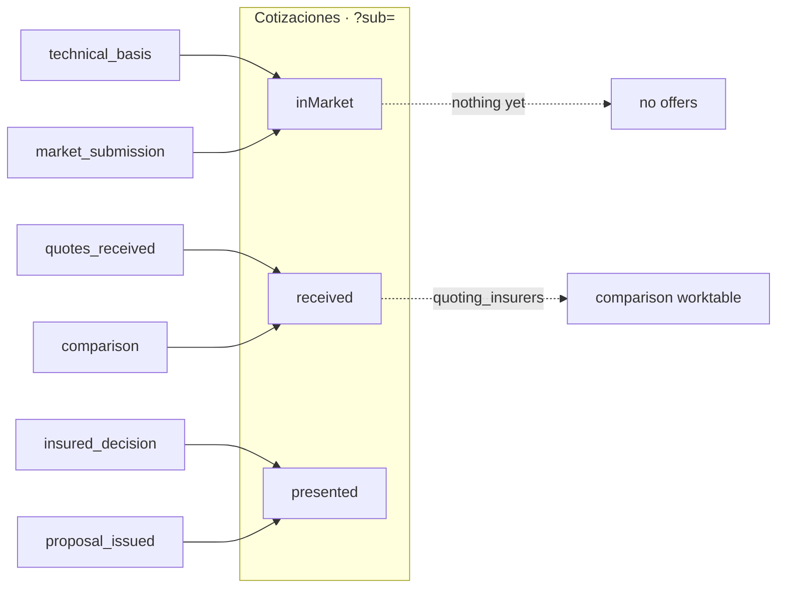
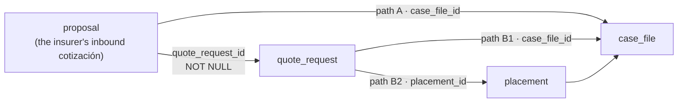
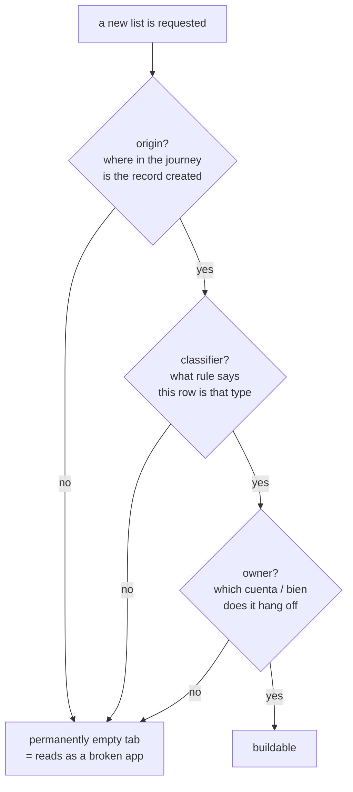

# Radal — Technical Reference

**Radal is the platform** (software provider) for insurance distribution in Chile. The **broker is
the tenant**; the app is their expediente-centric workspace.

This document is the **master reference** — the one that gets copied and pasted, and therefore the
one that carries the detail: product and domain context (§0), setup, data model, every endpoint,
the permission matrix, the AI extraction registry, the frontend map, the changelog, known issues
and handoff prompts. [`CLAUDE.md`](../CLAUDE.md) is deliberately the opposite: **three paragraphs
of orientation and current state, nothing more.** When a pass adds detail, it goes here, not there.

> **Code is English; the UI is Spanish.** Every table, column, model, router and comment is English.
> Spanish appears only as i18n locale *values* (`es` default, `en` mirrors) and inside LLM prompts,
> because the source documents are Spanish.

| Deep spec | What it covers |
|---|---|
| [`docs/v2-architecture.md`](v2-architecture.md) | actors, model + ER diagram, AI design, S3 layout, v2 scope |
| [`docs/v2-case-files-spec.md`](v2-case-files-spec.md) | the expediente pass as **designed** |
| [`docs/v2-case-files-as-built.md`](v2-case-files-as-built.md) | the expediente pass as **built** — deltas, verified state, gaps |
| [`docs/v2-data-modeling-decisions.md`](v2-data-modeling-decisions.md) | column vs JSON vs child table, with evidence |
| [`docs/deployment.md`](deployment.md) | AWS, CI/CD, the four OAC constraints, the migration runbook |
| [`docs/v3-groups-accounts-spec.md`](v3-groups-accounts-spec.md) | **groups & accounts** — `account_group`, the Account as `case_file`, the navigator tree, the 8 binary rules |
| [`docs/v4-agent-spec.md`](v4-agent-spec.md) | **the single AI agent** — typed READ/WRITE tool registry, `agent_action` confirm-cards, @-mentions |
| [`docs/v4-porcelana-ui-spec.md`](v4-porcelana-ui-spec.md) | **the current UI direction** — Porcelana tokens, the single sidebar, the Journey, `/analytics` |
| [`docs/design-system.md`](design-system.md) | Aqua Spectrum — **DEPRECATED, historical only**; Porcelana supersedes it |
| [`docs/usuarios-de-prueba.md`](usuarios-de-prueba.md) | test users + demo walkthrough (Spanish, for the team) |

## Contents

| § | Section | Use it when |
|---|---|---|
| 0 | [Product & domain context](#0-product--domain-context) | what Radal is, the actors, the flow, the rules, how we got here |
| 1 | [Stack & layout](#1-stack--layout) | orienting: what runs where, what lives in which folder |
| 2 | [Setup & run](#2-setup--run) | starting the app, loading data, running the checks |
| 3 | [Architecture](#3-architecture) | understanding the expediente model, stages and storage |
| 4 | [Deployment & migration runbook](#4-deployment--migration-runbook) | **shipping to `dev` — read the ordering first** |
| 5 | [Data model reference](#5-data-model-reference) | every table, column, enum and invariant |
| 6 | [API reference](#6-api-reference) | every endpoint with its permission and behaviour |
| 7 | [Permissions (RBAC)](#7-permissions-rbac) | who can do what; the full role × module matrix |
| 8 | [AI & the extraction registry](#8-ai--the-extraction-registry) | adding a document category, debugging an extraction |
| 9 | [Frontend map](#9-frontend-map) | routes, pages, shared components, the i18n rules |
| 10 | [Demo data](#10-demo-data) | what is in the database and how to rebuild it |
| 11 | [Change log](#11-change-log) | what changed in the last pass |
| 12 | [Known issues, gaps & tech debt](#12-known-issues-gaps--tech-debt) | **before starting work — the traps are here** |
| 13 | [Handoff prompts](#13-handoff-prompts) | ready-to-paste prompts to start the next task |
| 14 | [v3 — Groups & Accounts](#14-v3--groups--accounts-as-built) | the group layer, the Account, the navigator, the binary rules |
| 15 | [v4 — Agent & Porcelana UI](#15-v4--agent--porcelana-ui-as-built) | the tool-using agent and the current UI direction |
| 16 | [v5·v6·v7 — Signal UI · Antecedentes → Bases Técnicas · broker Lines](#16-v5--v6--v7--signal-ui-antecedentes--bases-técnicas-broker-defined-lines-as-built) | the UI direction, the expediente/bases-técnicas builder, and broker-defined lines |
| 17 | [v10 — Datos/Analítica, expediente completo, scope & exports](#17-v10--datosanalítica-el-expediente-completo-filtros-y-exportes-as-built) | the two analysis destinations, the account super-overview, the shared filter vocabulary and the export layer |
| 18 | [v11 — Portafolio & Asegurados](#18-v11--portafolio--asegurados-as-built) | the broker-vocabulary rename and the nine-tab Portafolio, driven by team-filed issues #1 and #2 |
| 19 | [v12 — policies first, three-level cobranza, Forpay, mail, share links, RPA, agent skills](#19-v12--policies-first-three-level-cobranza-forpay-mail-share-links-rpa-agent-skills) | **the latest arc (built, not deployed)** — data model + endpoint delta, RBAC, jobs runbook, webhook security, mail, share links, RPA (and how to fix a connector), agent skills, migration/deploy runbook, settings, traps; **§19.17 copilot home, chat sessions & feature flags (portal search "pronto")** |

**Current state (verified 2026-09-14):** **757 backend tests passing in ~155 s** · `npx tsc -b
--noEmit`, `npm run build` and `npm run check:locales` (**22 namespaces, 3 719 keys per locale**)
clean · the whole v10 surface **driven live in a real browser**, not just compile-green. The v2→v9
arc plus **v10** is committed as `0c60de6` on branch `dev` and **pushed**, which fired both CI
deploys to `https://dev.radalseguros.cl`. The dev RDS already carries the v9 schema + blank baseline;
**neither v10 nor v11 added a column or an enum value, so neither needs a migration**. Passes since the v2 rebuild:
v2 case files, **v3 groups & accounts (§14)**, **v4 agent + Porcelana (§15)**, **v5·v6·v7 Signal UI ·
Antecedentes → Bases Técnicas · broker-defined Lines (§16)**, v8/v9 broker-journey redesign +
tool-calling AI + expedient PDFs, **v10 Datos/Analítica · expediente completo · scope & exports (§17)**, and **v11 Portafolio &
Asegurados — the first issue-driven pass (§18)**. The short "what changed + candid error log" companions are
`docs/handoff-2026-09-09-v9.md` and `docs/handoff-2026-09-10-v10.md`.

> **v12 (2026-10-17) is built but NOT committed, deployed or migrated** — branch
> `feat/v12-policies-cobranza`: **1 404 backend tests**, 77 tables, 339 API operations, `tsc -b` /
> `check:locales` (**30 namespaces, 5 839 keys per locale**) / `build` clean. It adds 27 tables and
> 28 columns, so it **needs `migrate_case_files --pass v12` + `seed_v12` before the push**. Everything
> about it is in **§19**; the infra it needs (egress, webhook ingress, schedules) is scripted, dry-run
> only, in `deploy/v12/`.

---

## 0. Product & domain context

> This section is the *why*: what Radal is, who it serves, the rules that must never be simplified
> away, and how the model got its present shape. It used to live in `CLAUDE.md`; that file is now
> three paragraphs of orientation, and the detail lives here.

### 0.1 What Radal is

**Radal is the platform** — the software provider for insurance distribution in Chile.
**The broker (`corredora`) is the tenant.** Radal is *not* a broker and never appears as one.

The product exists because the placement cycle today lives in email, WhatsApp and spreadsheets.
Radal makes the **expediente** the folder the broker works in, and normalises every insurer offer —
whatever its origin — into one comparable shape, so the broker can defend a recommendation.

| Actor | Roles | Status |
|---|---|---|
| **broker** — the tenant | `broker_admin`, `broker_executive`, `broker_inspector`, `broker_technician`, plus the process profiles `broker_commercial`, `broker_collections`, `broker_claims` | **built; the entire focus** |
| **platform** — Radal staff | `platform_admin` | modelled; manages native insurers, approves insured accounts |
| **insured** | `insured_admin`, `insured_user` | modelled; tracking dashboard later |
| **insurer** | `insurer_admin`, `insurer_underwriter`, `insurer_executive` | modelled; tracking dashboard later |

Insured and insurer users are **not created up front**. They appear after a deal closes, and even
then the insured is mostly passive (receives offerings by WhatsApp/email).

### 0.2 The business flow

```
broker (TENANT)
  ├── sales_lead ─────── an opportunity: a data point, no files, no RUT required
  └── account_group ──── the broker-private group: the folder the broker opens each day
        └── client ───── the broker's private CRM row → canonical insured (by RUT)
              └── asset ────── the insurable good
                    └── placement ─── asset × insurance_line × period
                          │     wrapped 1:1 by case_file(kind=account) — ★ THE EXPEDIENTE / ACCOUNT
                          ├── inspection · quote_request → proposal · offering
                          └── policy ──── created only when a proposal is accepted, and the anchor
                                          for case_file(kind = endorsement | collection | claim |
                                          renewal)
canonical, cross-broker:  insured (RUT)   ·   insurer (RUT + CMF code)
```

The **proposal** is the comparable unit; the **expediente** is the unit of work — it carries the
journey stage, the sectioned documents, the generated packs and the notes. Post-sale work never
edits history: an endoso/cobranza/siniestro/renovación is a **new child case file** on the policy,
versioned by `sequence_no` (E1, E2…) and `supersedes_case_file_id`.

Since v3 the **Account** is `case_file(kind=account|renewal)` itself — one insurance line × one
validity period × N RUTs — sitting under an `account_group`. There is no parallel `account` table.
Three axes never mix on `case_file`: **origin** (`origin` + `origin_case_file_id` — sibling folders
in time), **version** (`supersedes_case_file_id` — rework), and **post-sale**
(`parent_case_file_id` + `policy_id` — children of a policy).

The broker's journey (mirrors the team's *Viaje del Riesgo*):
`lead → intake → pre_underwriting → technical_basis → market_submission → quotes_received →
comparison → insured_decision → proposal_issued → ratified → policy_issued → mirror_validation →
active`, with a short rail per post-sale kind. See §3 for the machine and §14 for the group layer
above it.

### 0.3 The ten non-negotiable rules

**1. English identifiers.** Tables, columns, models, routers, variables, comments — all English.
Spanish belongs only in `locales/*/**.json` **values** and inside LLM prompts (the source documents
are Spanish; that is correct and intentional).

**2. Multi-tenancy.** Every workspace table carries `broker_id`; every query filters on the
authenticated user's broker. `insured`, `insurer` and `cmf_line` are canonical (no `broker_id`) and
reached only through the broker's own rows. Another tenant's row is a **404, never a 403**. A `yes`
in the RBAC matrix **never** means "across brokers".

**3. No dead buttons.** A control is wired to a working endpoint or rendered visibly disabled with
a "pronto" chip **carrying the server's own reason**. The sidebar is filtered by the server matrix
(`GET /auth/permissions`) — a role never sees a link that would 403. Never hardcode "admins can do
X" in the UI; ask the server.

**4. i18n.** English keys, Spanish values. `es` complete, `en` mirrors the same key set. All copy
via `t()`. Beware dynamic keys — `` t(`prefix.${enum}`) `` passes `tsc` and `build`, then renders a
raw key on screen.

**5. Money — do not simplify.**
```
net   = taxable + exempt        # earthquake cover is VAT-exempt
vat   = 0.19 × taxable          # NOT on net
total = net + vat
comprehensive_rate = taxable_rate + exempt_rate
```

**6. AI is suggest → human confirm → commit.** Nothing auto-writes. Always persist an `extraction`
row (model, prompt_version, raw_output, parsed, confidence, source document). Since v4 the same law
governs the agent: READ tools execute inside the loop, WRITE tools **never** do — they become
`agent_action` rows awaiting a human (§15).

**7. Identity & access.** RUT validated mod-11, stored normalized `BODY-DV`; insurer identity is
RUT + CMF code. **A broker is never blocked** creating a client — confidentiality comes from tenant
scoping alone, not from gates. The insured later claims an account by RUT, approved manually by the
platform. There is **no broker-to-broker code handoff** — that design was removed twice; do not
resurrect it.

**8. Files.** The `document` table is the **only** place an S3 key lives. Entities reference files
by FK (`proposal.source_document_id`, NOT NULL). Local dev mirrors the same keys under
`backend/media/`, served through the broker-scoped `GET /documents/{id}/content` — never a static
mount, which would hand out other tenants' files without auth.

**9. Tests stay hermetic to AI.** `backend/.env` carries a real key and pack generation summarises
best-effort, so an unguarded suite makes **live DeepInfra calls and hangs**. `tests/conftest.py`
blanks `AI_API_KEY` and points `AI_BASE_URL` at an unroutable port **before** app import. Those two
lines are assignments, not `setdefault`, on purpose — they must shadow `.env`.

**10. Schema changes need the migration script.** There is **no Alembic**; startup only runs
`create_all`, which never ALTERs. New columns on existing tables must be applied with
`backend/scripts/migrate_case_files.py` **before** the branch is pushed — and to your local
`radal.db` too, or the app 500s on the first query touching a new column. See §4.

### 0.4 Chilean insurance domain notes

Learned from the team's real documents; do not "simplify" these away.

- **UF** is the money unit everywhere; percentages 0–100.
- Earthquake cover is **VAT-exempt** → hence the taxable/exempt split in premiums.
- Deductible **bases differ by peril** — fire = % of the loss, earthquake = % of the insured amount
  of the affected item with UF minimums. That difference is where a broker wins or loses the sale,
  so the comparator must surface it. Source deductibles arrive as prose
  (`"5% de la pérdida, mínimo UF 25"`); parsing them into structure is the job, and low confidence
  must be flagged rather than guessed.
- **Insurer dedup is by normalized RUT / CMF code — NEVER by name.** OCR yields `HDI Seguros S.A.`,
  `HDI SEGUROS SA`, `H.D.I.`. No match → create with `is_native = false`; that is the commercial
  signal telling Radal who to onboard next.
- **CMF** is the regulator; verification is manual for now (no stable public API). `cmf_line` holds
  the official 44-row FECU/CMF taxonomy; `insurance_line` is the broker's operating catalogue.
- Policy dates use a **contractual noon convention**; event dates (claims) do not — never fabricate
  an hourly franchise by defaulting one to the other.
- **Contractual datetimes are offset-less America/Santiago wall-clock** (decision 2026-10-17):
  `policy.period_start_at`/`period_end_at`, `endorsement.effective_at`/`ends_at`, the cobranza
  `terminated_at`/`rehabilitated_at` and `claim.occurred_at` go through `WallClockDatetime`
  (`app/schemas/wallclock.py`) — naive kept, aware converted to Santiago and stripped — and the
  frontend sends `datetime-local` values as typed (`src/lib/wallclock.ts::toWallClock`), never
  `toISOString()`. Event timestamps (`created_at`, `reported_at`, …) stay tz-aware UTC (`UtcDatetime`).
- Warranty codes (`R-n`/`G-n`/`M-n`) thread inspection → policy → cobranza → denuncio → liquidación
  → endoso. That thread is the causality story a broker uses to defend a claim.
- **Vigencia is a label over per-account full dates, not a shared date range.** The corpus proves
  it: Coccolino has Vehículos 2026-08-01→2027-08-01 and Incendio 2026-04-01→2027-04-01 under one
  RUT. Always show full dates at ramo and policy level.

### 0.5 How we got here (so nothing gets "re-fixed")

1. **v1 was a static-mockup port** — the UI defined truth and the backend was retrofitted, so many
   buttons did nothing. v2 inverts this: **model → API → UI**. Origin of the *no dead buttons* rule.
2. **Radal stopped being a broker.** It is now the platform; brokers are the tenants.
3. **Policy-centric → proposal-centric.** Policies/claims became post-sale.
4. **Spanish → English identifiers.** ~1,152 Spanish identifiers made a rename equal to a rewrite,
   so v2 was rebuilt rather than renamed.
5. **The access-code design collapsed.** Codes handed between brokers were reworked twice and
   removed — see rule 7. Do not resurrect it.
6. **Proposal-centric → expediente-centric (Aug 2026).** The team delivered 168 real documents and
   the vocabulary that came with them: everything is an expediente, with sub-expedientes per phase
   and post-sale work hanging off a policy as versioned children. The AI layer became a
   per-document-category registry rather than one proposal parser. Nothing was replaced —
   `placement` survives, wrapped by `case_file(kind=account)`.
7. **Expediente-centric → group-centric (Sep 2026, v3).** The 2026-08-24 team meeting established
   that the broker's daily loop is *open group → see vigencias → see ramos → act*. `account_group`
   was added above the expediente and `case_file(kind=account)` became the Account. See §14.
8. **Aqua Spectrum was deprecated (Sep 2026, v4).** The user reviewed the running app and rejected
   its visual execution outright — "consider the current one completely deprecated". **Porcelana**
   replaced it after a three-way exploration in `/style-lab`. `docs/design-system.md` is now
   historical. See §15.
9. **Two AI entries became one agent (Sep 2026, v4).** "Lector documental" and "Comparador" were
   replaced by a single tool-using **Agente** with @-mentions and confirm-cards. The registry-driven
   document extraction flow is unchanged — it simply lost its nav entry, not its reachability.

### 0.6 Working agreements with this user

- **Verify, don't assert.** Run the thing and show output. Claims about "it works" get checked.
- **Real or realistic data only** — no invented demo rows. The team supplies the corpus.
- The user does **UI and business validation**; Claude covers code, models and tests.
- Prefers **roles over access keys**, least privilege, reproducible infra.
- **Push/commit only when asked.** Destructive or outward-facing steps get confirmed first.
- Communicates in English; product/UI copy and team-facing docs are Spanish.

---

## 1. Stack & layout

- **Backend** — FastAPI + SQLAlchemy 2.x, SQLite locally / MySQL on RDS, `uv`-managed venv.
  API base `/api/v1`. 41 tables, 21 routers, 190 routes, 315 pytest tests.
- **Frontend** — React + TypeScript + Vite + Tailwind, shadcn-style primitives, TanStack Query,
  framer-motion, react-i18next. Dev server on `:5500`.
- **AI** — DeepInfra (OpenAI-compatible) through minimal LangChain; a per-document-category
  extraction registry with a suggest → confirm → commit contract.

```
radal-app/
  backend/
    app/
      api/routers/     21 routers under /api/v1
      core/            config, security, permissions (roles_config.py = the RBAC matrix)
      db/              base, session, import_fixtures.py, import_expedientes.py, seed_dev.py
      models/          41 SQLAlchemy tables
      schemas/         Pydantic request/response models
        extraction/    25 per-document-category AI schemas + registry.py
      services/        ai, packs, mirror, case_files, extraction_commit, media, identifiers
    scripts/           migrate_case_files.py  (there is NO Alembic)
    tests/             315 pytest
    media/             local mirror of the S3 key layout (gitignored)
  frontend/src/        pages/, components/, api/, lib/, locales/{es,en}/
  deploy/              attach-domain.sh + backend.env.example
  docs/                specs
  .claude/agents/      specialised sub-prompts
  .github/             dev-deploy.yml — push to `dev` deploys
```

---

## 2. Setup & run

### Local — no AWS required

The corpus bytes are mirrored locally, so downloads, packs and AI reading all work offline.

```bash
# backend :8000
cd backend
uv venv .venv && uv pip install -r requirements.txt --python .venv/bin/python
cp .env.example .env                                    # set AI_API_KEY

# load data (fixtures FIRST — the expediente importer requires that world)
MEDIA_BACKEND=local .venv/bin/python -m app.db.import_fixtures --reset --no-upload
MEDIA_BACKEND=local .venv/bin/python -m app.db.import_expedientes \
    --source "~/Downloads/EXPEDIENTES DEMO" --no-upload

MEDIA_BACKEND=local .venv/bin/uvicorn app.main:app --reload --port 8000
```

```bash
# frontend :5500 — calls http://localhost:8000/api/v1 via VITE_API_URL, no proxy
cd frontend && npm install && npm run dev
```

> ⚠️ **`backend/.env` ships `MEDIA_BACKEND=s3`, but nothing was ever uploaded to S3** — both
> importers ran with `--no-upload` and mirrored bytes into `backend/media/`. Without the
> `MEDIA_BACKEND=local` override every download, extraction and pack ZIP returns 404.

> `uv`-created venvs have **no `.venv/bin/pip`** — that is normal. Use
> `uv pip install --python .venv/bin/python`.

### With AWS

Drop `--no-upload`, add `--profile radal`, prefix with `AWS_PROFILE=radal`. The importers then
write the identical keys to `s3://radal-dev-185011028331/`.

### Verification commands

| Command | Expected |
|---|---|
| `.venv/bin/python -m pytest tests/ -q` | **315 passed in ~60s** — if it takes minutes or hangs, the AI neutralisation in `tests/conftest.py` was broken |
| `.venv/bin/python -c "from app.main import app"` | clean import, 190 routes |
| `npx tsc --noEmit && npm run build` | clean (one pre-existing 1.37 MB chunk warning) |
| `python -m app.db.import_expedientes --source … --dry-run` | 168 files classified, 0 in `other` |

### Ports & stale servers

Backend `:8000`, frontend `:5500`. Both dev servers run with `--reload` and get orphaned easily —
if a port is "in use", check the process start date before debugging a change that "isn't showing":

```bash
lsof -nP -iTCP:8000 -sTCP:LISTEN     # then: ps -o pid,lstart,command -p <pid>
```

### Environment variables

Local values live in `backend/.env` (gitignored). Deployed values live in
`s3://radal-dev-185011028331/deploy/backend.env` (17 keys) and CI syncs them into the Lambda on
every deploy — never commit either.

| Key | Notes |
|---|---|
| `DATABASE_URL` | `sqlite:///./radal.db` locally; MySQL on RDS |
| `SECRET_KEY` | JWT signing |
| `AI_BASE_URL` / `AI_API_KEY` / `AI_MODEL` / `AI_TIMEOUT_SECONDS` | DeepInfra, OpenAI-compatible |
| `MEDIA_BACKEND` | `local` \| `s3` — **override to `local` for local dev** |
| `MEDIA_LOCAL_DIR`, `MEDIA_S3_PREFIX`, `MEDIA_MAX_UPLOAD_MB` | media handling |
| `S3_BUCKET` | `radal-dev-185011028331` |
| `PACK_MAX_MB` | default 64; a larger assembled pack returns 413 |

---

## 3. Architecture

```
broker (TENANT)
  ├── sales_lead ─────── an opportunity: a data point, no files, no RUT required
  └── client ─────────── the broker's private CRM row → canonical insured (by RUT)
        └── asset ────── the insurable good
              └── placement ─── asset × insurance_line × period
                    │     wrapped 1:1 by case_file(kind=account) — THE EXPEDIENTE
                    ├── inspection · quote_request (+line items) → proposal (+coverages) · offering
                    └── policy ──── created when a proposal is accepted; anchors the post-sale
                                    children: case_file(kind = endorsement|collection|claim|renewal)
canonical, cross-broker:  insured (RUT)   ·   insurer (RUT + CMF code)   ·   cmf_line
```

**Expediente sections** (sub-expedientes, mirroring how the team files real cases):
`root_prospect` · `submission` (broker → insurers) · `insurer_quotes` (insurers → broker) ·
`broker_proposal` · `policy_file`, the last nesting `collection`, `endorsement` and `claim`.

**Journey stages** — an account case runs `lead → intake → pre_underwriting → technical_basis →
market_submission → quotes_received → comparison → insured_decision → proposal_issued → ratified →
policy_issued → mirror_validation → active`. Each post-sale kind has its own short rail
(endorsement: `requested → proposed → issued → applied`; collection: `scheduled → in_progress →
overdue → settled` plus an Art. 528 suspension branch; claim: `reported → adjusting → preliminary →
final → settled`; renewal re-enters the account flow). Transitions are server-validated
(`GET /case-files/{id}/transitions` returns each target with a reason when disallowed), write a
`case_file_stage_event` plus an `activity` row, and for an account case move `placement.status` in
the same transaction.

**Storage.** The `document` table is the only place a storage key lives; entities point at files by
FK. Keys follow `documents/{entity_type}/{entity_id}/{category}-{n}.{ext}` and
`media/{entity_type}/{id}/…`, identically on S3 and in the local `backend/media/` mirror. Files are
served through the broker-scoped `GET /documents/{id}/content` (local) or a presigned URL (S3) —
never a static mount.

**Multi-tenancy.** Every workspace table carries `broker_id` and every query filters on the caller's
broker; canonical tables are reached only through the broker's own rows.

---

## 4. Deployment & migration runbook

Full detail in [`docs/deployment.md`](deployment.md). Shape: **Lambda (container images,
Lambda Web Adapter 0.7.0) + CloudFront + RDS MySQL + ECR**, deployed by
`.github/workflows/dev-deploy.yml` on **push to `dev`** → ECR → `update-function-code` →
CloudFront invalidation. Account `185011028331`, `us-east-1`, CLI profile **`radal`** (never touch
`[default]`). Live: **https://dev.radalseguros.cl**.

### Deploy order for the case-files pass — NOT YET PERFORMED

1. **Migrate the dev RDS first.** There is no Alembic and startup only runs `create_all`, which
   creates missing tables but **never ALTERs** — so without this step the Lambda 500s on nearly
   every query.
   ```bash
   cd backend
   .venv/bin/python scripts/migrate_case_files.py --dialect mysql   # offline plan, no connection
   .venv/bin/python scripts/migrate_case_files.py                   # dry run; exits 1 on drift
   .venv/bin/python scripts/migrate_case_files.py --apply           # then verifies zero drift
   ```
   RDS is private: temporarily enable public access **and** allow your IP on
   `sg-0da8dd955985aaa32:3306`, then **revert both** and confirm only the Lambda SG
   (`sg-065438bbc14858097`) remains.
2. **Commit and push to `dev`** → CI deploys.
3. **Re-run both importers without `--no-upload`** (with `AWS_PROFILE=radal`) so the corpus lands
   in S3 and in the deployed database.

Only S3 presigning and buffered-SSE behaviour cannot be validated locally — smoke those after.

### The four OAC constraints — do NOT regress

1. Lambdas need **both** `lambda:InvokeFunctionUrl` **and** `lambda:InvokeFunction`.
2. POST bodies need **`x-amz-content-sha256`** — OAC does not sign bodies; the frontend computes it
   and reassigns `config.data` to the exact string it hashed.
3. The JWT rides in **`X-Radal-Token`** — OAC overwrites `Authorization` with its SigV4 signature.
4. LWA env **and** the Function URL invoke mode must **both** be `buffered`. This is why SSE cannot
   stream token-by-token in production; the frontend falls back after 5 s. Do not "fix" it by
   changing the invoke mode.

Function URLs use `AWS_IAM` (this account blocks public ones). Images need
`docker buildx --provenance=false`. CI auth is **GitHub OIDC** (`radal-github-actions-role`) — no
long-lived access keys. ECR keeps the last 5 images; RDS is the main idle cost, stop it when unused.

---

## 5. Data model reference

The schema is **50 tables** on SQLAlchemy 2.x declarative (`app/models/`, aggregated by
`app/db/base.py`; `Base.metadata.sorted_tables` is the authoritative list). Three of them —
`insured`, `insurer`, `cmf_line` — are **canonical**: one row per real-world identity, shared
across every tenant, no `broker_id`. Everything else is **workspace** and carries
`broker_id NOT NULL` (`insurance_line` and `insurer_contact` carry a *nullable* `broker_id`
so a row can be global/platform-owned or broker-owned; `user` carries a nullable `broker_id`
because platform/insurer/insured users have none). Every workspace query filters on the
authenticated user's broker; a broker reaches a canonical row only through one of its own
rows (`client.insured_id`, `proposal.insurer_id`). The shape of each table follows one rule,
argued in `docs/v2-data-modeling-decisions.md`: **a value becomes a column when something
sorts, filters or sums on it** (all proposal/policy money, inspection scores, case stage),
**a child table when the comparator must align it row-by-row across records**
(`proposal_coverage`, `quote_line_item`, `collection_installment`, `policy_location`,
`inspection_boundary`, `claim_item`), and **JSON only for a heterogeneous tail no query
touches** (`asset.attributes`, `*.deductibles` per peril, `inspection.checklist`,
`endorsement.effect`, `case_file.meta`).

**Conventions that hold everywhere and are not repeated per table.**

* `id INTEGER PRIMARY KEY AUTOINCREMENT` on all tables except `native_insurer_profile`,
  whose PK *is* `insurer_id` (1:1 extension).
* Every table mixes in `TimestampMixin` (`app/models/base_class.py`) →
  `created_at` and `updated_at`, `DATETIME(timezone=True)`, **NOT NULL**,
  `default=utcnow`, `server_default=func.now()`, `updated_at` also `onupdate=utcnow`, UTC.
  These two columns are the **only** ones elided from the tables below, and they exist on
  all 41.
* Money is `NUMERIC(14,4)` UF (`UF` in `app/models/types.py`), percentages `NUMERIC(6,3)`
  on a 0–100 scale (`PCT`), per-mille rates `NUMERIC(9,4)` (`RATE`), inspection scores
  `NUMERIC(6,2)` (`SCORE`), areas `NUMERIC(14,2)`, distances `NUMERIC(8,2)`. Never float.
* Enum columns are **`native_enum=False` VARCHAR** built by `sql_enum()`
  (`app/models/enums.py`), storing the lowercase English *value*, with
  `validate_strings=True` and an explicit length of `max(len(value)) + 12` slack — hence
  the odd widths (`VARCHAR(34)` for `CaseStage`, `VARCHAR(37)` for `DocumentCategory`).
* SQLite and MySQL compile identically for every column **except `Boolean`**, which is
  `BOOLEAN` on SQLite and `BOOL` on MySQL. No other type diverges.

**Legend for the tables below:** `PK` primary key · `FK→t.c CASCADE|SET NULL|RESTRICT`
foreign key + its `ondelete` · `NN` NOT NULL · `UQ` unique · `IX` indexed ·
`def=` column default. Composite indexes and table-level constraints are listed under
each table when they exist.

---

### 5.1 Identity & organizations

#### `broker` — an insurance brokerage; the tenant boundary of the whole application.

| column | type | notes |
|---|---|---|
| `id` | INTEGER | PK |
| `rut` | VARCHAR(20) | NN, UQ, IX (`ix_broker_rut`) |
| `legal_name` | VARCHAR(255) | NN |
| `trade_name` | VARCHAR(255) | |
| `cmf_code` | VARCHAR(32) | IX |
| `cmf_status` | VARCHAR(255) | |
| `cmf_registration_date` | DATE | |
| `registry_note` | TEXT | |
| `appointment_doc_type` | VARCHAR(255) | |
| `appointment_doc_date` | DATE | |
| `address` | VARCHAR(255) | |
| `commune` | VARCHAR(120) | |
| `region` | VARCHAR(120) | |
| `phone` | VARCHAR(64) | |
| `email` | VARCHAR(255) | |
| `logo_key` | VARCHAR(512) | S3 key for the logo (branding asset, not a `document` row) |
| `status` | VARCHAR(22) | NN, IX, enum `BrokerStatus`, def=`active` |

Indexes: `ix_broker_status(status)`.

#### `insured` — a company or person that buys insurance. **Canonical, cross-broker, keyed by RUT.**

| column | type | notes |
|---|---|---|
| `id` | INTEGER | PK |
| `rut` | VARCHAR(20) | NN, UQ, IX — normalized `BODY-DV` |
| `person_type` | VARCHAR(19) | NN, enum `PersonType`, def=`legal` |
| `legal_name` | VARCHAR(255) | NN, IX |
| `trade_name` | VARCHAR(255) | |
| `tax_activity` | TEXT | |
| `contact_name` | VARCHAR(255) | |
| `email` | VARCHAR(255) | |
| `phone` | VARCHAR(64) | |
| `address` | VARCHAR(255) | |
| `commune` | VARCHAR(120) | |
| `region` | VARCHAR(120) | |
| `logo_key` | VARCHAR(512) | |

#### `insurer` — an insurance company. **Canonical**; native (Radal partner) or external (broker-supplied).

| column | type | notes |
|---|---|---|
| `id` | INTEGER | PK |
| `rut` | VARCHAR(20) | NN, UQ, IX |
| `cmf_code` | VARCHAR(32) | NN, UQ, IX |
| `legal_name` | VARCHAR(255) | NN, IX |
| `trade_name` | VARCHAR(255) | |
| `is_native` | BOOLEAN | NN, IX, def=`false` — false ⇒ created ad-hoc from an OCR'd quote |
| `status` | VARCHAR(24) | NN, enum `InsurerStatus`, def=`active` |
| `cmf_status` | VARCHAR(255) | |
| `payment_url` | VARCHAR(512) | |
| `logo_key` | VARCHAR(512) | |
| `created_by_broker_id` | INTEGER | FK→broker.id SET NULL, IX — which tenant first surfaced this external insurer |

Indexes: `ix_insurer_native_status(is_native, status)`.

#### `native_insurer_profile` — 1:1 extension that exists **only** when `insurer.is_native` is true.

| column | type | notes |
|---|---|---|
| `insurer_id` | INTEGER | **PK**, FK→insurer.id CASCADE, NN |
| `commercial_agreement` | TEXT | |
| `onboarded_at` | DATETIME | |
| `managed_by_user_id` | INTEGER | FK→user.id SET NULL, IX |
| `priority` | INTEGER | NN, def=`100` — lower sorts first in the routing list |
| `sla_hours` | INTEGER | |
| `notes` | TEXT | |

#### `insurer_contact` — who to route a quote request to at an insurer.

Resolution order is broker+line → broker → line → global; hence both scoping FKs are nullable.

| column | type | notes |
|---|---|---|
| `id` | INTEGER | PK |
| `insurer_id` | INTEGER | FK→insurer.id CASCADE, NN, IX |
| `broker_id` | INTEGER | FK→broker.id CASCADE, **nullable**, IX — NULL = global contact |
| `insurance_line_id` | INTEGER | FK→insurance_line.id SET NULL, nullable, IX |
| `name` | VARCHAR(255) | NN |
| `email` | VARCHAR(255) | |
| `phone` | VARCHAR(64) | |
| `role` | VARCHAR(255) | |
| `is_primary` | BOOLEAN | NN, def=`false` |

Indexes: `ix_insurer_contact_lookup(insurer_id, broker_id, insurance_line_id)`.

#### `user` — an authenticated person. Email is the login and is globally unique.

Exactly one of the three org FKs is set, matching `user_type`.

| column | type | notes |
|---|---|---|
| `id` | INTEGER | PK |
| `broker_id` | INTEGER | FK→broker.id CASCADE, nullable, IX |
| `insurer_id` | INTEGER | FK→insurer.id CASCADE, nullable, IX |
| `insured_id` | INTEGER | FK→insured.id CASCADE, nullable, IX |
| `email` | VARCHAR(255) | NN, UQ, IX |
| `hashed_password` | VARCHAR(255) | NN |
| `full_name` | VARCHAR(255) | NN |
| `job_title` | VARCHAR(255) | |
| `phone` | VARCHAR(64) | |
| `user_type` | VARCHAR(20) | NN, IX, enum `UserType` |
| `role` | VARCHAR(64) | NN, IX — free string validated against `app/core/roles_config.py` |
| `is_active` | BOOLEAN | NN, def=`true` |
| `avatar_key` | VARCHAR(512) | |
| `last_login_at` | DATETIME | |

Indexes: `ix_user_type_role(user_type, role)`, `ix_user_broker_active(broker_id, is_active)`.

#### `insured_account_request` — a pending/approved/rejected claim on an insured RUT (the manual platform approval path).

| column | type | notes |
|---|---|---|
| `id` | INTEGER | PK |
| `rut` | VARCHAR(20) | NN, IX |
| `insured_id` | INTEGER | FK→insured.id SET NULL, IX |
| `requested_email` | VARCHAR(255) | NN |
| `requested_by` | VARCHAR(18) | NN, enum `AccountRequestOrigin`, def=`self` |
| `broker_id` | INTEGER | FK→broker.id SET NULL, nullable, IX — set when a broker filed it |
| `status` | VARCHAR(20) | NN, enum `AccountRequestStatus`, def=`pending` |
| `reviewed_by_id` | INTEGER | FK→user.id SET NULL, IX |
| `reviewed_at` | DATETIME | |
| `notes` | TEXT | |
| `created_user_id` | INTEGER | FK→user.id SET NULL, IX — the user minted on approval |

Indexes: `ix_insured_account_request_status(status, created_at)`.

#### `cmf_line` — a row of the official CMF/FECU line taxonomy. **Global, no `broker_id`.**

| column | type | notes |
|---|---|---|
| `id` | INTEGER | PK |
| `code` | VARCHAR(32) | NN, IX |
| `name` | VARCHAR(255) | NN |
| `kind` | VARCHAR(19) | NN, enum `CmfLineKind`, def=`line` |
| `group_code` | VARCHAR(32) | IX |
| `group_name` | VARCHAR(255) | |

Constraints: `uq_cmf_line_kind_code(kind, code)`.

#### `insurance_line` — an insurance line (*ramo*) the broker places business in.

| column | type | notes |
|---|---|---|
| `id` | INTEGER | PK |
| `broker_id` | INTEGER | FK→broker.id CASCADE, **nullable**, IX — NULL = platform-supplied default line |
| `name` | VARCHAR(160) | NN |
| `requires_inspection` | BOOLEAN | NN, def=`false` |
| `is_active` | BOOLEAN | NN, def=`true` |
| `cmf_subdivision` | VARCHAR(32) | |
| `min_fields` | JSON | required fields for a quote request in this line |
| `comparator_fields` | JSON | which proposal fields the comparator shows |

Constraints: `uq_insurance_line_broker_name(broker_id, name)`. Indexes:
`ix_insurance_line_broker_active(broker_id, is_active)`.

#### `insurance_line_cmf_code` — junction: which official CMF lines an `insurance_line` reports under.

| column | type | notes |
|---|---|---|
| `id` | INTEGER | PK |
| `insurance_line_id` | INTEGER | FK→insurance_line.id CASCADE, NN, IX |
| `cmf_line_id` | INTEGER | FK→cmf_line.id CASCADE, NN, IX |
| `composite_code` | VARCHAR(32) | |

Constraints: `uq_insurance_line_cmf_code(insurance_line_id, cmf_line_id)`.

---

### 5.2 Broker workspace

The spine: `client → asset → placement → quote_request → proposal → offering`, with
`inspection_request → inspection` hanging off the asset.

#### `client` — one broker's view of one insured (broker-private CRM data).

| column | type | notes |
|---|---|---|
| `id` | INTEGER | PK |
| `broker_id` | INTEGER | FK→broker.id CASCADE, NN, IX |
| `insured_id` | INTEGER | FK→insured.id **RESTRICT**, NN, IX |
| `status` | VARCHAR(22) | NN, enum `ClientStatus`, def=`prospect` |
| `account_manager_id` | INTEGER | FK→user.id SET NULL, IX |
| `source` | VARCHAR(120) | |
| `sector` | VARCHAR(255) | |
| `since` | DATE | |
| `contact_name` | VARCHAR(255) | |
| `contact_email` | VARCHAR(255) | |
| `contact_phone` | VARCHAR(64) | |
| `internal_notes` | TEXT | broker-private; never exposed to insured/insurer users |

Constraints: `uq_client_broker_insured(broker_id, insured_id)` — one client row per
(tenant, insured). Indexes: `ix_client_broker_status(broker_id, status)`.

#### `asset` — a physical (or intangible) object the broker places cover for. **Hybrid shape:** 10 shared attributes promoted to columns, type-specific tail in `attributes` JSON.

| column | type | notes |
|---|---|---|
| `id` | INTEGER | PK |
| `broker_id` | INTEGER | FK→broker.id CASCADE, NN, IX |
| `client_id` | INTEGER | FK→client.id CASCADE, NN, IX |
| `asset_type` | VARCHAR(64) | NN |
| `name` | VARCHAR(255) | NN |
| `address` | VARCHAR(255) | |
| `commune` | VARCHAR(120) | |
| `region` | VARCHAR(120) | |
| `status` | VARCHAR(20) | NN, enum `AssetStatus`, def=`active` |
| `built_area_m2` | NUMERIC(14,2) | |
| `land_area_m2` | NUMERIC(14,2) | |
| `construction_year` | INTEGER | IX |
| `structure` | TEXT | |
| `floors` | INTEGER | |
| `activity` | TEXT | |
| `fire_protection` | JSON | |
| `power_supply` | JSON | |
| `fire_station_distance_km` | NUMERIC(8,2) | |
| `seismic_zone` | VARCHAR(255) | |
| `attributes` | JSON | type-specific tail |

Indexes: `ix_asset_broker_status`, `ix_asset_broker_client`, `ix_asset_broker_type(broker_id, asset_type)`.

#### `placement` — the unit of operational work a quote request is issued from (one asset × one line × one period).

| column | type | notes |
|---|---|---|
| `id` | INTEGER | PK |
| `broker_id` | INTEGER | FK→broker.id CASCADE, NN, IX |
| `client_id` | INTEGER | FK→client.id CASCADE, NN, IX |
| `asset_id` | INTEGER | FK→asset.id CASCADE, NN, IX |
| `insurance_line_id` | INTEGER | FK→insurance_line.id **RESTRICT**, NN, IX |
| `period` | VARCHAR(32) | |
| `period_start` | DATE | |
| `period_end` | DATE | |
| `status` | VARCHAR(28) | NN, enum `PlacementStatus`, def=`draft` |
| `notes` | TEXT | |
| `brief_document_id` | INTEGER | FK→document.id SET NULL, IX |
| `case_file_id` | INTEGER | FK→case_file.id SET NULL (named `fk_placement_case_file`), IX |

Indexes: `ix_placement_broker_status`, `ix_placement_broker_client`, `ix_placement_asset_line(asset_id, insurance_line_id)`.

#### `inspection_request` — a request to inspect an asset, usually because the line requires it.

| column | type | notes |
|---|---|---|
| `id` | INTEGER | PK |
| `broker_id` | INTEGER | FK→broker.id CASCADE, NN, IX |
| `asset_id` | INTEGER | FK→asset.id CASCADE, NN, IX |
| `placement_id` | INTEGER | FK→placement.id SET NULL, IX |
| `insurance_line_id` | INTEGER | FK→insurance_line.id SET NULL, IX |
| `reason` | TEXT | |
| `urgency` | VARCHAR(18) | NN, enum `Priority`, def=`normal` |
| `target_date` | DATE | |
| `status` | VARCHAR(23) | NN, enum `InspectionRequestStatus`, def=`pending` |
| `requested_by_id` | INTEGER | FK→user.id SET NULL, IX |
| `requested_at` | DATETIME | |

Indexes: `ix_inspection_request_broker_status`, `ix_inspection_request_broker_target(broker_id, target_date)`.

#### `inspection` — a **versioned** inspection report for an asset. Scores are columns; the checklist is JSON.

| column | type | notes |
|---|---|---|
| `id` | INTEGER | PK |
| `broker_id` | INTEGER | FK→broker.id CASCADE, NN, IX |
| `asset_id` | INTEGER | FK→asset.id CASCADE, NN, IX |
| `inspection_request_id` | INTEGER | FK→inspection_request.id SET NULL, IX |
| `inspector_id` | INTEGER | FK→user.id SET NULL, IX |
| `case_file_id` | INTEGER | FK→case_file.id SET NULL, IX |
| `version` | INTEGER | NN, def=`1` |
| `status` | VARCHAR(21) | NN, enum `InspectionStatus`, def=`draft` |
| `visit_date` | DATE | |
| `report_date` | DATE | |
| `folio` | VARCHAR(64) | IX |
| `findings_summary` | TEXT | |
| `technical_score` | NUMERIC(6,2) | 0–100 |
| `commercial_score` | NUMERIC(6,2) | |
| `location_score` | NUMERIC(6,2) | |
| `loss_estimate_score` | NUMERIC(6,2) | |
| `overall_score` | NUMERIC(6,2) | IX via `ix_inspection_broker_score` |
| `pml_pct` | NUMERIC(6,3) | |
| `eml_pct` | NUMERIC(6,3) | |
| `risk_classification` | VARCHAR(255) | |
| `checklist` | JSON | |
| `checklist_version` | INTEGER | |
| `report_document_id` | INTEGER | FK→document.id SET NULL, IX |

Indexes: `ix_inspection_asset_version(asset_id, version)`, `ix_inspection_broker_status`,
`ix_inspection_broker_score(broker_id, overall_score)`.

#### `inspection_boundary` — one neighbouring property (*colindancia*) of the inspected asset.

| column | type | notes |
|---|---|---|
| `id` | INTEGER | PK |
| `inspection_id` | INTEGER | FK→inspection.id CASCADE, NN, IX |
| `orientation` | VARCHAR(64) | |
| `description` | TEXT | |
| `distance` | VARCHAR(64) | free text (`"5 m"`, `"colindante"`) |
| `aggravating` | VARCHAR(255) | |
| `is_aggravating` | BOOLEAN | NN, def=`false` |
| `sort_order` | INTEGER | NN, def=`0` |

Indexes: `ix_inspection_boundary_order(inspection_id, sort_order)`.

#### `quote_request` — a request for proposals issued from a placement. `round_no` supports re-submissions.

| column | type | notes |
|---|---|---|
| `id` | INTEGER | PK |
| `broker_id` | INTEGER | FK→broker.id CASCADE, NN, IX |
| `placement_id` | INTEGER | FK→placement.id CASCADE, NN, IX |
| `case_file_id` | INTEGER | FK→case_file.id SET NULL (`fk_quote_request_case_file`), IX |
| `round_no` | INTEGER | NN, def=`1` |
| `insured_object` | TEXT | |
| `declared_value_uf` | NUMERIC(14,4) | must equal Σ `quote_line_item.value_uf` |
| `currency` | VARCHAR(8) | NN, def=`'UF'` |
| `requested_coverages` | TEXT | |
| `desired_start` | DATE | |
| `desired_end` | DATE | |
| `sent_at` | DATETIME | |
| `due_at` | DATETIME | IX via `ix_quote_request_broker_due` |
| `priority` | VARCHAR(18) | NN, enum `Priority`, def=`normal` |
| `status` | VARCHAR(21) | NN, enum `QuoteRequestStatus`, def=`draft` |
| `recipient_insurer_ids` | JSON | list of insurer ids the submission went to |
| `created_by_id` | INTEGER | FK→user.id SET NULL, IX |

#### `quote_line_item` — one *partida* of the declared value (building, machinery, stock…). Child table, not JSON, because the sum is validated and the comparator aligns it.

| column | type | notes |
|---|---|---|
| `id` | INTEGER | PK |
| `quote_request_id` | INTEGER | FK→quote_request.id CASCADE, NN, IX |
| `name` | VARCHAR(255) | NN |
| `value_uf` | NUMERIC(14,4) | **NN** |
| `detail` | TEXT | |
| `sort_order` | INTEGER | NN, def=`0` |

Indexes: `ix_quote_line_item_order(quote_request_id, sort_order)`. No `broker_id` — reached
through `quote_request`.

#### `proposal` — **the unit of work.** One insurer's offer against one quote request, standardised for comparison.

| column | type | notes |
|---|---|---|
| `id` | INTEGER | PK |
| `broker_id` | INTEGER | FK→broker.id CASCADE, NN, IX |
| `quote_request_id` | INTEGER | FK→quote_request.id CASCADE, NN, IX |
| `insurer_id` | INTEGER | FK→insurer.id **RESTRICT**, NN, IX |
| `origin` | VARCHAR(20) | NN, enum `ProposalOrigin`, def=`external` |
| `case_file_id` | INTEGER | FK→case_file.id SET NULL (`fk_proposal_case_file`), IX |
| `source_document_id` | INTEGER | FK→document.id **RESTRICT**, **NN**, IX — no proposal without its source file |
| `modality` | VARCHAR(255) | |
| `activity_classification` | VARCHAR(255) | |
| `taxable_premium_uf` | NUMERIC(14,4) | *afecta* |
| `exempt_premium_uf` | NUMERIC(14,4) | *exenta* (earthquake) |
| `net_premium_uf` | NUMERIC(14,4) | = taxable + exempt |
| `vat_uf` | NUMERIC(14,4) | = 0.19 × taxable |
| `total_premium_uf` | NUMERIC(14,4) | = net + vat; **IX** (comparator sort key) |
| `taxable_rate_permille` | NUMERIC(9,4) | |
| `exempt_rate_permille` | NUMERIC(9,4) | |
| `comprehensive_rate_permille` | NUMERIC(9,4) | = taxable_rate + exempt_rate |
| `commission_pct` | NUMERIC(6,3) | 0–100 |
| `validity_business_days` | INTEGER | |
| `coverage_start` | DATE | |
| `coverage_end` | DATE | |
| `received_at` | DATE | |
| `deductibles` | JSON | per peril — fire = % of loss, earthquake = % of insured amount |
| `warranties` | TEXT | |
| `notes` | TEXT | |
| `status` | VARCHAR(21) | NN, enum `ProposalStatus`, def=`draft` |
| `outcome` | VARCHAR(23) | enum `ProposalOutcome` — how the insurer answered, independent of status |
| `quotation_number` | VARCHAR(64) | IX |
| `cover_mode` | VARCHAR(64) | |
| `ai_summary` | TEXT | |
| `ai_summary_model` | VARCHAR(120) | |
| `ai_summary_prompt_version` | VARCHAR(64) | |
| `is_summary_confirmed` | BOOLEAN | NN, def=`false` |
| `extraction_id` | INTEGER | FK→extraction.id SET NULL, IX |
| `extraction_confidence` | NUMERIC(6,3) | |
| `is_confirmed` | BOOLEAN | NN, def=`false` — the human gate of suggest→confirm→commit |
| `confirmed_by_id` | INTEGER | FK→user.id SET NULL, IX |
| `confirmed_at` | DATETIME | |

Indexes: `ix_proposal_broker_status`, `ix_proposal_broker_confirmed`,
`ix_proposal_broker_origin`, `ix_proposal_quote_insurer(quote_request_id, insurer_id)`,
`ix_proposal_total_premium_uf`.

#### `proposal_coverage` — one covered item or one exclusion. Child table so the comparator can align coverages across proposals by `normalized_code`.

| column | type | notes |
|---|---|---|
| `id` | INTEGER | PK |
| `proposal_id` | INTEGER | FK→proposal.id CASCADE, NN, IX |
| `kind` | VARCHAR(21) | NN, enum `CoverageKind` (`coverage` \| `exclusion`) |
| `text` | TEXT | NN — verbatim from the carrier |
| `normalized_code` | VARCHAR(64) | IX — the alignment key |
| `sort_order` | INTEGER | NN, def=`0` |

Indexes: `ix_proposal_coverage_kind(proposal_id, kind, sort_order)`, `ix_proposal_coverage_normalized`.

#### `offering` — a packaged, shareable comparison highlighting one recommended proposal.

| column | type | notes |
|---|---|---|
| `id` | INTEGER | PK |
| `broker_id` | INTEGER | FK→broker.id CASCADE, NN, IX |
| `quote_request_id` | INTEGER | FK→quote_request.id CASCADE, NN, IX |
| `selected_proposal_id` | INTEGER | FK→proposal.id SET NULL, IX — the broker's **recommendation** |
| `decided_proposal_id` | INTEGER | **v8** — FK→proposal.id SET NULL, IX — what the **insured** chose on the public share surface |
| `decided_note` | TEXT | **v8** — the insured's reason for the choice |
| `decided_at` | DATETIME | **v8** — when the insured decided |
| `share_token` | VARCHAR(64) | NN, **UQ**, IX — public link key |
| `pdf_document_id` | INTEGER | FK→document.id SET NULL, IX |
| `sent_via` | VARCHAR(20) | enum `OfferingChannel` |
| `status` | VARCHAR(20) | NN, enum `OfferingStatus`, def=`draft` |
| `sent_at` | DATETIME | |
| `viewed_at` | DATETIME | |
| `expires_at` | DATETIME | |
| `created_by_id` | INTEGER | FK→user.id SET NULL, IX |

---

### 5.3 Case files & leads

The *expediente* layer (`docs/v2-case-files-spec.md`). A `case_file` of kind `account`
wraps a placement 1:1; post-sale kinds hang off a policy. Every workspace entity that can
belong to a case carries a nullable `case_file_id` (`placement`, `quote_request`,
`proposal`, `policy`, `inspection`, `endorsement`, `collection_plan`, `claim`, `warranty`,
`document`, `extraction`, `case_pack`, `sales_lead.converted_case_file_id`).

#### `case_file` — one expediente: an account cycle, or a post-sale case on a policy.

| column | type | notes |
|---|---|---|
| `id` | INTEGER | PK |
| `broker_id` | INTEGER | FK→broker.id CASCADE, NN, IX |
| `client_id` | INTEGER | FK→client.id **RESTRICT**, NN, IX |
| `placement_id` | INTEGER | FK→placement.id SET NULL, IX |
| `policy_id` | INTEGER | FK→policy.id SET NULL, IX |
| `parent_case_file_id` | INTEGER | FK→case_file.id SET NULL, IX — self-reference (post-sale child of an account) |
| `supersedes_case_file_id` | INTEGER | FK→case_file.id SET NULL — renewal chain |
| `insurance_line_id` | INTEGER | FK→insurance_line.id SET NULL, IX |
| `kind` | VARCHAR(23) | NN, enum `CaseFileKind` |
| `stage` | VARCHAR(34) | NN, enum `CaseStage` |
| `status` | VARCHAR(21) | NN, enum `CaseFileStatus`, def=`open` |
| `reference` | VARCHAR(64) | IX — human reference, unique per broker |
| `title` | VARCHAR(255) | NN |
| `sequence_no` | INTEGER | NN, def=`1` — nth case of this kind on the policy |
| `version` | INTEGER | NN, def=`1` |
| `owner_user_id` | INTEGER | FK→user.id SET NULL, IX |
| `opened_at` | DATETIME | NN, def=`utcnow` |
| `due_at` | DATETIME | |
| `closed_at` | DATETIME | |
| `summary` | TEXT | |
| `meta` | JSON | |

Constraints: `uq_case_file_broker_reference(broker_id, reference)`. Indexes:
`ix_case_file_broker_kind_stage(broker_id, kind, stage)`,
`ix_case_file_broker_status_due(broker_id, status, due_at)`,
`ix_case_file_broker_policy_sequence(broker_id, policy_id, kind, sequence_no)`.

#### `case_file_stage_event` — one accepted stage transition. The timeline, as rows.

| column | type | notes |
|---|---|---|
| `id` | INTEGER | PK |
| `broker_id` | INTEGER | FK→broker.id CASCADE, NN, IX |
| `case_file_id` | INTEGER | FK→case_file.id CASCADE, NN, IX |
| `from_stage` | VARCHAR(34) | enum `CaseStage`, nullable (the opening event) |
| `to_stage` | VARCHAR(34) | NN, enum `CaseStage` |
| `occurred_at` | DATETIME | NN, def=`utcnow` |
| `user_id` | INTEGER | FK→user.id SET NULL, IX |
| `note` | TEXT | |
| `meta` | JSON | |

Indexes: `ix_case_file_stage_event_case_time(case_file_id, occurred_at)`.

#### `case_pack` — a generated, downloadable bundle (PDF + optional ZIP) of an expediente.

| column | type | notes |
|---|---|---|
| `id` | INTEGER | PK |
| `broker_id` | INTEGER | FK→broker.id CASCADE, NN, IX |
| `case_file_id` | INTEGER | FK→case_file.id CASCADE, NN, IX |
| `kind` | VARCHAR(22) | NN, enum `PackKind` (`submission`\|`comparison`\|`proposal`) |
| `section` | VARCHAR(27) | enum `CaseSection` |
| `status` | VARCHAR(22) | NN, enum `PackStatus`, def=`draft` |
| `pdf_document_id` | INTEGER | FK→document.id SET NULL, IX |
| `zip_document_id` | INTEGER | FK→document.id SET NULL, IX |
| `summary` | TEXT | |
| `summary_model` | VARCHAR(120) | |
| `summary_prompt_version` | VARCHAR(64) | |
| `is_summary_confirmed` | BOOLEAN | NN, def=`false` |
| `recipients` | JSON | |
| `generated_at` | DATETIME | |
| `sent_at` | DATETIME | |
| `generated_by_id` | INTEGER | FK→user.id SET NULL, IX |
| `error` | TEXT | |

Indexes: `ix_case_pack_case_kind(case_file_id, kind)`, `ix_case_pack_broker_status`.

#### `sales_lead` — a commercial data point tracked towards a first case. Deliberately *not* a `client`: no RUT is required and no `insured` row is created.

| column | type | notes |
|---|---|---|
| `id` | INTEGER | PK |
| `broker_id` | INTEGER | FK→broker.id CASCADE, NN, IX |
| `name` | VARCHAR(255) | NN |
| `rut` | VARCHAR(16) | IX, nullable |
| `contact_name` | VARCHAR(160) | |
| `contact_email` | VARCHAR(255) | |
| `contact_phone` | VARCHAR(40) | |
| `source` | VARCHAR(80) | |
| `insurance_line_id` | INTEGER | FK→insurance_line.id SET NULL, IX |
| `estimated_premium_uf` | NUMERIC(14,4) | |
| `status` | VARCHAR(21) | NN, enum `LeadStatus`, def=`new` |
| `follow_up_on` | DATE | IX via `ix_sales_lead_broker_followup` |
| `owner_user_id` | INTEGER | FK→user.id SET NULL, IX |
| `lost_reason` | VARCHAR(255) | |
| `converted_client_id` | INTEGER | FK→client.id SET NULL, IX |
| `converted_case_file_id` | INTEGER | FK→case_file.id SET NULL, IX |
| `summary` | TEXT | |

---

### 5.4 Post-sale

#### `policy` — an issued policy. Inherits the proposal's money shape. `policy_number` is unique **per broker**, never globally.

| column | type | notes |
|---|---|---|
| `id` | INTEGER | PK |
| `broker_id` | INTEGER | FK→broker.id CASCADE, NN, IX |
| `client_id` | INTEGER | FK→client.id **RESTRICT**, NN, IX |
| `asset_id` | INTEGER | FK→asset.id SET NULL, IX |
| `placement_id` | INTEGER | FK→placement.id SET NULL, IX |
| `proposal_id` | INTEGER | FK→proposal.id SET NULL, **UQ**, IX — a proposal issues at most one policy |
| `insurer_id` | INTEGER | FK→insurer.id **RESTRICT**, NN, IX |
| `insurance_line_id` | INTEGER | FK→insurance_line.id SET NULL, IX |
| `case_file_id` | INTEGER | FK→case_file.id SET NULL (`fk_policy_case_file`), IX |
| `source_document_id` | INTEGER | FK→document.id SET NULL, IX |
| `renews_policy_id` | INTEGER | FK→policy.id SET NULL, IX — self-reference, renewal chain |
| `policy_number` | VARCHAR(64) | NN, IX |
| `start_date` | DATE | |
| `end_date` | DATE | IX via `ix_policy_broker_end` |
| `period_start_at` | DATETIME | to-the-minute cover start (carriers quote 12:00) |
| `period_end_at` | DATETIME | |
| `issued_at` | DATE | |
| `status` | VARCHAR(21) | NN, enum `PolicyStatus`, def=`draft` |
| `cover_mode` | VARCHAR(64) | |
| `cmf_policy_code` | VARCHAR(32) | |
| `insured_amount_semantics` | VARCHAR(255) | what the insured amount means for this policy |
| `aggregate_limit_uf` | NUMERIC(14,4) | |
| `average_rate_permille` | NUMERIC(9,4) | |
| `indemnity_limit` | TEXT | |
| `insured_amount_uf` | NUMERIC(14,4) | |
| `taxable_premium_uf` | NUMERIC(14,4) | |
| `exempt_premium_uf` | NUMERIC(14,4) | |
| `net_premium_uf` | NUMERIC(14,4) | |
| `vat_uf` | NUMERIC(14,4) | |
| `total_premium_uf` | NUMERIC(14,4) | the "policy gross" of the collection invariant |
| `commission_pct` | NUMERIC(6,3) | |
| `deductibles` | JSON | per peril |
| `notes` | TEXT | |
| `payload` | JSON | **v8** — the full dynamic parse; every field NOT promoted to a typed column above (the columns-plus-JSON-tail split of `asset`). Never re-stores the money/vigencia columns (no double-sourcing). |
| `is_core_valid` | BOOLEAN | **v8** — the fixed minimal-core verdict (corredor / datos asegurado / vigencia / desglose de prima present). **NULLable**: NULL = not yet validated. |
| `core_validation` | JSON | **v8** — per-field present/missing detail behind the verdict; rendered, not filtered. |
| `extraction_id` | INTEGER | **v8** — FK→extraction.id SET NULL, IX. The dynamic parse this payload was read from (mirrors `proposal.extraction_id`). |

Constraints: `uq_policy_broker_number(broker_id, policy_number)`. Indexes:
`ix_policy_broker_client`, `ix_policy_broker_status`, `ix_policy_broker_end(broker_id, end_date)`,
`ix_policy_extraction_id`.

#### `policy_location` — one insured location, with its share of the insured amount.

| column | type | notes |
|---|---|---|
| `id` | INTEGER | PK |
| `policy_id` | INTEGER | FK→policy.id CASCADE, NN, IX |
| `name` | VARCHAR(255) | NN |
| `address` | VARCHAR(255) | |
| `commune` | VARCHAR(120) | |
| `region` | VARCHAR(120) | |
| `insured_amount_uf` | NUMERIC(14,4) | |
| `percentage` | NUMERIC(6,3) | 0–100 |

#### `coverage_item` — a coverage or exclusion as finally written into the issued policy (the mirror of `proposal_coverage`).

| column | type | notes |
|---|---|---|
| `id` | INTEGER | PK |
| `policy_id` | INTEGER | FK→policy.id CASCADE, NN, IX |
| `kind` | VARCHAR(21) | NN, enum `CoverageKind` |
| `description` | TEXT | NN |
| `sort_order` | INTEGER | NN, def=`0` |

Indexes: `ix_coverage_item_policy_kind(policy_id, kind, sort_order)`.

#### `coinsurance_share` — how a co-insured policy is split between companies. Percentages sum to 100.

| column | type | notes |
|---|---|---|
| `id` | INTEGER | PK |
| `policy_id` | INTEGER | FK→policy.id CASCADE, NN, IX |
| `insurer_id` | INTEGER | FK→insurer.id **RESTRICT**, NN, IX |
| `is_leader` | BOOLEAN | NN, def=`false` |
| `percentage` | NUMERIC(6,3) | **NN**, 0–100 |

Constraints: `uq_coinsurance_policy_insurer(policy_id, insurer_id)`.

#### `endorsement` — one *endoso* proposed to, or issued by, the carrier. Money is stored as **deltas**, never as a restated total.

| column | type | notes |
|---|---|---|
| `id` | INTEGER | PK |
| `broker_id` | INTEGER | FK→broker.id CASCADE, NN, IX |
| `policy_id` | INTEGER | FK→policy.id **RESTRICT**, NN, IX |
| `case_file_id` | INTEGER | FK→case_file.id SET NULL, IX |
| `endorsement_number` | VARCHAR(64) | IX |
| `sequence_no` | INTEGER | NN, def=`1` |
| `kind` | VARCHAR(35) | NN, enum `EndorsementKind`, def=`other` |
| `status` | VARCHAR(21) | NN, enum `EndorsementStatus`, def=`draft` |
| `effective_at` | DATETIME | |
| `ends_at` | DATETIME | |
| `issued_at` | DATE | |
| `proposal_document_id` | INTEGER | FK→document.id SET NULL, IX |
| `issued_document_id` | INTEGER | FK→document.id SET NULL, IX |
| `motive` | TEXT | verbatim carrier text (INCLUYE / EXCLUYE / AUMENTA / DISMINUYE) |
| `contractual_basis` | VARCHAR(255) | |
| `insured_amount_delta_uf` | NUMERIC(14,4) | |
| `taxable_premium_delta_uf` | NUMERIC(14,4) | signed |
| `exempt_premium_delta_uf` | NUMERIC(14,4) | signed |
| `net_premium_delta_uf` | NUMERIC(14,4) | = taxable Δ + exempt Δ |
| `vat_delta_uf` | NUMERIC(14,4) | = 0.19 × taxable Δ |
| `total_premium_delta_uf` | NUMERIC(14,4) | = net Δ + vat Δ; feeds the collection invariant |
| `commission_delta_uf` | NUMERIC(14,4) | |
| `prorata_days` | INTEGER | |
| `unexpired_days` | INTEGER | |
| `effect` | JSON | structured effect of the motive (locations/vehicles/roster added or removed) |
| `deductibles` | JSON | |
| `extraction_id` | INTEGER | FK→extraction.id SET NULL, IX |
| `extraction_confidence` | NUMERIC(6,3) | |
| `is_confirmed` | BOOLEAN | NN, def=`false` |
| `confirmed_by_id` | INTEGER | FK→user.id SET NULL, IX |
| `confirmed_at` | DATETIME | |

Indexes: `ix_endorsement_policy_sequence(policy_id, sequence_no)`,
`ix_endorsement_broker_kind`, `ix_endorsement_broker_status`.

#### `collection_plan` — the payment plan of one policy (*plan de pago / estado de cobranza*), incl. the Art. 528 suspension/rehabilitation trail.

| column | type | notes |
|---|---|---|
| `id` | INTEGER | PK |
| `broker_id` | INTEGER | FK→broker.id CASCADE, NN, IX |
| `policy_id` | INTEGER | FK→policy.id CASCADE, NN, IX |
| `case_file_id` | INTEGER | FK→case_file.id SET NULL, IX |
| `plan_number` | VARCHAR(64) | IX |
| `payment_mode` | VARCHAR(25) | NN, enum `PaymentMode`, def=`coupon_book` |
| `installment_count` | INTEGER | |
| `total_premium_uf` | NUMERIC(14,4) | |
| `bank` | VARCHAR(120) | |
| `account_number` | VARCHAR(64) | |
| `monthly_interest_rate_pct` | NUMERIC(6,3) | |
| `status` | VARCHAR(25) | NN, enum `CollectionPlanStatus`, def=`pending` |
| `as_of_date` | DATE | |
| `terminated_at` | DATETIME | |
| `rehabilitated_at` | DATETIME | |
| `days_without_cover` | INTEGER | |
| `rehabilitation_cost_uf` | NUMERIC(14,4) | |
| `art528_events` | JSON | the statutory notice/termination trail |
| `management_note` | TEXT | |

#### `collection_installment` — one *cuota* of a payment plan.

| column | type | notes |
|---|---|---|
| `id` | INTEGER | PK |
| `broker_id` | INTEGER | FK→broker.id CASCADE, NN, IX |
| `collection_plan_id` | INTEGER | FK→collection_plan.id CASCADE, NN, IX |
| `number` | INTEGER | **NN** |
| `coupon_number` | VARCHAR(32) | |
| `due_date` | DATE | IX |
| `gross_amount_uf` | NUMERIC(14,4) | **NN** — the summed column of the collection invariant |
| `net_premium_uf` | NUMERIC(14,4) | |
| `commission_uf` | NUMERIC(14,4) | |
| `paid_on` | DATE | |
| `days_late` | INTEGER | |
| `status` | VARCHAR(21) | NN, enum `InstallmentStatus`, def=`pending` |
| `endorsement_id` | INTEGER | FK→endorsement.id SET NULL, IX — the endorsement that created this cuota |
| `note` | TEXT | |

Indexes: `ix_collection_installment_plan_number(collection_plan_id, number)`,
`ix_collection_installment_broker_status`, `ix_collection_installment_due(due_date)`.

#### `warranty` — one condition the insured must keep for cover to hold (the R-n / G-n / M-n tracker).

| column | type | notes |
|---|---|---|
| `id` | INTEGER | PK |
| `broker_id` | INTEGER | FK→broker.id CASCADE, NN, IX |
| `policy_id` | INTEGER | FK→policy.id CASCADE, NN, IX |
| `case_file_id` | INTEGER | FK→case_file.id SET NULL, IX |
| `code` | VARCHAR(16) | IX — `R-1`, `G-3`, `M-2` |
| `title` | VARCHAR(255) | |
| `requirement` | TEXT | |
| `source` | VARCHAR(37) | NN, enum `WarrantySource`, def=`underwriting_warranty` |
| `category` | VARCHAR(4) | short bucket tag |
| `deadline_days` | INTEGER | |
| `due_date` | DATE | IX |
| `is_permanent` | BOOLEAN | NN, def=`false` |
| `is_suspensive` | BOOLEAN | NN, def=`false` — breach suspends cover |
| `status` | VARCHAR(27) | NN, enum `WarrantyStatus`, def=`pending` |
| `completed_on` | DATE | |
| `verification` | TEXT | |
| `budget_uf` | NUMERIC(14,4) | |
| `actual_cost_uf` | NUMERIC(14,4) | |
| `evidence_document_id` | INTEGER | FK→document.id SET NULL, IX |
| `sort_order` | INTEGER | NN, def=`0` |

Indexes: `ix_warranty_policy_code(policy_id, code)`, `ix_warranty_broker_due(broker_id, due_date)`,
`ix_warranty_broker_status`.

#### `claim` — a loss reported against a policy. Modelled in full; UI out of scope this pass.

| column | type | notes |
|---|---|---|
| `id` | INTEGER | PK |
| `broker_id` | INTEGER | FK→broker.id CASCADE, NN, IX |
| `policy_id` | INTEGER | FK→policy.id SET NULL, IX |
| `client_id` | INTEGER | FK→client.id CASCADE, NN, IX |
| `asset_id` | INTEGER | FK→asset.id SET NULL, IX |
| `case_file_id` | INTEGER | FK→case_file.id SET NULL, IX |
| `claim_number` | VARCHAR(64) | IX |
| `kind` | VARCHAR(160) | free text (peril) |
| `event_date` | DATE | IX via `ix_claim_broker_event` |
| `reported_date` | DATE | |
| `occurred_at` | DATETIME | |
| `reported_at` | DATETIME | |
| `notice_deadline_days` | INTEGER | |
| `description` | TEXT | |
| `status` | VARCHAR(24) | NN, enum `ClaimStatus`, def=`reported` |
| `adjuster_name` | VARCHAR(160) | |
| `adjuster_registry` | VARCHAR(32) | |
| `coverage_ruling` | VARCHAR(29) | NN, enum `ClaimRuling`, def=`pending` |
| `deductible_uf` | NUMERIC(14,4) | |
| `loss_ratio_pct` | NUMERIC(6,3) | |
| `estimated_amount_uf` | NUMERIC(14,4) | |
| `settled_amount_uf` | NUMERIC(14,4) | |
| `paid_amount_uf` | NUMERIC(14,4) | |
| `recovery_uf` | NUMERIC(14,4) | |
| `reserve_uf` | NUMERIC(14,4) | |
| `cost_uf` | NUMERIC(14,4) | |
| `participation` | JSON | co-insurance split applied to this loss |

#### `claim_item` — one *partida* of a loss, as the adjuster quantified it.

| column | type | notes |
|---|---|---|
| `id` | INTEGER | PK |
| `broker_id` | INTEGER | FK→broker.id CASCADE, NN, IX |
| `claim_id` | INTEGER | FK→claim.id CASCADE, NN, IX |
| `kind` | VARCHAR(33) | NN, enum `ClaimItemKind`, def=`material_damage` |
| `item` | VARCHAR(255) | |
| `basis` | TEXT | valuation basis |
| `notified_uf` | NUMERIC(14,4) | claimed by the insured |
| `determined_uf` | NUMERIC(14,4) | determined by the adjuster |
| `damage_uf` | NUMERIC(14,4) | |
| `deductible_uf` | NUMERIC(14,4) | |
| `indemnity_uf` | NUMERIC(14,4) | |
| `sort_order` | INTEGER | NN, def=`0` |
| `note` | TEXT | |

Indexes: `ix_claim_item_claim_order(claim_id, sort_order)`, `ix_claim_item_broker_kind`.

---

### 5.4b Comparison & outbound propuesta (v8)

The comparison and the outbound *propuesta* follow the `record_expediente` satellite pattern:
a thin container linked to `case_file` by a **plain SET NULL FK** (no `use_alter` — each points
*down* and nothing points back), typed columns for what we sort/filter, a JSON payload for the
dynamic tail, provenance FKs. Child rows only where a comparator aligns row-by-row. **Terminology
trap:** `Proposal` is the insurer's *inbound* offer; `broker_proposal` is the broker's *outbound*
artifact — never conflate them.

#### `comparison_source` — LAYER 1: the per-proposal dynamic-extraction cache (one live row per proposal, survives re-runs).

| column | type | notes |
|---|---|---|
| `id` | INTEGER | PK |
| `broker_id` | INTEGER | FK→broker.id CASCADE, NN, IX |
| `proposal_id` | INTEGER | FK→proposal.id SET NULL, IX |
| `source_extraction_id` | INTEGER | FK→extraction.id SET NULL, IX |
| `facets` | JSON | the compact dynamic facet list re-aligned across comparisons (the fixed money/period core stays on the typed `proposal` columns — no double-sourcing) |
| `is_wrong_file` | BOOLEAN | NN, def=`false` — wrong-file detection verdict |
| `wrong_file_reason` | TEXT | |
| `extracted_at` | DATETIME | |

Constraints: `uq_comparison_source_proposal(broker_id, proposal_id)`. Indexes: `ix_comparison_source_broker`.

#### `comparison` — LAYER 2: one aligned comparison RE-RUN of an account. **1:N per case_file**, history preserved.

| column | type | notes |
|---|---|---|
| `id` | INTEGER | PK |
| `broker_id` | INTEGER | FK→broker.id CASCADE, NN, IX |
| `case_file_id` | INTEGER | FK→case_file.id SET NULL, IX |
| `placement_id` | INTEGER | FK→placement.id SET NULL, IX |
| `status` | VARCHAR(22) | NN, enum `ComparisonStatus`, def=`draft` |
| `canonical_version` | INTEGER | NN, def=`1` — **monotonic** re-alignment version, the snapshot key of `dictionary` |
| `dictionary` | JSON | the canonical facet dictionary **snapshotted** at this version (a later edit never reshapes a stored comparison) |
| `aligned_matrix` | JSON | the rendered aligned result (rows × proposals); rendered only, never joined |
| `pdf_document_id` | INTEGER | FK→document.id SET NULL, IX |
| `source_extraction_id` | INTEGER | FK→extraction.id SET NULL, IX |

Indexes: `ix_comparison_broker_case(broker_id, case_file_id)`, `ix_comparison_broker_status`.

#### `comparison_entry` — one proposal column of a comparison run. A **pure child** — no `broker_id` (scope from `comparison`), like `proposal_coverage`.

| column | type | notes |
|---|---|---|
| `id` | INTEGER | PK |
| `comparison_id` | INTEGER | FK→comparison.id CASCADE, NN, IX |
| `proposal_id` | INTEGER | FK→proposal.id SET NULL, IX |
| `comparison_source_id` | INTEGER | FK→comparison_source.id SET NULL, IX |
| `is_recommended` | BOOLEAN | NN, def=`false` |
| `sort_order` | INTEGER | NN, def=`0` |

Indexes: `ix_comparison_entry_comparison(comparison_id, sort_order)`.

#### `broker_proposal` — the outbound *propuesta* artifact, built from a comparison snapshot (**not** `Proposal`).

| column | type | notes |
|---|---|---|
| `id` | INTEGER | PK |
| `broker_id` | INTEGER | FK→broker.id CASCADE, NN, IX |
| `case_file_id` | INTEGER | FK→case_file.id SET NULL, IX |
| `comparison_id` | INTEGER | FK→comparison.id SET NULL, IX — the source snapshot (mandatory at the **service layer**; a plain SET NULL FK per the v8 new-table convention) |
| `winning_proposal_id` | INTEGER | FK→proposal.id SET NULL, IX — the selected inbound insurer offer |
| `content_hash` | VARCHAR(64) | IX — a fixed scalar compared for tamper/version detection |
| `payload` | JSON | the assembled outbound content snapshot; rendered only |
| `pdf_document_id` | INTEGER | FK→document.id SET NULL, IX |
| `status` | VARCHAR(22) | NN, enum `BrokerProposalStatus`, def=`draft` |
| `is_ratified` | BOOLEAN | NN, def=`false` |
| `ratified_at` | DATETIME | |
| `ratified_by_id` | INTEGER | FK→user.id SET NULL, IX |

Indexes: `ix_broker_proposal_broker_status(broker_id, status)`, `ix_broker_proposal_case(case_file_id)`.

**Ramo repurpose (v8):** `line_record_schema` is the user-facing *ramo* (`insurance_line` stays the
pure CMF classifier). It gains `recommended_files` (JSON — the recommended antecedentes documents,
`[{category, label, explanation, required}]`) and `explanation` (TEXT — a ramo-level blurb priming
the AI); per-field `ai_hint` lives **inside** the `definition` JSON, not a column.
`line_record_schema.insurance_line_id` is now **NULLable** (NULL = a custom ramo not mapped to any
CMF line). Ramos remain advisory-only — comparison and policy extraction are dynamic and never read
this table. New enums: `ComparisonStatus` (`draft|aligned|superseded`), `BrokerProposalStatus`
(`draft|issued|ratified|superseded`).

---

### 5.5 Documents & AI

#### `document` — one stored file, attached polymorphically. **The only place an S3 key lives.** Domain entities point at files by FK, never by key.

| column | type | notes |
|---|---|---|
| `id` | INTEGER | PK |
| `broker_id` | INTEGER | FK→broker.id CASCADE, NN, IX |
| `entity_type` | VARCHAR(30) | NN, enum `EntityType` — mirrors the S3 route |
| `entity_id` | INTEGER | NN |
| `s3_key` | VARCHAR(512) | NN, **UQ** — `documents/{entity_type}/{entity_id}/…` |
| `bucket` | VARCHAR(128) | NN |
| `original_name` | VARCHAR(255) | NN |
| `mime_type` | VARCHAR(128) | |
| `size_bytes` | BIGINT | |
| `checksum` | VARCHAR(128) | |
| `category` | VARCHAR(37) | NN, enum `DocumentCategory` (41 members), def=`other` |
| `phase` | VARCHAR(120) | |
| `case_file_id` | INTEGER | FK→case_file.id SET NULL (`fk_document_case_file`), IX |
| `section` | VARCHAR(27) | enum `CaseSection` — which sub-expediente folder |
| `document_code` | VARCHAR(8) | corpus code, e.g. `D-03` |
| `uploaded_by_id` | INTEGER | FK→user.id SET NULL, IX |

Indexes: `ix_document_entity(entity_type, entity_id)`, `ix_document_broker_category`,
`ix_document_case_section(case_file_id, section)`.

#### `extraction` — one AI parse of one document. Retained forever for traceability; written on every AI run, before any human confirm.

| column | type | notes |
|---|---|---|
| `id` | INTEGER | PK |
| `broker_id` | INTEGER | FK→broker.id CASCADE, NN, IX |
| `document_id` | INTEGER | FK→document.id CASCADE, NN, IX |
| `kind` | VARCHAR(25) | NN, enum `ExtractionKind`, def=`proposal` |
| `case_file_id` | INTEGER | FK→case_file.id SET NULL (`fk_extraction_case_file`), IX |
| `category` | VARCHAR(37) | enum `DocumentCategory` — selects the Pydantic schema in `app/schemas/extraction/registry.py` |
| `model` | VARCHAR(160) | **NN** |
| `prompt_version` | VARCHAR(32) | **NN** |
| `raw_output` | JSON | |
| `parsed` | JSON | |
| `confidence` | NUMERIC(6,3) | |
| `status` | VARCHAR(21) | NN, enum `ExtractionStatus`, def=`pending` |
| `error` | TEXT | |
| `started_at` | DATETIME | |
| `finished_at` | DATETIME | |
| `prompt_tokens` | INTEGER | |
| `completion_tokens` | INTEGER | |
| `created_by_id` | INTEGER | FK→user.id SET NULL, IX |

Indexes: `ix_extraction_broker_status`, `ix_extraction_document`.

#### `agent_thread` — a chat conversation, optionally anchored to one entity.

| column | type | notes |
|---|---|---|
| `id` | INTEGER | PK |
| `broker_id` | INTEGER | FK→broker.id CASCADE, NN, IX |
| `user_id` | INTEGER | FK→user.id CASCADE, NN, IX |
| `scope` | VARCHAR(20) | NN, enum `AgentScope`, def=`general` |
| `entity_type` | VARCHAR(30) | enum `EntityType`, nullable |
| `entity_id` | INTEGER | |
| `title` | VARCHAR(255) | |
| `is_archived` | BOOLEAN | NN, def=`false` |
| `last_message_at` | DATETIME | |

Indexes: `ix_agent_thread_broker_user`, `ix_agent_thread_entity(entity_type, entity_id)`.

#### `agent_message` — one turn in an `agent_thread`.

| column | type | notes |
|---|---|---|
| `id` | INTEGER | PK |
| `thread_id` | INTEGER | FK→agent_thread.id CASCADE, NN, IX |
| `role` | VARCHAR(21) | NN, enum `AgentRole` |
| `content` | TEXT | |
| `tool_calls` | JSON | |
| `model` | VARCHAR(160) | |
| `tokens` | INTEGER | |

Indexes: `ix_agent_message_thread(thread_id, id)`. No `broker_id` — reached through the thread.

---

### 5.6 Audit

#### `activity` — one audited event in the broker's workspace (system-written).

| column | type | notes |
|---|---|---|
| `id` | INTEGER | PK |
| `broker_id` | INTEGER | FK→broker.id CASCADE, NN, IX |
| `user_id` | INTEGER | FK→user.id SET NULL, IX — NULL when the system acted |
| `action` | VARCHAR(120) | NN |
| `entity_type` | VARCHAR(30) | NN, enum `EntityType` |
| `entity_id` | INTEGER | |
| `description` | TEXT | |
| `meta` | JSON | |
| `occurred_at` | DATETIME | NN, def=`utcnow` |

Indexes: `ix_activity_broker_occurred(broker_id, occurred_at)`, `ix_activity_broker_action`,
`ix_activity_entity(entity_type, entity_id)`.

#### `note` — a free-text note a user attached to any entity (human-written).

| column | type | notes |
|---|---|---|
| `id` | INTEGER | PK |
| `broker_id` | INTEGER | FK→broker.id CASCADE, NN, IX |
| `entity_type` | VARCHAR(30) | NN, enum `EntityType` |
| `entity_id` | INTEGER | NN |
| `author_id` | INTEGER | FK→user.id SET NULL, IX |
| `body` | TEXT | NN |
| `is_internal` | BOOLEAN | NN, def=`true` — internal notes never reach insured/insurer users |
| `phase` | VARCHAR(120) | |
| `follow_up_on` | DATE | |

Indexes: `ix_note_entity(entity_type, entity_id)`, `ix_note_broker_internal`,
`ix_note_broker_followup(broker_id, follow_up_on)`.

---

### Enums

All enums subclass `StrEnum` (`str` + `enum.Enum`), so they serialise as their **value**.
Persisted through `sql_enum()` → non-native VARCHAR with `validate_strings=True`; the API
accepts and returns exactly these tokens, and `frontend/src/locales/{es,en}/*.json` must
label every one of them. Values below are verbatim and complete.

**Cross-aggregate — `app/models/enums.py`**

| enum | members |
|---|---|
| `EntityType` (20) | `broker`, `user`, `client`, `insured`, `insurer`, `asset`, `insurance_line`, `placement`, `quote_request`, `proposal`, `inspection_request`, `inspection`, `policy`, `claim`, `offering`, `case_file`, `sales_lead`, `endorsement`, `collection_plan`, `warranty` |
| `CoverageKind` (2) | `coverage`, `exclusion` |
| `UserType` (4) | `platform`, `broker`, `insurer`, `insured` |
| `PersonType` (2) | `natural`, `legal` |
| `Priority` (4) | `low`, `normal`, `high`, `urgent` |

**Case files — `app/models/enums.py`**

| enum | members |
|---|---|
| `CaseSection` (9) | `root_prospect`, `submission`, `insurer_quotes`, `broker_proposal`, `policy_file`, `collection`, `endorsement`, `claim`, `renewal` |
| `CaseFileKind` (5) | `account`, `endorsement`, `collection`, `claim`, `renewal` |
| `CaseStage` (29) | *account/renewal chain:* `lead`, `intake`, `pre_underwriting`, `technical_basis`, `market_submission`, `quotes_received`, `comparison`, `insured_decision`, `proposal_issued`, `ratified`, `policy_issued`, `mirror_validation`, `active`, `renewal_review` · *endorsement:* `endorsement_requested`, `endorsement_proposed`, `endorsement_issued`, `endorsement_applied` · *collection:* `collection_scheduled`, `collection_in_progress`, `collection_overdue`, `collection_settled`, `collection_suspended` · *claim:* `claim_reported`, `claim_adjusting`, `claim_preliminary`, `claim_final`, `claim_settled` · *terminal:* `closed` |
| `CaseFileStatus` (6) | `open`, `on_hold`, `won`, `lost`, `cancelled`, `closed` |
| `LeadStatus` (5) | `new`, `contacted`, `qualified`, `converted`, `lost` |
| `PackKind` (3) | `submission`, `comparison`, `proposal` |
| `PackStatus` (5) | `draft`, `generating`, `generated`, `sent`, `failed` |

**Post-sale — `app/models/enums.py`**

| enum | members |
|---|---|
| `EndorsementKind` (15) | `location_inclusion`, `location_exclusion`, `vehicle_inclusion`, `vehicle_exclusion`, `additional_insured`, `activity_extension`, `aggregate_reinstatement`, `roster_increase`, `roster_adjustment`, `pledge_update`, `policyholder_change`, `sum_insured_increase`, `sum_insured_decrease`, `deductible_reduction`, `other` |
| `EndorsementStatus` (6) | `draft`, `proposed`, `issued`, `applied`, `rejected`, `cancelled` |
| `PaymentMode` (6) | `coupon_book`, `direct_debit`, `card_debit`, `transfer`, `single_charge`, `other` |
| `CollectionPlanStatus` (7) | `pending`, `current`, `overdue`, `settled`, `suspended`, `terminated`, `rehabilitated` |
| `InstallmentStatus` (7) | `pending`, `due`, `paid`, `paid_late`, `overdue`, `credited`, `cancelled` |
| `WarrantySource` (3) | `inspection_recommendation`, `underwriting_warranty`, `engineering_measure` |
| `WarrantyStatus` (7) | `pending`, `in_progress`, `met_on_time`, `met_late`, `met_after_claim`, `breached`, `waived` |
| `ClaimItemKind` (6) | `material_damage`, `business_interruption`, `expense`, `liability`, `personal_accident`, `recovery` |
| `ClaimRuling` (4) | `pending`, `covered`, `partially_covered`, `rejected` |
| `ProposalOutcome` (4) | `quoted`, `declined`, `conditional`, `no_response` |
| `DocumentDirection` (9) | `insured_to_broker`, `broker_to_insurers`, `broker_to_insurer`, `broker_to_insured`, `broker_and_insured_to_insurers`, `insurer_to_broker`, `third_party_to_broker`, `adjuster_to_parties`, `internal` — **not persisted on any column**; metadata in the extraction registry |

**Per-model enums**

| enum | module | members |
|---|---|---|
| `BrokerStatus` (4) | `broker.py` | `active`, `onboarding`, `suspended`, `inactive` |
| `InsurerStatus` (3) | `insurer.py` | `active`, `inactive`, `deregistered` |
| `CmfLineKind` (2) | `insurance_line.py` | `line`, `subline` |
| `AccountRequestOrigin` (2) | `access.py` | `self`, `broker` |
| `AccountRequestStatus` (3) | `access.py` | `pending`, `approved`, `rejected` |
| `ClientStatus` (4) | `client.py` | `prospect`, `onboarding`, `active`, `archived` |
| `AssetStatus` (3) | `asset.py` | `active`, `inactive`, `archived` |
| `PlacementStatus` (8) | `placement.py` | `draft`, `inspection`, `pre_underwriting`, `quoting`, `negotiating`, `awarded`, `active`, `closed` |
| `InspectionRequestStatus` (5) | `inspection.py` | `pending`, `scheduled`, `in_progress`, `completed`, `cancelled` |
| `InspectionStatus` (4) | `inspection.py` | `draft`, `in_review`, `issued`, `archived` |
| `QuoteRequestStatus` (5) | `quote.py` | `draft`, `sent`, `receiving`, `closed`, `cancelled` |
| `ProposalOrigin` (2) | `proposal.py` | `native`, `external` |
| `ProposalStatus` (6) | `proposal.py` | `draft`, `submitted`, `accepted`, `rejected`, `withdrawn`, `expired` |
| `OfferingChannel` (4) | `offering.py` | `whatsapp`, `email`, `download`, `link` |
| `OfferingStatus` (5) | `offering.py` | `draft`, `sent`, `viewed`, `accepted`, `expired` |
| `PolicyStatus` (5) | `policy.py` | `draft`, `active`, `expired`, `cancelled`, `renewed` |
| `ClaimStatus` (6) | `policy.py` | `reported`, `under_review`, `settled`, `paid`, `rejected`, `closed` |
| `AgentScope` (3) | `ai.py` | `proposal`, `quote`, `general` |
| `AgentRole` (4) | `ai.py` | `system`, `user`, `assistant`, `tool` |
| `ExtractionKind` (6) | `ai.py` | `proposal`, `policy`, `inspection`, `case_document`, `summary`, `other` |
| `ExtractionStatus` (4) | `ai.py` | `pending`, `running`, `succeeded`, `failed` |
| `DocumentCategory` (41) | `document.py` | `cmf_certificate`, `appointment`, `logo`, `asset_sheet`, `asset_photo`, `valuation`, `insured_amounts`, `evidence`, `inspection_report`, `technical_brief`, `claims_history`, `proposal`, `power_of_attorney`, `offering`, `other`, `prospect_request`, `business_questionnaire`, `insured_values_schedule`, `loss_history`, `submission_letter`, `risk_engineering_plan`, `resubmission_letter`, `insurer_quotation`, `declination`, `conditional_pronouncement`, `quote_comparison`, `issuance_proposal`, `technical_recommendation`, `policy`, `payment_plan`, `collection_status`, `endorsement_proposal`, `endorsement`, `compliance_notice`, `claim_notice`, `claim_preliminary_report`, `claim_final_report`, `broker_closing_note`, `submission_pack`, `comparison_pack`, `proposal_pack` |

---

### Invariants enforced in code

None of these are database CHECK constraints — SQLite/MySQL portability rules them out.
They live in Pydantic validators and router guards and always surface as **422 with a
structured detail** (`field`, `rule`, `expected`, `received`, `difference`, `tolerance`),
never as a silent correction. Money comparisons use
`MONEY_TOLERANCE = Decimal("0.02")` (`app/schemas/proposal.py:37`), because the source
documents round VAT to the cent.

| invariant | where it is enforced |
|---|---|
| `net = taxable + exempt` · `vat = 0.19 × taxable` (**never on net** — earthquake cover is VAT-exempt) · `total = net + vat` · `comprehensive_rate = taxable_rate + exempt_rate` | `app/schemas/proposal.py` → `reconcile_money()` (`VAT_RATE = Decimal("0.19")`, line 34; function line 392). Called by `app/api/routers/proposals.py:193` and, for policies, `app/api/routers/policies.py:129` (`app/schemas/policy.py` reuses the same function). A missing component is **derived**, a present-but-wrong one is a 422. |
| The same arithmetic on **deltas**: `net_delta = taxable_delta + exempt_delta`, `vat_delta = 0.19 × taxable_delta`, `total_delta = net_delta + vat_delta` | `app/schemas/endorsement.py` → `reconcile_endorsement_money()` (line 55), reusing `VAT_RATE` / `MONEY_TOLERANCE` from `app/schemas/proposal.py`. |
| The same arithmetic on AI output, before anything is committed | `app/schemas/extraction/common.py` (`VAT_RATE`, line 70; premium-block validator ~line 563) and the per-category schemas `insurer_quotation.py`, `issuance_proposal.py`, `endorsement_proposal.py`. |
| `quote_request.declared_value_uf == Σ quote_line_item.value_uf` | `app/schemas/quote.py` → `check_declared_value()` (line 164). Called from `app/api/routers/quotes.py:124` on every line-item mutation; when the caller did not state a declared value it is re-derived from the items instead (`quotes.py:115-124`). |
| `Σ collection_installment.gross_amount_uf == policy.total_premium_uf + Σ endorsement.total_premium_delta_uf` (last instalment absorbs rounding) | `app/schemas/collection.py` → `check_installment_total()` (line 31). Called from `app/api/routers/collections.py:104` and `:418`. Returns `None` (skips) when the policy has no gross premium recorded yet, so the importer is not blocked. |
| `proposal.source_document_id` **NOT NULL** *and* the document must belong to the caller's broker | Column: `app/models/proposal.py` (`nullable=False`, FK `ondelete="RESTRICT"`). Schema: `app/schemas/proposal.py:122` (`source_document_id: int`, required). Router guard `_require_source_document()` in `app/api/routers/proposals.py` — called on create (`:338`) and on update, which also rejects an explicit `None` (`:401-411`). |
| **Insurer dedup by normalized `rut` / `cmf_code` — never by name** (OCR yields `HDI Seguros S.A.` / `HDI SEGUROS SA` / `H.D.I.`). Unknown ⇒ create with `is_native = false`. A `rut` and a `cmf_code` resolving to two different insurers is a hard conflict error. | `app/api/routers/insurers.py` — the matching helper at `:107-205` ("Matching by name is not allowed", `:138`); identity fields (`rut`, `cmf_code`) are additionally platform-only on update (`:595`). DB backstop: `insurer.rut` and `insurer.cmf_code` are both UNIQUE. |
| RUT validated **módulo-11**, stored normalized `BODY-DV` (dots/spaces stripped, `K` uppercased, leading zeros dropped) | `app/services/identifiers.py` — `compute_dv()` (:47), `normalize_rut()` (:67), `is_valid_rut()` (:96), `validate_rut()` (:105); `InvalidRut` on failure. Wired as Pydantic field validators in `app/schemas/client.py:109` and `app/schemas/insurer.py:42/127/153`. CMF codes go through `normalize_codigo_cmf()` / `validate_codigo_cmf()` in the same module. |
| AI is **suggest → human confirm → commit**: nothing auto-writes | An `extraction` row (model, prompt_version, raw_output, parsed, confidence, document) is always persisted; the target row carries `is_confirmed` / `confirmed_by_id` / `confirmed_at` (`proposal`, `endorsement`) or `is_summary_confirmed` (`proposal`, `case_pack`). Commit path: `app/services/extraction_commit.py`. |
| Multi-tenancy: every workspace query filters `broker_id` | Enforced per-router via the auth dependency; permissions matrix in `app/core/permissions.py` + `app/core/roles_config.py`, served to the SPA by `GET /auth/permissions`. |

---

### Engine portability

`DATABASE_URL` switches SQLite (local `radal.db`) ↔ MySQL (RDS). Four rules keep the two
identical:

1. **No unbounded `VARCHAR`.** Models are written without lengths for SQLite ergonomics;
   the `@compiles(String, "mysql")` / `@compiles(String, "mariadb")` hook in
   `backend/app/models/base_class.py` renders any length-less `String` as `VARCHAR(255)`
   on MySQL. Anything longer than 255 must use `Text` explicitly. Enum columns always
   carry an explicit length (computed by `sql_enum()`), and JSON is portable `sqlalchemy.JSON`
   (TEXT-backed on SQLite, native `JSON` on MySQL 5.7+/8) via `JSONType` in `app/models/types.py`.
2. **No engine-specific SQL.** No `NULLS LAST` — order with `col.is_(None)` first; keep
   every `GROUP BY` `ONLY_FULL_GROUP_BY`-safe. `Boolean` is the only type that renders
   differently (`BOOLEAN` vs `BOOL`) and that difference is inert.
3. **`backend/scripts/verify_schema.py`** compiles `CreateTable` + `CreateIndex` for all 41
   tables against *both* dialects and fails on length-less VARCHAR, unbounded TEXT inside an
   index/unique key, and enum columns missing a length. Run it before any deploy.
4. **There is no Alembic.** Startup runs `Base.metadata.create_all()`, which creates missing
   tables but never `ALTER`s existing ones. Schema evolution is handled by
   **`backend/scripts/migrate_case_files.py`**: it diffs the live SQLAlchemy metadata against
   `sqlalchemy.inspect()` of the target database and emits, in dependency order, `CREATE TABLE`
   (+ indexes), `ALTER TABLE … ADD COLUMN`, `ALTER TABLE … MODIFY COLUMN` (MySQL, for widened
   enum VARCHARs such as `document.category` 29→37 and `extraction.kind` 22→25), `CREATE INDEX`,
   and `ADD CONSTRAINT … FOREIGN KEY` (MySQL only — SQLite cannot ALTER-add FKs). Every spec is
   compiled from the model `Column`, so the script cannot drift from the models. It is
   **dry-run by default** (exit 1 on drift, usable as a CI check), applies with `--apply`, and
   prints an offline RDS plan with `--dialect mysql`.

---

## 6. API reference

Everything is mounted under **`settings.API_V1_PREFIX` = `/api/v1`** by `create_app()` in
`backend/app/main.py`. FastAPI also serves `/openapi.json`, `/docs`, `/docs/oauth2-redirect`
and `/redoc` outside that prefix. `GET /api/v1/health` is the only unauthenticated
non-public-share endpoint (`{"status":"ok","service":"radal-backend","version":"2.0.0"}`).

**186 routes** across 21 routers (24 `APIRouter` objects — several modules mount two).

### 6.0 Conventions

**Auth.** `Authorization: Bearer <jwt>` **or** `X-Radal-Token: <jwt>`. `deps.get_current_user`
reads the `HTTPBearer` credential first and falls back to the header. **The fallback is not
optional**: behind CloudFront the OAC overwrites `Authorization` with its own SigV4 signature,
so the app JWT must ride in a separate header (`docs/deployment.md`, OAC constraint 3). Only
`type == "access"` tokens pass — a refresh token presented here is a 401. Access tokens live
60 min (`ACCESS_TOKEN_EXPIRE_MINUTES`), refresh tokens 7 days (`REFRESH_TOKEN_EXPIRE_DAYS`);
`POST /auth/refresh` rotates **both**. The JWT carries `email`/`role`/`user_type`/`broker_id`
for observability only — authorization always re-reads the `user` row, so deactivating a user
takes effect within one access-token lifetime.

**Tenancy.** Almost every route additionally depends on `deps.get_current_broker_id`, which
403s (`"This user is not attached to a broker workspace"`) for a user with no `broker_id` —
i.e. **platform users cannot use the broker workspace endpoints at all**; only `/users` and
parts of `/insurers` accept an explicit `?broker_id=` from a platform caller. Every workspace
query filters `broker_id == <caller's>`. `insured`, `insurer`, `cmf_line` and global
`insurance_line` rows (`broker_id IS NULL`) are canonical and reached only through the
broker's own rows. **A row belonging to another tenant is always a 404, never a 403** — the
API never confirms that a foreign id exists.

**Status codes.**

| Code | Meaning in this API |
|---|---|
| 200 / 201 / 204 | OK · created · deleted (empty body) |
| 400 | not used; validation is 422 |
| 401 | missing/undecodable/expired token, wrong token `type`, inactive user |
| 403 | RBAC gate refused (`Not permitted to {Action} on {Module}`), no broker workspace, or a platform-only surface (native insurer, global contact) |
| 404 | absent **or** in another tenant — deliberately indistinguishable |
| 409 | state conflict: duplicate email/RUT/policy number, an already-committed extraction, an accepted proposal, a non-draft delete, a refused status move |
| 410 | a shared offering link that has expired (public route only) |
| 413 | upload over `DOCUMENT_MAX_UPLOAD_MB` (25) or a pack ZIP over `PACK_MAX_MB` (64) |
| 422 | schema validation **and** every domain-rule violation (money invariants, ledger invariant, stage guards, identity rules); detail is often a structured dict with `code` |
| 502 | AI provider error, S3 `put_object`/presign failure, pack generation failure |
| 503 | `AI_API_KEY` unset, or `boto3` missing on the `s3` media backend |
| 504 | AI provider timeout |

**Pagination is not uniform** — two envelopes coexist. `clients`, `assets`, `placements`,
`case-files` use `?page`/`?page_size` → `{items,total,page,page_size,pages}`. Everything else
uses `?limit`/`?offset` → `{items,total,limit,offset}`.

**Activity trail.** `clients.record_activity` is imported by most routers and appends an
`activity` row on every mutation. Notable exceptions that write **no** activity:
`offerings.py`, `insurers.py`, and `POST /quotes/{id}/send` (which moves a placement's status
without a `placement.transitioned` row — the one hole in "reconstruct status history from the
activity trail alone").

---

### 6.1 `auth` — `/auth`

| Method | Path | Permission | Purpose |
|---|---|---|---|
| POST | `/auth/login` | public | email + password → access/refresh pair, `user` + `organization`; stamps `last_login_at` |
| POST | `/auth/refresh` | public | rotate a refresh token into a brand-new access **and** refresh token |
| GET | `/auth/me` | authenticated | current profile + home organization (broker/insurer/insured summary; `null` for platform) |
| GET | `/auth/permissions` | authenticated | the effective RBAC matrix — see §7 |
| POST | `/auth/change-password` | authenticated | self-service change |

Errors: 401 on unknown email **or** wrong password (one uniform message — no user
enumeration); 403 when the password is right but `is_active` is false; 403 on
`change-password` when `current_password` does not verify; 422 when `new_password ==
current_password`.

`GET /auth/permissions` returns `{user_id, user_type, role, modules[], actions[], grants{},
matrix{module:{action:"yes"|"no"|"partial"}}, allowed{module:{action:bool}}}`. The sidebar is
built from this; see §7.

### 6.2 `users` — `/users`

| Method | Path | Permission | Purpose |
|---|---|---|---|
| GET | `/users/roles` | `Users.View` | roles the caller may grant (own actor family; platform sees all) |
| GET | `/users` | `Users.View` | list users of the caller's organization (`search`, `role`, `user_type`, `is_active`, `broker_id`, `limit`, `offset`) |
| POST | `/users` | `Users.Create` | invite/create inside the caller's org; returns `{user, temporary_password}` once when no password is supplied |
| GET | `/users/{user_id}` | `Users.View` | read one user in scope |
| PATCH | `/users/{user_id}` | `Users.Edit` | patch profile fields (role and status excluded) |
| PATCH | `/users/{user_id}/role` | `Users.Manage` | change the RBAC role |
| PATCH | `/users/{user_id}/status` | `Users.Manage` | activate/deactivate — **there is no DELETE**; users are referenced by activity, documents, proposals and policies |

Scoping is local (`_scope_conditions`), not `get_current_broker_id`: platform users are
deliberately unscoped and may pass `?broker_id=`; everyone else is pinned to their own
`broker_id`/`insurer_id`/`insured_id`. Errors: 403 a non-platform caller passing a foreign
`broker_id`; 422 unknown `user_type` or a role whose actor family is unknown; 403 a role
outside `_assignable_roles`; 409 duplicate email; 409 changing your own role; 409 deactivating
your own account; 409 `_guard_last_admin` — leaving an organization with zero other active
`*_admin`; 422 a role change that would move the target out of its own actor family.

### 6.3 `clients` — `/clients`

| Method | Path | Permission | Purpose |
|---|---|---|---|
| GET | `/clients/summary` | `Clients.View` | list-header counters: `total`, `by_status`, `with_active_placements`, `unassigned` |
| GET | `/clients` | `Clients.View` | list (`q` over insured legal/trade name, RUT, contact; `status`, `account_manager_id`, `sector`, `source`, `sort`, `order`, `page`, `page_size`) |
| POST | `/clients` | `Clients.Create` | create from a RUT, find-or-creating the canonical `insured` |
| GET | `/clients/{client_id}` | `Clients.View` | one client + canonical insured + counters |
| PATCH | `/clients/{client_id}` | `Clients.Edit` | patch the **broker-private** side only |
| DELETE | `/clients/{client_id}` | `Clients.Delete` | hard delete, history-guarded |

**Rules.** The RUT is mod-11 validated and normalized to `BODY-DV` by the Pydantic schema.
`insured` is canonical and shared across brokers, so an existing insured is only
**non-destructively enriched** (empty fields only) — one broker can never overwrite another's
canonical data. There is no access code and no approval gate: a broker is never blocked
creating a client (CLAUDE.md rule 7). Errors: 422 `account_manager_id` is not an active user
of this broker; 422 unknown RUT with no `legal_name`; 409 this broker already has a client for
that insured (detail carries `client_id=`); 409 on the create race (`IntegrityError`); 409 on
delete when placements or policies exist (archive via `status=archived` instead).

This module also owns the helpers the rest of the API imports: `record_activity`, `paginate`,
`count_total` (portable subquery wrap, SQLite + MySQL), `counts_by`, `get_client_or_404`,
`OPEN_PLACEMENT_STATUSES`.

### 6.4 `assets` — `/assets` and `/clients/{client_id}/assets`

| Method | Path | Permission | Purpose |
|---|---|---|---|
| GET | `/assets/summary` | `Assets.View` | counters: `total`, `by_status`, `by_type`, `without_placements` (opt. `?client_id`) |
| GET | `/assets` | `Assets.View` | list across every client (`q`, `asset_type`, `status`, `commune`, `region`, `sort`, `order`, page envelope) |
| POST | `/assets` | `Assets.Create` | create; body `client_id` mandatory on this route |
| GET | `/assets/{asset_id}` | `Assets.View` | one asset + placements/inspections counts |
| PATCH | `/assets/{asset_id}` | `Assets.Edit` | patch; **`attributes` is REPLACED wholesale, never merged** (a merge makes key deletion impossible) |
| DELETE | `/assets/{asset_id}` | `Assets.Delete` | hard delete |
| GET | `/clients/{client_id}/assets` | `Assets.View` | nested list (no `commune`/`region` filters) |
| POST | `/clients/{client_id}/assets` | `Assets.Create` | nested create |

Hybrid storage: 10 promoted underwriting columns + an `attributes` JSON tail. Errors: 422
missing `client_id` on the flat create; 422 body `client_id` ≠ path `client_id` on the nested
create; 404 client not this broker's; 409 delete with placements attached (`status=inactive`
is the soft path).

### 6.5 `placements` — `/placements`

| Method | Path | Permission | Purpose |
|---|---|---|---|
| GET | `/placements/summary` | `Placements.View` | `total`, `by_status`, `by_insurance_line`, `open`, `in_market`, `awaiting_inspection`, `expiring_within_60_days` |
| GET | `/placements` | `Placements.View` | list (`client_id`, `asset_id`, `insurance_line_id`, `status`, `period`, `open_only`, `q`, `sort`, `order`, page envelope) |
| POST | `/placements` | `Placements.Create` | open a placement on an asset; `client_id` derived from the asset |
| GET | `/placements/{placement_id}` | `Placements.View` | detail + counters + `allowed_transitions[]` |
| GET | `/placements/{placement_id}/transitions` | `Placements.View` | `{status, allowed[], is_terminal}` — drives button enablement |
| POST | `/placements/{placement_id}/transition` | `Placements.Edit` | move along the machine, writing a `placement.transitioned` activity |
| PATCH | `/placements/{placement_id}` | `Placements.Edit` | patch period/line/brief/notes — **`status` is absent from the schema**, so PATCH can never move it |
| DELETE | `/placements/{placement_id}` | `Placements.Delete` | hard-delete a pristine draft |

**The status machine** (`ALLOWED_TRANSITIONS`, 8 statuses): forward along the canonical path,
exactly one step back for operator correction, `closed` reachable from anywhere and terminal.

| from | → allowed |
|---|---|
| `draft` | inspection, pre_underwriting, quoting, closed |
| `inspection` | pre_underwriting, quoting, draft, closed |
| `pre_underwriting` | quoting, inspection, closed |
| `quoting` | negotiating, awarded, pre_underwriting, closed |
| `negotiating` | awarded, quoting, closed |
| `awarded` | active, negotiating, closed |
| `active` | closed |
| `closed` | — (terminal) |

A refused move is **409** (`"Cannot move a placement from '{a}' to '{b}'. Allowed: …"` /
`"none (terminal)"`), deliberately not 422 — it is a resource-state conflict, not a bad body.
Requesting the current status is a 200 no-op with no activity row. There is **no data
precondition** on `/transition` (no "needs a proposal" guard); the only structural guards are
on DELETE: 409 unless `draft`, and 409 when quote requests, proposals, inspection requests or
policies are attached. Create errors: 404 asset / 404 insurance line (own or global); 422 line
inactive; 422 `brief_document_id` not this broker's. PATCH also 422s when
`period_end < period_start` on the **merged** state.

### 6.6 `quotes` — `/quotes`

| Method | Path | Permission | Purpose |
|---|---|---|---|
| GET | `/quotes` | `Quotes.View` | list (`placement_id`, `client_id`, `status`, `priority`, `search`, limit/offset) |
| POST | `/quotes` | `Quotes.Create` | create on one of the broker's placements, optionally with line items |
| GET | `/quotes/{quote_id}` | `Quotes.View` | one quote + items + live `proposal_count` |
| PATCH | `/quotes/{quote_id}` | `Quotes.Edit` | patch; sending `line_items` replaces the whole set. No status-machine check |
| DELETE | `/quotes/{quote_id}` | `Quotes.Delete` | delete |
| POST | `/quotes/{quote_id}/send` | `Quotes.Submit` | freeze recipients, stamp `sent_at`, status → `sent`, pull the placement into `quoting` |
| GET | `/quotes/{quote_id}/line-items` | `Quotes.View` | list items |
| POST | `/quotes/{quote_id}/line-items` | `Quotes.Edit` | append one (201, returns the whole re-totalled quote) |
| PUT | `/quotes/{quote_id}/line-items` | `Quotes.Edit` | replace the whole array (bare JSON list; ids are **not** preserved) |
| PATCH | `/quotes/{quote_id}/line-items/{item_id}` | `Quotes.Edit` | patch one item |
| DELETE | `/quotes/{quote_id}/line-items/{item_id}` | `Quotes.Edit` | remove one item — **200 with the re-totalled quote**, not 204 |
| GET | `/quotes/{quote_id}/comparison` | **`Proposals.View`** | the comparator grid |

**Declared-value invariant.** `declared_value_uf == Σ line_items.value_uf` within
`UF_TOLERANCE = 0.01`. With zero items any declared value is legal. With items, either the
caller omits `declared_value_uf` (the server re-derives it) or states it and a mismatch is a
422 with `{"code":"declared_value_mismatch", declared_value_uf, line_items_total_uf,
difference, tolerance_uf, line_item_count}` (or `declared_value_required`), after
`db.rollback()` so nothing partial lands. All four item routes take `?sync_declared_value`
(default `true` = re-derive silently; `false` = strict, i.e. the 422 path).

**`POST /{id}/send` is a snapshot, not a delivery** — Radal sends no email this pass. It
overwrites `recipient_insurer_ids`, sets `status=sent` and `sent_at=now(UTC)`, optionally
overrides `due_at`, and drags the placement from `draft|inspection|pre_underwriting` into
`quoting` **bypassing `ALLOWED_TRANSITIONS`** and writing no activity row. Errors: 409
`{"code":"quote_not_sendable"}` unless the current status is `draft` or `sent` (re-sending is
allowed); 422 `{"code":"unknown_insurers", unknown_insurer_ids[]}`; 422 an empty recipient list
(schema `min_length=1`). Delete: 409 `{"code":"quote_has_proposals", proposal_count}`.

**The comparator** (`?include_rejected=false` by default keeps `draft|submitted|accepted`)
returns five aligned structures: `quote`; `columns[]` — one per proposal with the full money
block (`taxable/exempt/net/vat/total_premium_uf`), rates (`taxable/exempt/comprehensive_rate_permille`,
`commission_pct`), validity and dates, `coverage_count`/`exclusion_count`; `perils[]` +
`deductibles[]` — the union of every proposal's deductible keys, one cell per proposal in
`columns` order with `term=null` where that insurer did not price the peril (**the hole is the
point**); `coverages[]`/`exclusions[]` — rows aligned on
`coverage_key(normalized_code, text)` (`code:<lowered code>` when the normalisation pass filled
it, otherwise an accent-stripped, punctuation-slugged text key, so `Sismo / Terremoto` and
`SISMO/TERREMOTO` line up); and `highlights` — explicitly no scoring model, just
`lowest_total_premium_proposal_id`, `lowest_comprehensive_rate_proposal_id`,
`highest_commission_proposal_id`.

### 6.7 `proposals` — `/proposals`

| Method | Path | Permission | Purpose |
|---|---|---|---|
| GET | `/proposals` | `Proposals.View` | list (`quote_request_id`, `placement_id`, `insurer_id`, `status`, `origin`, `is_confirmed`, limit/offset) |
| POST | `/proposals` | `Proposals.Create` | register one insurer's offer against a quote request |
| GET | `/proposals/{proposal_id}` | `Proposals.View` | one proposal + coverages + insurer |
| PATCH | `/proposals/{proposal_id}` | `Proposals.Edit` | patch; sending `coverages` replaces the whole set |
| DELETE | `/proposals/{proposal_id}` | `Proposals.Delete` | delete |
| GET | `/proposals/{proposal_id}/coverages` | `Proposals.View` | list (`?kind=coverage\|exclusion`) |
| POST | `/proposals/{proposal_id}/coverages` | `Proposals.Edit` | append one line |
| PUT | `/proposals/{proposal_id}/coverages` | `Proposals.Edit` | replace all |
| PATCH | `/proposals/{proposal_id}/coverages/{coverage_id}` | `Proposals.Edit` | patch one line |
| DELETE | `/proposals/{proposal_id}/coverages/{coverage_id}` | `Proposals.Edit` | remove one line |
| POST | `/proposals/{proposal_id}/confirm` | `Proposals.Approve` | human confirmation of an AI pre-fill; stamps `confirmed_by_id`/`confirmed_at` |
| POST | `/proposals/{proposal_id}/accept` | `Proposals.Approve` | **award the quote — one transaction, four effects** |
| POST | `/proposals/{proposal_id}/reject` | `Proposals.Approve` | reject; reverses the award if this proposal held it |

**Three rules, enforced here with precise errors.**

1. `source_document_id` is NOT NULL and must belong to the broker → 422
   `{"code":"source_document_not_found"}`; setting it to `null` in a PATCH → 422
   `{"code":"source_document_required"}`.
2. The insurer must carry **both** `rut` and `cmf_code` → 422
   `{"code":"insurer_identity_incomplete", insurer_id, missing[]}`. `insurer` is canonical so it
   is looked up without a tenant filter; a missing insurer is a 404.
3. The Chilean premium arithmetic. `_apply_money` merges the patch over the current row,
   **invalidates any stored derived figure whose inputs are changing in this request** (so
   patching only `taxable_premium_uf` works instead of demanding net/vat/total be resent), then
   runs `reconcile_money`. A real contradiction is 422
   `{"code":"money_invariant_violated", errors[]}` after `db.rollback()`, naming field, rule,
   expectation and delta: `net = taxable + exempt` · `vat = 0.19 × taxable` (**never on net** —
   earthquake cover is VAT-exempt) · `total = net + vat` ·
   `comprehensive_rate = taxable_rate + exempt_rate`.

`origin` defaults from `insurer.is_native` (`native`/`external`) when not stated.
Per-peril `deductibles` are dumped to JSON with Decimals kept **numeric**, not stringified.

**`POST /{id}/accept` — one commit, four effects.** The winner → `accepted`; every still-open
sibling of the same quote request → `rejected` (ids returned in `rejected_proposal_ids`); the
quote request → `closed`; the placement → `awarded`. Guards: 409
`{"code":"proposal_not_acceptable"}` when the proposal is `rejected|withdrawn|expired`; 409
`{"code":"proposal_not_confirmed"}` when `extraction_id is not None and not is_confirmed` —
**an AI pre-filled proposal must be confirmed before it can win** (CLAUDE.md rule 6).

**`POST /{id}/reject`** appends the optional `reason` to `notes` and, when the rejected
proposal held the award, reverses it: quote `closed → receiving`, placement `awarded →
negotiating`, so the broker is never left with a closed quote and no winner.

Delete: 409 `{"code":"proposal_accepted"}` and 409 `{"code":"proposal_has_policy"}`.

### 6.8 `insurers` — `/insurers`

| Method | Path | Permission | Purpose |
|---|---|---|---|
| GET | `/insurers` | `Insurers.View` | list (`is_native`, `status`, `q` over legal/trade name, RUT, CMF code); order `is_native DESC, legal_name` |
| GET | `/insurers/recommendations` | `Insurers.View` | rank active **native** partners for an insurance line |
| POST | `/insurers/match` | `Insurers.Create` | resolve by normalized `rut`/`cmf_code`, creating as external on a miss |
| POST | `/insurers` | `Insurers.Create` | register a company; brokers may only add **external** ones |
| GET | `/insurers/{insurer_id}` | `Insurers.View` | one insurer (`native_profile` hard-nulled when not native) |
| PATCH | `/insurers/{insurer_id}` | `Insurers.Edit` | update descriptive fields |
| GET | `/insurers/{insurer_id}/contacts` | `Insurers.View` | all visible contacts (`insurance_line_id`, `broker_id`) |
| GET | `/insurers/{insurer_id}/contacts/resolve` | `Insurers.View` | **the single effective contact** for broker + line |
| POST | `/insurers/{insurer_id}/contacts` | `Insurers.Create` | add a broker-scoped (or platform-only global) contact |
| PATCH | `/insurers/{insurer_id}/contacts/{contact_id}` | `Insurers.Edit` | update a contact owned by the caller's broker |
| DELETE | `/insurers/{insurer_id}/contacts/{contact_id}` | `Insurers.Delete` | delete it |

`insurer` has no `broker_id`. **Visibility**: platform sees everything; a broker sees
`is_native = true OR created_by_broker_id IS NULL (Radal-seeded) OR created_by_broker_id =
<own>`. **Mutability**: a broker may edit only `is_native = false AND created_by_broker_id =
<own>`; `InsurerRead.can_edit` carries that answer to the UI so no dead button is rendered.
`is_native`, `native_insurer_profile` and identity fields (`rut`, `cmf_code`) are platform-only
→ 403 with a precise message. 422 when a `native_profile` is sent while the resulting
`is_native` is false. Flipping `is_native → false` deletes the profile row.

**Dedup is by normalized code/RUT — NEVER by name** (OCR yields `HDI Seguros S.A.` /
`HDI SEGUROS SA` / `H.D.I.`). `POST /insurers/match` runs two independent lookups
(`Insurer.rut == normalize_rut(...)`, `Insurer.cmf_code == normalize_codigo_cmf(...)`);
`legal_name` is used **only** to name a newly created row. Responses: hit →
`{insurer, created:false, matched_on:"rut"|"cmf_code"}` (RUT wins when both hit the same row);
miss → creates `is_native=false, created_by_broker_id=<caller's broker>` and returns
`{insurer, created:true, matched_on:null}`. Errors: 409 `InsurerIdentityConflict` when the two
identifiers resolve to **different** rows (it never silently picks one); 422 both identifiers
empty/unparseable, or a create attempt without a name, without a **mod-11 valid** RUT, or with
an invalid/`TBD` CMF code. An `IntegrityError` on the race triggers a rollback + re-lookup and
adopts the winner with `created=false`.

**`/recommendations`** ranks `is_native AND status=active` (LEFT JOIN `native_insurer_profile`)
by `(has_line_contact ? 0 : 1, profile.priority, legal_name)` — a line-specific contact first,
then `priority` ascending (default 100 when there is no profile row), then name. Each item
carries `priority`, `sla_hours`, `onboarded_at`, `has_line_contact`, the resolved `contact` and
a stable i18n `reason` key (`native_partner_with_line_contact` / `native_partner_with_contact` /
`native_partner`). 404 an insurance line owned by another broker; 422 a platform user that did
not name a `broker_id`.

**Contact resolution — `broker+line → broker → line → global`.** `GET
/insurers/{id}/contacts/resolve?insurance_line_id=&broker_id=` fetches candidates in one query
(`broker_id IS NULL OR = <broker>`; `insurance_line_id IS NULL OR = <line>` when a line is
given, strictly `IS NULL` when it is not), labels each candidate by tier
(`broker_line`/`broker`/`line`/`global`) and walks `_MATCH_ORDER` in that exact order, taking
the first row of the winning tier under `is_primary DESC, id ASC`. Returns
`{insurer_id, broker_id, insurance_line_id, match_level, contact}`. 404 when nothing resolves.
`_demote_siblings` keeps at most one primary per `(insurer, broker_id, insurance_line_id)`
bucket, matching NULLs with `IS NULL`. A non-platform user touching a global
(`broker_id IS NULL`) contact gets 403; another tenant's contact gets 404.

### 6.9 `inspections` — `/inspection-requests` and `/inspections`

| Method | Path | Permission | Purpose |
|---|---|---|---|
| POST | `/inspection-requests` | `Inspections.Create` | raise a request to inspect an asset |
| GET | `/inspection-requests` | `Inspections.View` | list (`asset_id`, `placement_id`, `status`, limit/offset) |
| GET | `/inspection-requests/{request_id}` | `Inspections.View` | one request |
| PATCH | `/inspection-requests/{request_id}` | `Inspections.Edit` | patch, **including status** (no request-side machine) |
| POST | `/inspection-requests/{request_id}/cancel` | `Inspections.Edit` | status → `cancelled` |
| DELETE | `/inspection-requests/{request_id}` | `Inspections.Delete` | delete |
| POST | `/inspections` | `Inspections.Create` | create a report; `version` auto-assigned per asset |
| GET | `/inspections` | `Inspections.View` | list (`asset_id`, `inspection_request_id`, `inspector_id`, `status`, `min/max_overall_score`, `latest_only`) |
| GET | `/inspections/{inspection_id}` | `Inspections.View` | one report + boundaries |
| PATCH | `/inspections/{inspection_id}` | `Inspections.Edit` | patch fields, scores, checklist |
| POST | `/inspections/{inspection_id}/assign` | `Inspections.Edit` | assign/clear the inspector |
| POST | `/inspections/{inspection_id}/status` | **`Inspections.Submit`** | advance the report machine |
| PUT | `/inspections/{inspection_id}/checklist` | `Inspections.Edit` | replace the versioned checklist JSON wholesale |
| POST | `/inspections/{inspection_id}/versions` | `Inspections.Create` | fork into the next version — how an issued report is amended |
| DELETE | `/inspections/{inspection_id}` | `Inspections.Delete` | delete (boundaries cascade) |
| GET | `/inspections/{inspection_id}/boundaries` | `Inspections.View` | list the colindancias |
| POST | `/inspections/{inspection_id}/boundaries` | `Inspections.Edit` | add one |
| PATCH | `/inspections/{inspection_id}/boundaries/{boundary_id}` | `Inspections.Edit` | patch one |
| DELETE | `/inspections/{inspection_id}/boundaries/{boundary_id}` | `Inspections.Edit` | delete one |

**Report machine** (`_STATUS_TRANSITIONS`): `draft → in_review|archived`;
`in_review → draft|issued|archived`; `issued → archived`; `archived` terminal. A refused move
is **409** `"Cannot move an inspection from {a} to {b}"`. Issuing has one data precondition:
422 `"An issued inspection needs report_document_id (upload the report first)"`, and
`report_date` defaults to today. Issuing also flips the linked request to `completed` unless it
is cancelled; assigning an inspector pulls a `pending|scheduled` request to `in_progress`.

**Freeze rule.** `_FROZEN_STATUSES = (issued, archived)` → 409 `"…is read-only; create a new
version to amend it"` on PATCH (when the payload touches anything besides `status`),
`/assign`, `PUT /checklist` and `POST /boundaries`. It is deliberately **not** applied to
individual boundary PATCH/DELETE, and DELETE of the report has its own narrower rule (409 for
`issued`; `archived` is deletable).

Checklist PUT is a wholesale replacement — no merge, no key patch. Version: an explicit
`checklist_version` wins, otherwise `(current or 0) + 1`. `POST /versions` forks with
asymmetric, deliberate defaults: `copy_checklist=true`, `copy_boundaries=true`,
**`copy_scores=false`** (scores must be re-judged); the fork starts `draft` at `max(version)+1`
and never carries `report_date`/`report_document_id`. Other errors: 404 on any cross-tenant FK
(global `insurance_line` rows allowed); 422 `"User {id} is not a broker user and cannot be
assigned"`; 422 `"Placement/request {id} covers asset {a}, not asset {b}"`; 409 cancelling a
completed request; 409 deleting a request that has reports.

### 6.10 `documents` — `/documents`

| Method | Path | Permission | Purpose |
|---|---|---|---|
| POST | `/documents` | `Documents.Upload` | multipart upload; derives the S3 key, registers the row |
| GET | `/documents` | `Documents.View` | list (`entity_type`, `entity_id`, `category[]`, `section[]`, `case_file_id`, `document_code`, `phase`) |
| GET | `/documents/{document_id}` | `Documents.View` | one row |
| GET | `/documents/{document_id}/download` | `Documents.View` | presigned S3 URL (900 s) or the local content route |
| GET | `/documents/{document_id}/content` | `Documents.View` | stream the stored bytes (local backend only) |
| PATCH | `/documents/{document_id}` | `Documents.Edit` | metadata only — key and bytes are immutable |
| DELETE | `/documents/{document_id}` | `Documents.Delete` | delete row + bytes, unless still referenced |

**The `document` table is the only place an S3 key lives** (CLAUDE.md rule 8). Key layout:
`documents/{entity_type}/{entity_id}/{category}-{n}.{ext}`, with `n` seeded from the existing
count and walked forward while the UNIQUE `s3_key` is taken, so delete/re-upload never 500s.

Upload fields: `file`, `entity_type`, `entity_id`, `category` (default `other`), `phase`,
`case_file_id`, `section`, `document_code`. Order of operations: `resolve_entity` (404 for a
missing/foreign target) → `_validate_case_file` (404) → `_classify` (an `other` category plus a
`document_code` is resolved through `category_for_code(code, section)`, then `spec_for` fills a
missing `section`/canonical `code`; explicit caller values always win; a legacy category that
has no registry spec is left untouched) → read bytes → **422 on an empty body** → **413
`"File too large (max 25 MB)"`** when `len(raw) > DOCUMENT_MAX_UPLOAD_MB × 1MB`.
**There is no MIME allowlist and 415 is never raised** on the generic path — `_MIME_TO_EXT` is
only an extension-derivation table. The single content-type gate is the logo branch
(`category=logo` + `image/*`), which routes through `services.media` (EXIF-transposed,
512×512 WEBP q82, secondary 8 MB `MEDIA_MAX_UPLOAD_MB` cap) and surfaces violations as **422**.

`MEDIA_BACKEND` (`local` | `s3`) switches storage. On `s3`: a missing `boto3` is **503**, a
failed `put_object` is **502**, and `generate_presigned_url` failure on download is **502**
(TTL `DOWNLOAD_URL_TTL_SECONDS = 900`, signed against `doc.bucket`). On `local`, `/download`
returns the broker-scoped `/documents/{id}/content` route with `expires_in_seconds = null` —
so a dev download still cannot cross tenants. `GET /content` is **409** on the s3 backend
("use the presigned URL"), 404 when the local file is unreadable, and has **no size cap** — it
reads the whole object into memory.

Delete guard: `_DOCUMENT_REFERENCES` probes `Proposal.source_document_id`,
`Inspection.report_document_id`, `Placement.brief_document_id`, `Offering.pdf_document_id`;
the first hit is **409** `"Document {id} is still referenced by {label} {id} ({column}); detach
it first"`. Byte deletion is best-effort **after** the commit (an orphaned object beats a 500).

Exported helpers other routers depend on: `resolve_entity` (notes), `store_generated_document`
(offerings, packs — flushes only, the caller commits; with an explicit fixed key it
**overwrites the bytes and reuses the existing row**, so a shared URL keeps working),
`build_download_payload` (offerings, packs, case-files), `get_document_url`,
`build_document_key`.

### 6.11 `offerings` — `/offerings` and `/public/offerings`

| Method | Path | Permission | Purpose |
|---|---|---|---|
| POST | `/offerings` | `Offerings.Create` | create with an unguessable share token + generated PDF; status `draft` |
| GET | `/offerings` | `Offerings.View` | list (`quote_request_id`, `status`, limit/offset) |
| GET | `/offerings/{offering_id}` | `Offerings.View` | one offering + `share_url` |
| PATCH | `/offerings/{offering_id}` | `Offerings.Edit` | change recommended proposal / expiry; regenerates the PDF only when `selected_proposal_id` actually changes |
| POST | `/offerings/{offering_id}/send` | `Offerings.Submit` | record **how** it was delivered — an audit stamp, not a send |
| GET | `/offerings/{offering_id}/pdf` | `Offerings.View` | download link for the generated PDF |
| POST | `/offerings/{offering_id}/pdf` | `Offerings.Edit` | force-rebuild from current figures |
| DELETE | `/offerings/{offering_id}` | `Offerings.Delete` | delete a **draft** offering |
| GET | `/public/offerings/{share_token}` | **public** | resolve a share link into the insured-facing projection |

`share_token = secrets.token_urlsafe(24)` (~192 bits), uniqueness-probed up to 8 times.
`share_url = <first CORS origin>/o/<token>`. Errors: 404 quote/proposal not this broker's; 422
`"Proposal {id} belongs to quote request {x}, not {y}"`; 422 on send without a
`selected_proposal_id`; 409 sending an expired offering; 409 deleting a non-draft
(`"a shared offering is kept for audit"`); 502/503 from S3.

**The public route is the only unauthenticated domain endpoint.** Its sole dependency is
`get_db` — no `get_current_user`, no broker scope; the token *is* the credential, and the row
is looked up across all tenants. It exposes only `share_token, status, sent_at, viewed_at,
expires_at, broker_name, insured_object, declared_value_uf`, one nested proposal projection
(`insurer_name, insurer_cmf_code, modality, total/net/vat premium, comprehensive rate,
validity_business_days, coverage_start/end`) and `pdf_url` — never ids, commission or internal
notes. Side effects on the GET: stamps `viewed_at`, promotes `sent → viewed`, and flips an
expired offering to `expired` before answering **410**. A `draft` token answers **404**, so
enumeration cannot distinguish "not shared yet" from "does not exist".

The PDF generator is an explicit zero-dependency stub (`build_offering_pdf`) writing to the
fixed architecture route `offerings/{id}/offering.pdf` — because the key is fixed,
regeneration overwrites the bytes and keeps the same `document.id`.

### 6.12 `search` — `/search`

| Method | Path | Permission | Purpose |
|---|---|---|---|
| GET | `/search?q=` | **`Dashboard.View`** | one query across the broker's book, grouped for the topbar dropdown |

`q` is required, 2–120 chars (422 otherwise); whitespace-only returns empty groups. Four kinds,
5 hits each: **clients** (join `insured`, matching `legal_name`/`trade_name`/`rut` — the RUT
match tries both the raw term and `normalize_rut(term)`, so `12.345.678-9` and `123456789` both
hit); **assets** (`name`, `address`); **quotes** (`insured_object`); **proposals** (matched on
the issuing insurer's `legal_name`, filtered **in Python** over the first 50 of the broker's
proposals). Each hit is `{id, label, sublabel, url}` where `url` is the frontend route. Every
branch carries its own `broker_id` filter; the canonical `insured` table is only ever reached
through a join from the broker's own `client` rows.

### 6.13 `ai` — `/ai`

| Method | Path | Permission | Purpose |
|---|---|---|---|
| POST | `/ai/proposals/extract` | `Proposals.Create` | read a proposal document → suggestion (**writes no proposal**) |
| GET | `/ai/extractions/{extraction_id}` | `Proposals.View` | re-read a persisted extraction + its suggestion |
| POST | `/ai/proposals/{extraction_id}/confirm` | `Proposals.Approve` | commit the reviewed payload as a real proposal |
| POST | `/ai/threads` | `Dashboard.View` (+ `Proposals.View` for a proposal/quote scope) | open a chat thread |
| GET | `/ai/threads` | `Dashboard.View` | the caller's own threads |
| GET | `/ai/threads/{thread_id}/messages` | `Dashboard.View` | full transcript |
| POST | `/ai/threads/{thread_id}/messages` | `Dashboard.View` | one turn (persists user + assistant together) |
| POST | `/ai/threads/{thread_id}/stream` | `Dashboard.View` | one turn as SSE (`start`/`token`/`done`/`error`) |
| GET | `/ai/categories` | `Documents.View` | the extraction registry as JSON — drives the generic review form |
| POST | `/ai/documents/extract` | `Documents.Upload` | registry-driven SUGGEST for all 26 categories |
| POST | `/ai/documents/{extraction_id}/confirm` | `Documents.Upload` **+ the target module's gate** | generic COMMIT to the registry's prefill target |
| POST | `/ai/proposals/{proposal_id}/summary` | `Proposals.Edit` | Spanish prose for one proposal, written unconfirmed |
| POST | `/ai/case-files/{case_file_id}/summary` | `CaseFiles.Edit` | Spanish prose for an expediente, written unconfirmed |

A thread is private to the user who opened it (403 `"This thread belongs to another user"`);
chat context is assembled server-side and always broker-scoped, so the client cannot widen it.
409 when an extraction was already committed as a proposal. Full semantics, error mapping and
the registry table are §8.

### 6.14 `leads` — `/leads`

| Method | Path | Permission | Purpose |
|---|---|---|---|
| GET | `/leads/summary` | `Leads.View` | `total`, `by_status`, `due_this_week`, `overdue` |
| GET | `/leads` | `Leads.View` | list (`status`, `owner_id`, `insurance_line_id`, `follow_up_before`, `q`, limit/offset) |
| POST | `/leads` | `Leads.Create` | track a prospect — **`rut` is optional at this stage** |
| GET | `/leads/{lead_id}` | `Leads.View` | one lead |
| PATCH | `/leads/{lead_id}` | `Leads.Edit` | patch |
| DELETE | `/leads/{lead_id}` | `Leads.Delete` | hard-delete an unconverted lead |
| POST | `/leads/{lead_id}/convert` | `Leads.Edit` **+ `CaseFiles.Create`** (two stacked gates) | the single door out of the pipeline |

Conversion is one transaction: canonical `insured` matched/created by RUT → broker `client`
find-or-created → `asset` → `placement` (status `draft`) → `case_file` (kind `account`, stage
`intake`, `sequence_no=1`, `version=1`, reference from `machine.build_reference`) → back-link
`placement.case_file_id` → `record_stage_event(lead → intake)` → the lead is stamped
`converted`, `converted_client_id`, `converted_case_file_id`, and `lead.rut` is back-filled.
Response returns all five new ids plus `case_file_reference`. Errors: 422 re-converting (the
detail names the existing case file); 422 no insurance line resolvable; 404 a line that is
neither the broker's nor global; 422 setting `status=converted` by hand via PATCH; 422 deleting
a converted lead ("a converted lead is history").

### 6.15 `case_files` — `/case-files`

| Method | Path | Permission | Purpose |
|---|---|---|---|
| GET | `/case-files/summary` | `CaseFiles.View` | pipeline board: `by_kind`, `by_stage`, `by_status`, `open`, `overdue` |
| GET | `/case-files` | `CaseFiles.View` | list (`kind[]`, `stage[]`, `status[]`, `client_id`, `policy_id`, `parent_id`, `insurance_line_id`, `owner_user_id`, `q`, `sort`, `order`, page envelope) |
| POST | `/case-files` | `CaseFiles.Create` | open an expediente — the server owns `reference`, `sequence_no`, `version` |
| GET | `/case-files/{case_id}` | `CaseFiles.View` | detail: per-section doc counts, children, versions, timeline tip, counters |
| PATCH | `/case-files/{case_id}` | `CaseFiles.Edit` | patch editable fields — **the stage never moves here** |
| DELETE | `/case-files/{case_id}` | `CaseFiles.Delete` | delete an empty expediente |
| GET | `/case-files/{case_id}/transitions` | `CaseFiles.View` | every stage of the chain with `allowed` + `reason` |
| POST | `/case-files/{case_id}/transition` | `CaseFiles.Submit` | move along the journey machine |
| GET | `/case-files/{case_id}/timeline` | `CaseFiles.View` | stage events + activity + notes, merged and ordered (the bitácora) |
| GET | `/case-files/{case_id}/documents` | **`Documents.View`** | the document tree grouped by sub-expediente, each row with a download URL |
| POST | `/case-files/{case_id}/versions` | `CaseFiles.Create` | rework: a new row at `version + 1` superseding this one |

**`partial` narrowing lives here.** `_visible()` calls `deps.is_partial(role, "CaseFiles",
"View")` and, for `broker_inspector`, restricts the base SELECT to case files that have an
inspection attached. This is the reference implementation of how a `partial` grant is narrowed
in a router.

**Stage guards — 422 with a named reason.** `POST /{id}/transition` raises
`CaseTransitionError` → **422** carrying the exact sentence. The structural machine is checked
first (`"Cannot move a '{kind}' case from '{a}' to '{b}'. Allowed: …"` / `"The case is already
in stage '{x}'"`), then the seven `STAGE_GUARDS` of spec §5.2:

| target stage | 422 reason when blocked |
|---|---|
| `market_submission` | `"The case needs a technical_brief document (01 bases técnicas) before it can be sent to the market"` · or `"No recipient insurer resolves for this broker and insurance line"` |
| `comparison` | `"At least one confirmed proposal is required to build the comparison"` |
| `proposal_issued` | `"Exactly one accepted proposal is required to issue the propuesta de emisión (found N)"` |
| `policy_issued` | `"No policy with a source document (08) is attached to this case"` |
| `endorsement_issued` | `"No endorsement is attached to this case"` · `"The endorsement has no issued document (08A/08B/09B/09D) attached"` |
| `collection_settled` | `"Every instalment must be paid, credited or cancelled before settling"` · `"No collection plan is attached to this case"` |
| `claim_final` | `"The claim needs a claim_final_report document (informe final)"` |

`_sync_placement` then keeps the parent placement in step **inside the same transaction**,
refusing with `"The placement cannot move from '{a}' to '{b}', which stage '{s}' requires"`
when the placement machine would forbid it. `GET /transitions` runs the same guards read-only,
so the journey strip never renders a live button for a move the server would refuse.
(`apply_transition(force=True)` skips the guards but never the structural machine — that is the
importer's door, not the API's.)

Create errors: 422 `client_id` required unless a placement or policy is supplied; 422
`"Placement {id} already has account case file {id}; one account case wraps one placement"`;
422 a non-`account` kind without a `policy_id` ("post-sale cases hang off a policy"); 422 a
stage outside the kind's chain. Delete: 422 when documents or children exist ("close it
instead"). Versions: 422 when the case is already superseded; the clone keeps `sequence_no`
(E2 v2 is still E2) and closes the original.

### 6.16 `notes` — `/notes` and `/activities`

| Method | Path | Permission | Purpose |
|---|---|---|---|
| GET | `/notes` | dynamic — `MODULE_BY_ENTITY[entity_type].View` | notes on one entity, oldest first |
| POST | `/notes` | dynamic — owning module `.Comment` | attach a note, optionally with a follow-up date |
| GET | `/notes/{note_id}` | dynamic — owning module `.View` | read one |
| PATCH | `/notes/{note_id}` | owning module `.Comment` + authorship | edit your own (or any, with `.Manage`) |
| DELETE | `/notes/{note_id}` | owning module `.Comment` + authorship | delete your own (or any, with `.Manage`) |
| GET | `/activities` | `Dashboard.View` (+ the entity's module `.View` when `entity_type` is given) | the real broker audit trail behind ActivityPanel |

These are the only routers with a **dynamic** gate: the permission is the module that *owns*
the target entity, looked up in the exported `MODULE_BY_ENTITY` map, rather than a static
`require_permission` dependency. `_may_write` = author OR `.Manage` on the owning module.
Cross-tenant targets are 404 (via `documents.resolve_entity` for the classic entity types, and
a hand-rolled `broker_id` check for `case_file`, `sales_lead`, `endorsement`,
`collection_plan`, `warranty`). 422 for an unmapped `entity_type`, and 422 on `/activities`
when `entity_id` is supplied without `entity_type`. Activities are append-only — there are no
write endpoints; they are produced by `record_activity` from every other router.

### 6.17 `policies` — `/policies` and `/warranties`

| Method | Path | Permission | Purpose |
|---|---|---|---|
| GET | `/policies` | `Policies.View` | list (`client_id`, `insurer_id`, `placement_id`, `case_file_id`, `status[]`, `q`) |
| POST | `/policies` | `Policies.Create` | register an already-issued policy (`policy_number` unique **per broker**) |
| POST | `/policies/from-proposal` | `Policies.Create` | build the DRAFT policy from an accepted proposal — **this row is the mirror baseline** |
| GET | `/policies/{policy_id}` | `Policies.View` | one policy + derived counts |
| PATCH | `/policies/{policy_id}` | `Policies.Edit` | patch; empty patch is a no-op |
| DELETE | `/policies/{policy_id}` | `Policies.Delete` | delete a **draft** policy |
| GET | `/policies/{policy_id}/mirror-diff` | `Policies.View` | field-by-field 07-issuance-proposal vs 08-policy comparison (read-only) |
| POST | `/policies/{policy_id}/mirror-diff/queue` | **`Endorsements.Create`** | turn selected diff rows into `endorsement(status=draft)` suggestions |
| GET | `/policies/{policy_id}/warranties` | `Policies.View` | the R-n / G-n / M-n tracker, in source order |
| POST | `/policies/{policy_id}/warranties` | `Policies.Edit` | add a warranty row |
| GET | `/warranties/{warranty_id}` | `Policies.View` | one warranty by its own id |
| PATCH | `/warranties/{warranty_id}` | `Policies.Edit` | mark met / breached / waived — the coverage-deciding column |
| GET | `/policies/{policy_id}/case-files` | `Policies.View` | the versioned post-sale sub-funnel (`kind`, `sequence_no`, `version`) |

`_resolve_insurer` refuses any insurer without **both** `rut` and `cmf_code` (422 — *"identity
is never matched by name"*). `_apply_money` merges the patch over the current row and validates
the **post-write** state through the same `reconcile_money` the proposals router uses
(tolerance 0.02) → 422 with the error list. `_sync_period` fills `start_date`/`end_date` from
`period_start_at`/`period_end_at` and back, using the Chilean **noon convention** (`12:00`,
offset-less wall-clock; an aware value is converted to America/Santiago first).

`from-proposal` copies the money block, cover mode, dates, commission, rate, deductibles and
every coverage line verbatim from the proposal (and client/asset/placement/line from the
placement, `declared_value_uf → insured_amount_uf` from the quote), forcing `status=draft` and
`policy_number = payload ?? proposal.quotation_number ?? "BORRADOR-{id}"`. It deliberately does
**not** re-run the money check — the figures are trusted from the proposal. Errors: 422 `"Only
an accepted proposal becomes a policy; proposal {id} is '{status}'"`; 422 `"Proposal {id}
already produced policy {id}"` (one policy per proposal). It is registered at
`/policies/from-proposal`, not `/policies/{id}/from-proposal`, so it cannot shadow
`GET /policies/{policy_id}`.

`mirror-diff` resolves both sides confirmed-first via `services.mirror.load_sources`
(`issuance_proposal` from `case_file_id`, `policy` from `source_document_id`); a missing side
degrades to an empty payload plus its name in `missing_sources` rather than erroring. `/queue`
mints endorsements with `contractual_basis="mirror_validation"`, an auto-incremented
`sequence_no` and `is_confirmed=False` always; 422 `"No current diff row for: {paths}"` and 422
`"The mirror validation found nothing to queue"`. Delete: 422 unless `draft`, and 422 when
endorsements or claims reference it.

### 6.18 `endorsements` — `/endorsements`

| Method | Path | Permission | Purpose |
|---|---|---|---|
| GET | `/endorsements` | `Endorsements.View` | list (`policy_id`, `case_file_id`, `status[]`); order `policy_id, sequence_no` |
| POST | `/endorsements` | `Endorsements.Create` | open one on a policy; `sequence_no` auto-assigned |
| GET | `/endorsements/{endorsement_id}` | `Endorsements.View` | read one |
| PATCH | `/endorsements/{endorsement_id}` | `Endorsements.Edit` | patch; setting `is_confirmed` stamps `confirmed_by_id`/`confirmed_at` |
| DELETE | `/endorsements/{endorsement_id}` | `Endorsements.Delete` | delete a `draft`/`rejected` endorsement |
| POST | `/endorsements/{endorsement_id}/issue` | `Endorsements.Submit` | **the application point** |

Deltas are **sign-preserving** (`reconcile_endorsement_money`, no `abs()`): a zero delta is a
valid administrative endorsement, a negative one is an exclusion or a sum-insured decrease.
The invariants mirror the policy's: `net_delta = taxable_delta + exempt_delta`,
`vat_delta = 0.19 × taxable_delta`, `total_delta = net_delta + vat_delta`, tolerance 0.02.

**Named stage guards.** `_APPLIED_STATUSES = (issued, applied)` is the single definition of
"already reflected in the policy": PATCH → 422 `"The deltas of an issued endorsement are
already reflected in the policy; cancel it and raise a new one instead"` when the patch touches
any of the five money fields; `/issue` → 422 `"Endorsement {id} is already '{status}'"`, 422
`"A cancelled endorsement cannot be issued"`, and 422 `"issued_document_id is required: an
endorsement is issued by the carrier's document (08A/08B/09B/09D), never by a status flip"`.
DELETE → 422 `"An endorsement in '{status}' cannot be deleted — cancel it instead"`.

`/issue` runs in one transaction: attach the carrier's document → re-validate the stored deltas
→ `policy.insured_amount_uf` and all five premium columns move by their deltas → the first
collection plan of that policy has `total_premium_uf` moved and the **last open instalment**
absorbs the delta (or a new instalment is appended when none is open). Status lands on
**`applied`**, not `issued` — `issued` means "folio recorded, not yet folded in", which is
exactly what the collection ledger still adds on top of the policy premium, so nothing is ever
double-counted.

### 6.19 `collections` — `/collections`

| Method | Path | Permission | Purpose |
|---|---|---|---|
| GET | `/collections` | `Collections.View` | list plans (`policy_id`, `case_file_id`, `status[]`), instalments eager-loaded |
| POST | `/collections` | `Collections.Create` | register the plan de pago with its ledger |
| GET | `/collections/{plan_id}` | `Collections.View` | one plan, instalments sorted by `number` |
| PATCH | `/collections/{plan_id}` | `Collections.Edit` | patch header fields only |
| GET | `/collections/{plan_id}/installments` | `Collections.View` | the ledger |
| PUT | `/collections/{plan_id}/installments` | `Collections.Edit` | **full replace** of the ledger |
| PATCH | `/collections/{plan_id}/installments/{number}` | `Collections.Edit` | mark one cuota paid/late |
| GET | `/collections/{plan_id}/status` | `Collections.View` | derived arrears dashboard + alerts |

**The ledger invariant — validated before any write.**

```
Σ installment.gross_amount_uf  ==  policy.total_premium_uf
                                 + Σ endorsement.total_premium_delta_uf   (status == ISSUED only)
```

`_validate_total` builds the **projected post-write** row list (create: before the plan row is
constructed; PUT: before `installments.clear()`; PATCH: over the other rows plus a shim
carrying the new amount) and delegates to `check_installment_total`. Tolerance
`MONEY_TOLERANCE = 0.02`. A failure is **422 with a one-element list** wrapping
`{"field":"installments","rule":"sum(installment.gross_amount_uf) = policy gross premium +
sum(endorsement.total_premium_delta_uf)","expected","received","difference","tolerance"}`, and
because the check runs first the DB is left untouched — *never a silent correction, because in
the demo files the difference is exactly where a missing endorsement hides*. Only `ISSUED`
endorsements count: `APPLIED` ones were already folded into `policy.total_premium_uf` by
`POST /endorsements/{id}/issue`, and counting both would double-count. Escape hatch: a policy
with `total_premium_uf IS NULL` is not validated at all (refusing the write would block the
importer). Also 422 `"Duplicate instalment number {n}"`; numbering need not be contiguous.

Not covered by the invariant: `PATCH /collections/{plan_id}` (header only — patching
`total_premium_uf` there *can* unbalance the ledger) and a `PATCH` of an instalment that omits
`gross_amount_uf`. `PATCH /installments/{number}` derives `days_late = max(0, paid_on -
due_date)` and `status = paid_late|paid` when the caller supplies `paid_on` without them.

`GET /status` never 422s on an unbalanced ledger — it reports `balances=false` plus a
**medium**-severity `ledger_out_of_balance` alert alongside `installments_overdue`,
`plan_{suspended|terminated}` ("La cobertura está afectada por el estado del plan (Art. 528)")
and `days_without_cover`, all high. It also returns `total_scheduled_uf`, `paid_uf`,
`outstanding_uf`, `overdue_uf`, `overdue_count`, `paid_count`, `compliance_pct`,
`next_due_date` and `expected_total_uf`, with "today" = `plan.as_of_date or date.today()`.

### 6.20 `claims` — `/claims`

| Method | Path | Permission | Purpose |
|---|---|---|---|
| GET | `/claims` | `Claims.View` | list (`policy_id`, `client_id`, `case_file_id`, `status[]`, `q` over claim number / insured) |
| POST | `/claims` | `Claims.Create` | report a loss; `client_id` derived from the policy when omitted |
| GET | `/claims/{claim_id}` | `Claims.View` | one claim + items + policy number |
| PATCH | `/claims/{claim_id}` | `Claims.Edit` | patch; **no status guard — a closed claim can still be patched** |
| GET | `/claims/{claim_id}/items` | `Claims.View` | the adjuster's per-partida table + column totals |
| PUT | `/claims/{claim_id}/items` | `Claims.Edit` | **full replace** — the shape the pre-informe and informe final arrive in |
| POST | `/claims/{claim_id}/close` | **`Claims.Approve`** | the final ruling + loss ratio |

The **hour matters**: `event_date`/`reported_date` are kept in step with
`occurred_at`/`reported_at` because the hourly franchise (`franquicia horaria`) is contractual.
`PUT /items` performs `clear() → flush() → reassign`, so ids are not preserved, and it applies
no Σ validation and no status guard. `close` is the **only** way a claim reaches its final
state: 422 `"A claim cannot be closed while the coverage ruling is 'pending'"` (checked first),
422 `"Claim {id} is already closed"`; it back-fills `settled_amount_uf` and `deductible_uf`
from the item totals when not given, derives `cost_uf = paid − recovery`, and lands on
`rejected` when the ruling is `rejected`, otherwise `closed`. Create errors: 404 policy/client
not this broker's; 422 `"client_id is required unless a policy is supplied"`.

### 6.21 `packs` — `/case-files/{id}/packs` and `/packs`

| Method | Path | Permission | Purpose |
|---|---|---|---|
| GET | `/case-files/{case_id}/packs` | `CaseFiles.View` | every pack of this expediente with its download URLs |
| POST | `/case-files/{case_id}/packs/submission` | **`CaseFiles.Submit`** | master PDF + ZIP of the root and submission sections, plus recipients |
| POST | `/case-files/{case_id}/packs/comparison` | **`CaseFiles.Submit`** | the comparativo handed to the insured (PDF only) |
| POST | `/case-files/{case_id}/packs/proposal` | **`CaseFiles.Submit`** | the confirmed 07 plus the documents it lists |
| GET | `/case-files/{case_id}/recipients` | `Insurers.View` | native insurers + the contact resolved broker+line → broker → line → global |
| GET | `/packs/{pack_id}` | `CaseFiles.View` | one pack |
| POST | `/packs/{pack_id}/summary/confirm` | `CaseFiles.Submit` | suggest → human edit → confirm, applied to the pack's Spanish prose |
| GET | `/packs/{pack_id}/download?part=pdf\|zip` | **`Documents.View`** | signed (S3) or static (local) URL for one part |

Generation is **synchronous and bounded**. A ZIP over `settings.PACK_MAX_MB` (64) raises
`PackTooLargeError` → **413** `"The pack exceeds 64 MB; download the sections separately"`; any
other `PackError` → **502**. In both cases the router still commits, so `case_pack.status`
stays `failed` with its error message rather than vanishing on the rollback. Bytes never touch
S3 from here — `services.packs` funnels everything through
`documents.store_generated_document`.

Pack generation is gated on **`CaseFiles.Submit`, not `Manage`**: the pack is the headline
broker deliverable and both executives and technicians hold Submit; reserving it to `Manage`
made it admin-only. Downloading stays on `Documents.View`. `POST /packs/{id}/send` deliberately
does not exist — emailing the carpeta is out of scope, and the UI renders that control disabled
with a "pronto" chip rather than as a dead button. `summary/confirm` → 422 `"There is no
summary text to confirm"`.

---

### 6.22 `expediente` — `/case-files/{id}/expediente`

`app/api/routers/expediente.py`. The account **super-overview** behind "Ver expediente completo".
Both endpoints gate on `CaseFiles:View`, resolve through `case_files.get_case_or_404` (so
`CASE_VIEW_SCOPE` narrowing applies), and answer **404** for a foreign/invisible case. A non-account
folder (endoso/cobranza/siniestro) is **422 `not_an_account`**; `kind=renewal` is accepted.

| Method | Path | Perm | Notes |
|---|---|---|---|
| GET | `/case-files/{id}/expediente?activity_limit=20` | CaseFiles:View | `AccountExpediente` — the whole account in one payload |
| GET | `/case-files/{id}/expediente/pdf` | CaseFiles:View | `application/pdf` **bytes**; `attachment; filename="expediente-{reference}.pdf"`; 502 on render failure |

**Rendered on demand, never stored.** No `PackKind`, no `DocumentCategory`, no pack row, no column —
which is both why it is always current and why it needed no migration.

`AccountExpediente` carries `case_file`, `group`, `clients` (contratante first), `journey`,
`antecedentes`, `comparison`, `proposal`, `policies`, `documents` + `documents_count`, `money`,
`activity`, `generated_at`. Decimals cross the wire as **strings**. The optional blocks are
**nullable with a sibling `*_pending_reason`** (`antecedentes_pending_reason`,
`comparison_pending_reason`, `proposal_pending_reason`, `policies_pending_reason`,
`money_pending_reason`, `group_pending_reason`).

`journey` is one entry per milestone — `antecedentes` → `technical_basis` → `comparison` →
`proposal` → `policies` — each `{key,label,stage,stages,status,completed_at,summary,pending_reason}`.
`status` is `complete|in_progress|pending`; `completed_at` comes from the real
`case_file_stage_event` and is **never inferred**, so a force-moved or imported folder can legitimately
read `complete` with `completed_at: null`.

**Every reason is derived FROM the journey, never in parallel with it** — that was the v10 bug, twice
(see `docs/handoff-2026-09-10-v10.md` §2). Three shapes:
- milestone not reached → `Pronto, al cerrar {milestone anterior}`
- milestone reached, artifact never created → `La cuenta avanzó sin registrar una comparación en Radal.`
- milestone pending, artifact already present → `La comparación ya está cargada; la etapa se cierra cuando el expediente avance desde Bases técnicas.`

`money` resolves in order **Σ pólizas → propuesta → accepted cotización**, runs through
`reconcile_money_verbose`, and reports `derived_fields` (what the server computed rather than read)
and `warnings` (invariant/rate mismatches). **A read never 422s over a money mismatch**, so the UI has
to surface `warnings` or the disagreement is invisible.

### 6.23 Scope filters and `group_by` — on every list and every `/summary`

One dependency (`app/services/analytics.py::scope_filters`) gives 13 entities the same vocabulary:

```
?account_group_id=<int>&case_file_id=<int>&date_from=YYYY-MM-DD&date_to=YYYY-MM-DD
```

Entities: `case_files`, `quotes`, `proposals`, `policies`, `endorsements`, `collections`, `claims`,
`documents`, `placements`, `inspections`, `offerings`, `leads`, `clients`. Dates are **inclusive both
ends** (on DATETIME columns the upper bound is `< date_to + 1 day`); the date column differs per
entity (policy → `start_date`/vigencia, claim → `event_date`, inspection → `visit_date`, most others
→ `created_at`) and each router's docstring names its own.

Group resolution is a **correlated `EXISTS`** through the entity's real path to the group
(`case_file.account_group_id`, or the client's, or the policy's) — **no denormalised column, no
schema change** — and every hop re-asserts `broker_id`, so a foreign `account_group_id` yields an
empty page rather than a leak (rule 2). `case_files` and `documents` still run through
`CASE_VIEW_SCOPE` first, on list, summary **and** export.

`/summary` was **added** to the six entities that had none: endorsements, collections, claims,
documents, inspections, offerings. `?group_by=` adds a `grouped` envelope to any summary:

```json
{"group_by":"insurer","dimensions":["status","insurer","account_group","month"],
 "money_field":"total_premium_uf","total":1,"total_uf":"423.0300",
 "buckets":[{"key":"1","label":"HDI Seguros S.A.","count":1,"total_uf":"423.0300"}]}
```

`key` is stable (enum value, id-as-string, `"2026-09"`, `"unassigned"`). **`label` is data-derived
server-side** — a group's name, an insurer's name, `"Sin asignar"` — and enum dimensions stay RAW,
because translating those is the frontend's job (rule 1). An unsupported dimension is **422
`unsupported_group_by`** with the supported list, never a silent ignore.

**The dimensions are NOT uniform across entities** — `case_files` groups by `stage` and has no
insurer; `proposals` groups by `insurer` and has no stage. Read them from the catalog (§6.24); do not
hardcode a list.

### 6.24 `exports` — `/exports`

`app/api/routers/exports.py`. XLSX and branded PDF over **every row matching the filters**, not the
50-row page the client is holding.

| Method | Path | Perm | Notes |
|---|---|---|---|
| GET | `/exports/entities` | any authenticated | `ExportCatalog` — per entity: `label`, `module`, `date_field`, `money_field`, `group_by[]`, `columns[{key,label,kind}]`, `row_cap`. **Build pickers off this.** |
| POST | `/exports/{entity}` | that entity's `View` | Body `{format:"xlsx"\|"pdf", filters:{…}, columns:[…]\|null, group_by:"…"\|null}` |

Returns raw bytes + `Content-Type`, `Content-Disposition: attachment; filename="policies-grupo-3-cuenta-5-2026-09-09.xlsx"`,
and **`X-Radal-Row-Count`**. `group_by` on an export swaps rows for buckets
(`Clave | Etiqueta | Cantidad | Total UF`). XLSX: bold white-on-teal header, `freeze_panes="A2"`,
autofilter, typed cells (dates as dates, UF as `#,##0.0000`). PDF: A4 **landscape** on the existing
branded Playwright pipeline (`render_table_report_html`) — no second PDF stack.

Errors: `404 unknown_entity`, `403` on the module, `422 unknown_columns`, `422 unsupported_group_by`,
`422 export_too_large` (`row_cap` 10 000). **Nothing is written to `document`; no S3 key ever appears
in output** (rule 8). Dependency: `openpyxl` (already present).

> **`group_by` is a SIBLING of `filters`, never a member.** `ScopeFilterPayload` is
> `extra="forbid"`, so a stray key 422s rather than silently vanishing — which is the point.

> **`main.py` CORS must keep `expose_headers=["Content-Disposition","X-Radal-Row-Count"]`.**
> `allow_headers` governs the REQUEST; a browser can only read a RESPONSE header that is explicitly
> exposed. Without these the export still downloads, so the loss of filename and row count is silent.

## 7. Permissions (RBAC)

`app/core/roles_config.py` is the **single source of truth** — a plain, spreadsheet-friendly
data structure. `app/core/permissions.py` is the enforcement layer on top of it. Swapping in a
revised matrix is a one-file data change; no enforcement code moves.

### 7.1 Vocabulary

**Actor families** (`user.user_type`): `platform`, `broker`, `insurer`, `insured`.

**Roles**: `platform_admin` · `broker_admin`, `broker_executive`, `broker_inspector`,
`broker_technician` · `insured_admin`, `insured_user` · `insurer_admin`,
`insurer_underwriter`, `insurer_executive`.

**19 modules**: `Dashboard, Clients, Assets, CaseFiles, Leads, Placements, Quotes, Proposals,
Inspections, Insurers, Offerings, Documents, Policies, Endorsements, Collections, Claims,
Reports, Users, Settings`. `Reports` is declared but **out of scope this pass** (all `no`
everywhere) so the matrix stays complete and the UI can render it visibly disabled.

**9 actions**: `View, Create, Edit, Delete, Comment, Upload, Submit, Approve, Manage`.

**3 grants**: `"yes"` · `"no"` · `"partial"` (allowed at the coarse gate, with a restriction the
router applies). `PARTIAL_IS_ALLOWED = True`; flip it to make `partial` fail closed.

### 7.2 The broker matrix

Derived programmatically from `roles_config.ROLES`. Legend: **V**iew · **C**reate · **E**dit ·
**D**elete · **Cm**=Comment · **U**pload · **S**ubmit · **A**pprove · **M**anage.
`ALL` = all nine actions granted. `*` = `partial`. `—` = nothing granted.

| Module | broker_admin | broker_executive | broker_technician | broker_inspector | platform_admin |
|---|---|---|---|---|---|
| Dashboard | ALL | V Cm | V Cm | V | ALL |
| Clients | ALL | V C E Cm U S | V Cm U E* | — | ALL |
| Assets | ALL | V C E Cm U | V C E Cm U | V Cm | ALL |
| CaseFiles | ALL | V C E Cm U S | V C E Cm U S A | V* | ALL |
| Leads | ALL | V C E Cm | V | — | ALL |
| Placements | ALL | V C E Cm U S | V C E Cm U S A* | V* Cm | ALL |
| Quotes | ALL | V C E Cm U S | V C E Cm U S | — | ALL |
| Proposals | ALL | V C E Cm U S | V C E Cm U S A | — | ALL |
| Inspections | ALL | V C Cm U S E* | V Cm U A* | V C E Cm U S | ALL |
| Insurers | ALL | V C Cm E* | V C Cm E* | — | ALL |
| Offerings | ALL | V C E Cm U S | V C E Cm U S A | — | ALL |
| Documents | ALL | V C E Cm U S | V C E Cm U S* | V* C* U* | ALL |
| Policies | ALL | V C E Cm U | V C E Cm U | V | ALL |
| Endorsements | ALL | V C E Cm U S | V C E Cm U S A | — | ALL |
| Collections | ALL | V Cm U | V Cm | — | ALL |
| Claims | ALL | V C E Cm U S | V C E Cm U A | V | ALL |
| Reports | — | — | — | — | — |
| Users | ALL | — | — | — | ALL |
| Settings | ALL | V* | V* | — | ALL |

Reading the shape: the **executive** owns the commercial expediente end to end but not
technical sign-off (no `Approve`) and not pack generation (`CaseFiles.Manage`); the
**technician** owns proposal standardization (`Proposals.Approve` — confirming AI extractions
and running the comparator), endorsement and claim sign-off, but only reads and comments the
collection ledger; the **inspector** is deliberately narrow — no clients, no quotes, no
proposals, and everything else read-only or `partial`. `Users` and full `Settings` are
`broker_admin` only.

The insured and insurer families are modelled but their portals are deferred: they carry
`partial` almost everywhere, which encodes "restricted to their own RUT's records" for the
insured, and for the insurer "an insurer on a closed deal sees everything; others see only
their own proposal plus an anonymized insured" (v2-architecture §7). `insurer_underwriter`
holds `Proposals.Approve` (it binds) while `insurer_executive` holds only `Submit` (it quotes).

### 7.3 `partial` semantics

`has_permission()` is the **coarse** gate only: `yes` → allow, `no` → deny, `partial` → allow
and hand the restriction to the router. Unknown role / module / action fails closed. The router
must then narrow *scope*, *editable fields* or *required status* using `deps.is_partial()`.

Where it is actually narrowed today:

- **`CaseFiles.View` = `partial` for `broker_inspector`** → `case_files._visible()` calls
  `is_partial(role, "CaseFiles", "View")` and restricts the base SELECT to case files that have
  an inspection attached. This is the reference implementation.
- **`Insurers.Edit` = `partial` for executives and technicians** → `insurers._require_editable`
  allows only `is_native = false AND created_by_broker_id = <own broker>`, with a distinct 403
  message for the native case vs the foreign case, and mirrors the answer into
  `InsurerRead.can_edit` so the UI disables rather than fails.
- **`Placements.Approve` / `Inspections.Approve` = `partial` for the technician**, and
  **`Documents.Submit` = `partial`** — narrowed by the specific endpoint's own status guards
  rather than by a scope filter.

**Multi-tenancy is not in this matrix.** Scoping every query to the authenticated user's
`broker_id` is a separate, always-applied concern — *a `yes` here never means "across brokers"*.

### 7.4 Rules for consumers

- **Pack generation is `CaseFiles.Submit`**, not `Manage` — see §6.21 for why.
- **The frontend MUST ask `GET /auth/permissions`.** The sidebar is filtered from the server
  matrix so a role never sees a link that would 403. Never hardcode "admins can do X" in the
  UI; the response ships both `matrix` (raw `yes`/`no`/`partial`, so the UI can show a partial
  state) and `allowed` (coarse booleans, for cheap show/disable). A control is either wired to
  a working endpoint or rendered visibly disabled with a "pronto" chip — no dead buttons
  (CLAUDE.md rule 3).
- `require_permission(module, action)` raises `ValueError` at **import time** for an unknown
  module or action, so a typo cannot ship as a silently-open route.

---

## 8. AI & the extraction registry

### 8.1 Provider wiring

**Minimal LangChain**: `langchain-core>=0.3,<0.4` + `langchain-openai>=0.2,<0.4`. No
`langchain` meta-package, no agent framework, no vector store. `openai>=1.40,<2.0` stays
because `langchain-openai` depends on it and the direct-client path is still used for the
non-streaming chat turn.

One `ChatOpenAI` covers everything, built by `_chat_model()` against
`settings.AI_BASE_URL` / `settings.AI_MODEL` (defaults: DeepInfra's OpenAI-compatible endpoint
`https://api.deepinfra.com/v1/openai`, `zai-org/GLM-5.3-Flash`, `AI_TIMEOUT_SECONDS = 120`)
with **`max_retries=0`** — an SDK-level retry would hide the failure from the extraction row,
and every call here is user-triggered and re-runnable. (The `tool_call` path owns its own
backoff-retry instead, so a flaky DeepInfra call is recovered without hiding the outcome.)

- **Structured extraction (registry categories)**: `llm.with_structured_output(spec.schema,
  method="json_mode", include_raw=True)`. `include_raw=True` keeps the raw text and token usage
  in the audit trail even when the structured parse succeeds; when it fails, the
  fence-tolerant `_extract_json_object` (balanced-brace scan) is the fallback before giving up,
  and `_coerce_payload` then drops (and reports) individual fields that will not coerce — one
  unreadable date must not throw away an otherwise reviewable extraction.
- **Tool/function calling is supported and is the structured-output mechanism going forward.**
  `zai-org/GLM-5.3-Flash` on DeepInfra **supports tool/function calling** (verified live
  2026-09): the arguments arrive as a JSON string on
  `resp.choices[0].message.tool_calls[0].function.arguments`, `finish_reason == "tool_calls"`,
  and `reasoning_content` (interleaved thinking) may accompany it. The earlier claim that
  DeepInfra lacks tool-calling was **stale** — it was true only for the retired
  `meta-llama/Llama-3.3-70B-Instruct`. The reliable path is `ai.tool_call(...)`: it forces the
  call with `tool_choice`, parses + `_coerce_payload`-validates the arguments, keeps
  `reasoning_content` out of the payload, and **retries with exponential backoff** on transient
  failures (timeout, 5xx/429, connection error, empty/malformed/no-`tool_calls` answer) before
  raising a typed `AIError`. `extract_budget_proposal` uses it with a deliberately **slim** tool
  schema (`budget_proposal_tool_schema()` — no 10-leaf value object, no lenient-number regex;
  numeric coercion is a Python concern), which shed the ~5.6 KB prompt bloat that drove the
  Stage-5 timeouts. Models are chosen per task through `ai_models.model_for(AITask.*)`
  (all tasks default to `AI_MODEL`; override via `AI_MODEL_TIERS`).
- **Streaming chat**: `llm.astream()` behind `POST /ai/threads/{id}/stream`, emitting
  `event: start | token | done | error` over `text/event-stream`. ⚠️ **Behind CloudFront this
  does not truly stream**: the OAC contract requires both the Function URL invoke mode and the
  LWA env to be `buffered` (`docs/deployment.md`, constraint 4). Do **not** switch to
  `RESPONSE_STREAM` to "fix" it — `POST /ai/threads/{id}/messages` is the documented fallback
  and the frontend uses it when the first token does not arrive in time.
- The **prompt is Spanish** (`_GENERIC_EXTRACTION_SYSTEM` + each category's `guidance`). That is
  correct and deliberate: the source documents are Spanish, and CLAUDE.md rule 1 allows Spanish
  in locale values and LLM prompts, nowhere else. Documents are flattened to text by
  `load_document_text` (PDF via `pypdf`, `.docx` via `python-docx` with headings as `##` and
  tables as tab-separated rows, `.xlsx` via `openpyxl` `read_only`+`data_only` as
  `### <sheet>` + TSV), space-collapsed but **never** touching tabs or newlines (they are the
  only thing keeping a montos matrix readable), truncated at `MAX_DOCUMENT_CHARS = 45_000`.
  **No OCR in this pass**: a scanned, image-only PDF yields under 40 chars and becomes an
  explicit, visible `DocumentUnavailable` rather than an empty context sent to the model.

### 8.2 SUGGEST → HUMAN CONFIRM → COMMIT

**Nothing auto-writes** (CLAUDE.md rule 6).

`POST /ai/documents/extract` (and its pinned wrapper `POST /ai/proposals/extract`) writes
**exactly one `extraction` row in every outcome** — success, provider failure, unparsable
answer — carrying `broker_id`, `document_id`, `case_file_id`, `category`, `kind`, `model`,
`prompt_version`, `status`, `started_at`/`finished_at`, `prompt_tokens`/`completion_tokens`,
`raw_output`, `parsed`, `confidence`, `created_by_id`, and `error` on a failure. It never
writes a domain entity. `DocumentUnavailable` and `UnsupportedCategory` are raised **before**
any row is created; every other `AIError` is raised after the row exists and has been marked
`failed`.

`confidence` is the model's own self-report when it is a sane 0–100, otherwise a completeness
heuristic over the schema's filled fields.

`POST /ai/documents/{extraction_id}/confirm` is the COMMIT. **The payload the human approved —
not `extraction.parsed` — is what gets committed**; that is the point of the review step.
Confirming with no `payload` key at all means "the suggestion is correct as it stands" and
re-uses the stored parse (falling through with the empty default would overwrite what the model
read with an all-null payload). `ai.record_confirmation` writes the reviewed payload back onto
`extraction.parsed` and stamps `raw_output.confirmation = {at, by_user_id, target, applied}`.
One transaction per confirm.

For the insurer-quotation categories the commit path is the dedicated one:
`ai_service.confirm_proposal` resolves the insurer through `find_or_create_insurer` (normalized
`cmf_code`/`rut` only — never by name; a miss creates `is_native=false` and requires **both**
identifiers because a proposal is invalid without them), runs `derive_money` (back-filling
missing components and raising `MoneyInconsistent` on a real contradiction), and creates the
proposal with `source_document_id = extraction.document_id`, `extraction_id` and
`extraction_confidence` as provenance. It additionally requires `Proposals.Approve` on top of
`Documents.Upload`, needs a `quote_request_id` in the body, and 409s when that extraction
already produced a proposal. Every other category dispatches to
`app.services.extraction_commit`, gated by the target's own module permission
(`COMMIT_PERMISSIONS`) on top of `Documents.Upload`, tenant-scoped and transactional.

**Summaries follow the same contract.** `POST /ai/proposals/{id}/summary` and
`POST /ai/case-files/{id}/summary` write Spanish prose from the **confirmed structured data**
(never from raw OCR) onto `proposal.ai_summary` / `case_pack.summary` with
`is_summary_confirmed = False`, plus a `kind=summary` extraction row — and the row is created
*before* the configuration check, so even "the key is unset" leaves an audit row behind.
`POST /packs/{id}/summary/confirm` is the human confirmation.

### 8.3 The extraction registry

`app/schemas/extraction/registry.py` — **26 keys / 25 specs**; `proposal` is a deprecated alias
resolving to the very same `insurer_quotation` spec object (which is what keeps
`pages/proposals/upload.tsx` and the existing proposal tests working). It is serialised whole by
`GET /ai/categories`, so adding a category needs no new React component. Codes are resolved by
`(section, code)` first and only then by the flat `CODE_ALIASES` map, because the same numeric
code means different things in different expedientes.

Commit column cross-checked against `_COMMITTERS` (14) and `_INFORMATIONAL` (10) in
`app/services/extraction_commit.py`; the 25th spec, `insurer_quotation`, is neither — it has
its own dedicated proposal path.

| Category | Code | Section | Direction | Prefill target | Commits? |
|---|---|---|---|---|---|
| `prospect_request` | 00A | root_prospect | insured→broker | client + contacts + placement(intake) + document checklist | **yes** → client (`Clients.Edit`) |
| `business_questionnaire` | 00B | submission | insured→broker | client master data + asset (10 promoted columns + attributes JSON) + placement questionnaire | informational |
| `insured_values_schedule` | 00C | submission | broker→insurers | asset value schedule + `quote_request.declared_value_uf` + quote_line_item rows | informational |
| `loss_history` | 00D | submission | insurer→broker | historical claim rows (status only) + loss-ratio KPIs | informational |
| `inspection_report` | 00E | submission | third_party→broker | inspection (scores→columns, checklist→JSON, boundaries→child) + warranty rows | **yes** → inspection (`Inspections.Edit`) |
| `technical_brief` | 01 | submission | broker→insurers | quote_request header + requested coverages/deductibles + `placement.brief_document_id` | **yes** → quote_request (`Quotes.Edit`) |
| `submission_letter` | 02 | submission | broker→insurers | quote_request dispatch: `recipient_insurer_ids`, `sent_at`, `due_at`, one pending proposal slot | **yes** → quote_request (`Quotes.Edit`) |
| `risk_engineering_plan` | 03E | submission | broker+insured→insurers | warranty rows with `source=engineering_measure` + budget/deadline | informational |
| `resubmission_letter` | 03F | submission | broker→insurers | `quote_request.round_no += 1`; per-insurer `proposal.outcome` | **yes** → quote_request (`Quotes.Edit`) |
| `insurer_quotation` (alias `proposal`) | 03 | insurer_quotes | insurer→broker | proposal (money→columns, deductibles→JSON, coverages→`proposal_coverage`) | **yes**, dedicated path → proposal (`Proposals.Approve` + `quote_request_id`) |
| `declination` | 03A | insurer_quotes | insurer→broker | proposal `status=rejected`, `outcome=declined`, reasons in notes + meta | informational |
| `conditional_pronouncement` | 03D | insurer_quotes | insurer→broker | `proposal.outcome=conditional` + warranty rows (pre-quotation vs post-issuance) | informational |
| `quote_comparison` | 06 | insurer_quotes | broker→insured | `case_pack(kind=comparison)` summary + `proposal.ai_summary` seeds | informational |
| `issuance_proposal` | 07 | broker_proposal | broker→insurer | the winning proposal promoted + **the mirror baseline** for the issued policy | informational |
| `technical_recommendation` | 07R | broker_proposal | broker→insured | `case_pack(kind=comparison)` insured-facing summary; signing advances to `proposal_issued` | informational |
| `policy` | 08 | policy_file | insurer→broker | policy + policy_location + coverage_item + warranty + collection_plan/installments | **yes** → policy (`Policies.Create`) |
| `payment_plan` | 09 | collection | insurer→broker | collection_plan + collection_installment | **yes** → collection_plan (`Collections.Edit`) |
| `collection_status` | 10 | collection | internal | plan status + installment statuses + `warranty.status` + case alerts | **yes** → collection_plan (`Collections.Edit`) |
| `endorsement_proposal` | 07A | endorsement | broker→insurer | endorsement `status=proposed` + `proposal_document_id` | **yes** → endorsement (`Endorsements.Create`) |
| `endorsement` | 08A | endorsement | insurer→broker | endorsement → `status=issued`; applies deltas to policy + collection_plan on confirm | **yes** → endorsement (`Endorsements.Edit`) |
| `compliance_notice` | 09A | endorsement | broker→insurer | `warranty.status` + `completed_on` + opens the expected `endorsement(status=draft)` | **yes** → warranty/policy (`Policies.Edit`) |
| `claim_notice` | 11 | claim | broker→insurer | claim + `claim_item(kind=…)` + tasks from `broker_requests` | **yes** → claim (`Claims.Create`) |
| `claim_preliminary_report` | 12 | claim | adjuster→parties | `claim.coverage_ruling` + `claim_item.determined_uf` + `warranty.status` | **yes** → claim (`Claims.Edit`) |
| `claim_final_report` | 13 | claim | adjuster→parties | claim closure columns + claim_item final figures + `claim.loss_ratio_pct` | **yes** → claim (`Claims.Edit`) |
| `broker_closing_note` | 14 | claim | broker→insured | claim closure summary + seeds `case_file(kind=renewal)` with dated actions | informational |

Informational categories commit nothing and **say so**: the response carries
`informational=true` plus a `commit.detail` explaining why, instead of silently doing nothing.

Every spec also carries `prompt_version` (bumped whenever the prompt or the target schema
changes — the version that produced a row is recorded on it), `extraction_kind`
(`case_document` | `proposal` | `inspection` | `policy` | `summary`), the Pydantic `schema`, its
`module`, and the Spanish `guidance` prose. `insurer_quotation` pins the legacy
`prompt_version = "proposal-extract-v1"` verbatim so extraction rows stay comparable across the
change.

### 8.4 Error family → HTTP

Every provider, parser and Pydantic exception is funnelled through `_wrap_provider_error` into
the typed `AIError` family. **This is the single reason an LLM hiccup can never surface as a
500** — `langchain_core.exceptions.*`, `openai.*` and `pydantic.ValidationError` all come out of
it as something the router knows how to answer.

| Exception | HTTP | `X-Radal-AI-Error` code | Raised when |
|---|---|---|---|
| `AINotConfigured` | **503** | `ai_not_configured` | `AI_API_KEY` unset, or `langchain-openai`/`openai` not installed — the feature is *off*, not broken |
| `AITimeout` | **504** | `ai_timeout` | the provider did not answer within `AI_TIMEOUT_SECONDS` |
| `AIProviderError` | **502** | `ai_provider` | refused, errored, no choices, empty message, unreachable, bad credentials |
| `AIParseError` | **422** | `ai_parse` | the model answered but not with usable JSON (the raw text is kept) |
| `DocumentUnavailable` | **422** | `document_unavailable` | bytes unreadable, corrupt PDF/docx/xlsx, or a scanned file with no extractable text |
| `MoneyInconsistent` | **422** | `money_inconsistent` | the confirmed payload violates the Chilean premium invariants |
| `UnsupportedCategory` | **422** | `unsupported_category` | no registry schema exists for that category |

`_ai_http_error` attaches the stable machine code to the **`X-Radal-AI-Error`** response header
so a client can branch on the failure without parsing the human `detail` string; the same code
rides inside the SSE `error` frame. `ensure_ai_configured()` is called at the very top of every
AI entry point — including *before* the SSE stream opens — so an unconfigured deployment
answers a clean 503 rather than a half-written stream. Once the stream is open a failure is an
`error` frame and never an HTTP 500: by then the 200 is already on the wire. In both the
buffered and streaming chat paths, **both** messages persist only after the provider actually
answered — a stored user message with no reply would be replayed as history on the retry and
confuse the next turn.

### 8.5 Hermetic tests

`tests/conftest.py` sets `os.environ["AI_API_KEY"] = ""` (assignment, not `setdefault` — it
must shadow a real key in a developer's `backend/.env`) and points
`AI_BASE_URL` at `http://127.0.0.1:9/no-provider-in-tests`, **before any `app.*` module is
imported**. A best-effort summarize inside a pack build would otherwise call the live provider
from the test suite — slow at best, a socket that never returns at worst. Even a test that
fakes a key fails fast instead of reaching DeepInfra; tests that exercise AI paths fake the
chat model. The same file pins `DATABASE_URL` to a temp SQLite file before import (the engine
is built at import time) and builds a deliberately **two-broker** world, because tenant
isolation is only meaningful when broker B actually owns something for broker A to fail to
reach.

---

## 9. Frontend map

### 9.1 Stack and the rules that constrain it

Vite 5 + React 18 + TypeScript (strict) + Tailwind + shadcn-style primitives (`components/ui/`)
+ framer-motion + TanStack Query v5 + TanStack Table + react-router-dom v6 + react-i18next +
axios + `sonner` toasts + `lucide-react` icons. Dev and preview both run on **:5500**
(`frontend/vite.config.ts:13,16`); the API base is `VITE_API_URL`, defaulting to
`http://localhost:8000/api/v1` (`src/lib/api.ts:7`).

Four rules are not stylistic preferences — they are load-bearing, and code review should reject
a change that breaks any of them.

1. **No dead buttons.** A control is wired to a working endpoint, or it renders *visibly
   disabled* with a reason. The vocabulary for this already exists: `SoonButton` and
   `DisabledHint` in `src/pages/proposals/shared.tsx:398,429`, and the `UnderConstruction` page
   (`src/components/common/UnderConstruction.tsx`). Nothing is hidden to avoid explaining it.
2. **Permissions come from the server.** `GET /auth/permissions` returns the full matrix;
   `src/lib/permissions.ts` wraps it in `usePermissions()` / `can()` / `useCan()` /
   `useModulePermissions()` / `isBrokerAdmin()`. The UI never hardcodes "admins can do X".
   `Sidebar.tsx:115-117` filters every nav entry through `can(perms, module, "View")`, and while
   the matrix is in flight it renders **only** Dashboard rather than popping items away a moment
   later. `isPartial()` exists so a `"partial"` grant can be surfaced as "allowed, but the server
   narrows the scope".
3. **i18n: English keys, Spanish values.** `es` is authoritative, `en` mirrors it exactly.
   Verified today: **16 namespaces, 2 106 keys each side, zero missing and zero extra in `en`.**
   All copy goes through `t()`.
4. **Aqua Spectrum tokens only.** Colours come from CSS custom properties (`--teal`, `--blue`,
   `--ink`, `--lime`, `--amber`, `--red`) and the semantic aliases (`text-text-primary`,
   `bg-bg-surface`, `border-line`, `bg-bg-sidebar`, `text-signal-danger`, …). Components mix with
   `color-mix(in srgb, var(--teal) 14%, transparent)` rather than inventing hex values. Full token
   table and the 60/30/10 composition rule live in `docs/design-system.md` §1–§4.

Route protection is **authentication only** — `ProtectedRoute` (`src/components/layout/
ProtectedRoute.tsx`) redirects to `/login` and nothing else. Typing a URL a role cannot use
therefore *renders* the page; the API then answers 403/404 and the page shows its error state.
The sidebar filter is what stops a user from ever *finding* such a link. This is deliberate:
authorization has exactly one home, and it is the server.

### 9.2 Route table

All app routes are declared in one file, `src/App.tsx` — there is exactly one router.
"Module" is the RBAC module that gates the sidebar entry and the page's own controls.

| Path | Page file (`src/`) | Module | What it does |
|---|---|---|---|
| `/login` | `pages/auth/Login.tsx` | — (public) | Email + password → JWT pair in `localStorage`. |
| `/` | `HomeRedirect` (`components/layout/RequirePermission.tsx`) | — | **the front door (copilot pass, §19.17):** broker with `Dashboard.View` → `/agent`; platform user → `/platform`; a broker role without the agent grant → `/policies`. (v12 sent everyone to `/policies`; the KPI dashboard still lives at `/dashboard`.) |
| `/leads` | `pages/leads/index.tsx` | `Leads` | Lead pipeline list. `Leads.Create` / `Leads.Edit`. |
| `/leads/:leadId` | `pages/leads/detail.tsx` | `Leads` | Lead detail + notes + **Convertir** → creates client, placement and a case file in one call (`POST /leads/{id}/convert`). A technician sees the button disabled with the reason. |
| `/cases` | `pages/cases/index.tsx` | `CaseFiles` | The expediente list — the app's real front door. |
| `/cases/:caseId` | `pages/cases/detail.tsx` | `CaseFiles` | **The seven-tab expediente page** (resumen · documentos · cotizaciones · propuesta · post-venta · notas · bitácora). Consumes almost every endpoint the case-files pass added. Uses `CaseFiles.{Edit,Delete,Submit,Manage,Comment}` and `Documents.Upload`. |
| `/cases/:caseId/packs` | `pages/cases/packs.tsx` | `CaseFiles` (`Submit` to generate) | Generate/download the submission, comparison and proposal packs; lists resolved insurer recipients (needs `Insurers.View`). |
| `/clients` | `pages/clients/index.tsx` | `Clients` | Client list. `Clients.Create`. |
| `/clients/:id` | `pages/clients/detail.tsx` | `Clients` | Client detail with assets, documents and activity panels. |
| `/placements` | `pages/placements/index.tsx` | `Placements` | Placement list. `Placements.Create`. |
| `/placements/:id` | `pages/placements/detail.tsx` | `Placements` | Placement detail: quotes, proposals, inspection requests. |
| `/quotes` | `pages/quotes/index.tsx` | `Quotes` | Quote-request list. `Quotes.Create`. |
| `/quotes/:quoteId` | `pages/quotes/detail.tsx` | `Quotes` | Quote request + the proposals received against it. |
| `/quotes/:quoteId/comparison` | `pages/proposals/compare.tsx` | `Proposals` | The side-by-side comparator; awarding an offering needs `Offerings.Create`, approving needs `Proposals.Approve`. |
| `/proposals` | `pages/proposals/index.tsx` | `Proposals` | Proposal list. `Proposals.Create`. |
| `/proposals/upload` | `pages/proposals/upload.tsx` | `Proposals` | Upload a quotation PDF → AI suggestion → human review → confirm. 1 214 lines; still carries its **own local** `SuggestionForm` (see §12.3). |
| `/proposals/:proposalId` | `pages/proposals/detail.tsx` | `Proposals` | One proposal: money block, deductibles per peril, coverage child rows. |
| `/inspections` | `pages/inspections/index.tsx` | `Inspections` | Inspection list + requests. Also reads `Users.View` to render the assignee picker. |
| `/inspections/:id` | `pages/inspections/detail.tsx` | `Inspections` | Scores, checklist, boundaries, evidence gallery, report. |
| `/insurers` | `pages/insurers/index.tsx` | `Insurers` | The 25-company catalog, native vs external. `Insurers.Create`. |
| `/insurers/:insurerId` | `pages/insurers/detail.tsx` | `Insurers` | Insurer profile + contacts (broker+line → broker → line → global resolution). |
| `/offerings` | `pages/offerings/index.tsx` | `Offerings` | Offerings to the insured. `Offerings.Create`. |
| `/offerings/:offeringId` | `pages/offerings/detail.tsx` | `Offerings` | One offering. |
| `/policies` | `pages/policies/index.tsx` | `Policies` | **lazy** — policy list. |
| `/policies/:policyId` | `pages/policies/detail.tsx` | `Policies` | **lazy** — four tabs: identidad · post-venta (the sub-funnel) · espejo (mirror-diff) · garantías. Gates on `Endorsements.Create` and `Claims.Create` for its child actions. |
| `/endorsements/:endorsementId` | `pages/endorsements/detail.tsx` | `Endorsements` | **lazy** — effect diff table + premium delta card. `Endorsements.Submit` to issue. |
| `/collections/:planId` | `pages/collections/detail.tsx` | `Collections` | **lazy** — instalment ledger + the article-528 timeline. |
| `/claims` | `pages/claims/index.tsx` | `Claims` | **lazy** — claim list. |
| `/claims/:claimId` | `pages/claims/detail.tsx` | `Claims` | **lazy** — items table, adjuster report, counterfactual card. `Claims.Approve` to close. |
| `/data` | `pages/data/index.tsx` | `Dashboard` (per-tab module gates) | **Portafolio** (v11; the route keeps its English name) — **nine** table tabs behind one scope (asegurado · cuenta · fechas) + XLSX/PDF export: Asegurados · Pipeline · Cotizaciones · Propuestas · Pólizas · Endosos · Cobranza · Siniestros · Documentos. Asegurados and Cotizaciones each split further on `?sub=`; Clientes and Leads reuse the standalone pages with `embedded`. Colocaciones/Inspecciones/Ofertas lost their tabs but keep their routes. |
| `/analytics` | `pages/analytics/index.tsx` | `Dashboard` | **Analítica** — visuals only. KPI row + a `?by=` dimension (read from `GET /exports/entities`) driving generic bucket charts. |
| `/groups/:groupId/accounts/:caseId/expediente` | `pages/groups/expediente.tsx` | `CaseFiles` | **El expediente completo** — the account super-overview + its branded PDF. This is what "Ver expediente completo" opens; it used to go to `/cases/:id`. |
| `/agent`, `/agent/:threadId` | `pages/agent/index.tsx` (+ `Welcome.tsx`, `Transcript.tsx`, `catalog.ts`; sub-sidebar `components/agent/AgentSidebar.tsx`) | `Dashboard` | **the broker's home (§19.17).** No thread → the copilot welcome ("Hola, {nombre}", floating indicators from `GET /ai/copilot/home`, common queries + "Ver más"); a thread → SSE chat with a 5 s non-streaming fallback (§12.6). Rendered outside `StandardPage`; the rail switches to the sessions sub-sidebar (Hoy / Ayer / Últimos 7 días / Anteriores, search, rename, archive with *Deshacer*, Archivadas). |
| `/settings` | `pages/settings/index.tsx` | `Settings` / `Users` | Broker profile, team, documents. Sidebar entry shown only when `isBrokerAdmin()` — i.e. `Settings.Manage` **or** `Users.Manage` **and** `user_type === "broker"`. |
| `*` | — | — | `<Navigate to="/" replace />`. |

**Endosos and cobranzas have no top-level route or nav entry on purpose** — they are always
reached from the policy they amend or bill (`Sidebar.tsx:68-72`). Four modules are listed in the
sidebar's second section as permanently disabled with a "PRONTO" chip: renovaciones, pipeline,
facturación, reportes.

**The post-sale routes resolve through `import.meta.glob` + `React.lazy`, not static imports**
(`App.tsx:48-73`). The route contract — paths, params, titles — was published by `App.tsx`
*before* the post-sale pass wrote its pages, and a static `import` of a module that does not yet
exist breaks the build for everyone. `postsaleRoute(path, titleKey)` looks the loader up in the
glob map: found → `React.lazy` behind a `<Skeleton>` suspense fallback; missing → the
`UnderConstruction` "en construcción" placeholder. A missing page is therefore never a blank
screen and never a route that silently 404s. `src/i18n/index.ts` uses the identical trick for
locale bundles, so a namespace owned by another pass registers itself the moment its JSON lands.

### 9.3 Shared components worth reusing

Everything below is in `src/components/common/` unless noted.

| Component | One line | Reach for it when |
|---|---|---|
| **`SuggestionForm.tsx`** (362 l) | The generic **suggest → human edit → confirm** review form, driven *entirely* by `GET /ai/categories`: the registry sends the category's Pydantic field list and the component renders one input per field. Keeps the provenance card (model, prompt version, confidence, tokens, source document, warnings), override highlighting, and a confirm button disabled-with-reason when the grant is missing. | Any new AI extraction screen. Adding a 27th document category needs a backend schema and **no new React component**. |
| **`JourneyStrip.tsx`** (148 l) | The hitos c1…c7 journey rail rendered onto `case_file.stage`. Every button's enabled state comes from `GET /case-files/{id}/transitions` (`{to_stage, allowed, reason}`); a disallowed step renders disabled with its server `reason` as the tooltip, and a stage not offered at all is drawn as an inert rail marker so the operator sees the whole path. | Any stage machine surfaced to a user. Never reimplement a guard client-side. |
| **`SectionAccordion.tsx`** (163 l) | The expediente document tree grouped by sub-expediente: corpus code chip (`00A`, `07R`, `09B`), Spanish category label, uploader, date, download, and "analizar con IA" — offered **only** when the category has a registry schema, otherwise disabled with a "pronto" chip instead of a 422. | Any grouped document list. |
| **`NotesPanel.tsx`** (199 l) | Notes on any entity (`entity_type` + `entity_id`), with the two things the team asked for as first-class controls: the `is_internal` toggle and the single `follow_up_on` date. Composer renders disabled — never hidden — when `canComment` is false. | Every detail page. Already used on cases, leads, policies, claims. |
| **`DataTable.tsx`** (138 l) | TanStack Table wrapper: sorting, skeleton loading rows, empty message, `onRowClick`, Aqua Spectrum card chrome. | Every list page. |
| **`KpiCard.tsx`** (74 l) | Metric tile with an optional animated `CountUp`, an icon chip in one of six tones (`brand/action/danger/warn/success/default`), and a hint line. | Dashboard and summary headers. |
| **`PageHeader.tsx`** (48 l) | Eyebrow / title / subtitle / right-aligned actions, wrapped in `FadeUp`. | The first element of every page. |
| **`motion.tsx`** (177 l) | The whole motion system: `FadeUp`, `Stagger` + `staggerContainer`/`fadeUpItem`, `dropIn` for menus, `CountUp`, a shared `EASE` curve. **Every primitive respects `prefers-reduced-motion`.** | Any entrance animation. Do not hand-roll framer variants. |
| `UnderConstruction.tsx` | Full-page "en construcción" placeholder. | A scaffolded route with no page yet. |
| `SearchDropdown.tsx` (205 l) | Debounced global search over `GET /search`, grouped into clients / assets / quotes / proposals. | The topbar. |
| `ExportButton.tsx` | Word / Excel / PDF dropdown; **stub by default** (toasts "en construcción") unless you pass a real `onExport`. | Wire `onExport` before shipping it as functional. |

One more that is not in `common/` but behaves as if it were: **`src/pages/proposals/shared.tsx`**
(543 l, imported by **38 files**, including three of the `common/` components above). It is the
de-facto UI kit — `uf()`, `permille()`, `pct()`, `deriveMoney()` (the VAT rule from CLAUDE.md §5),
`differs()`, `StatusBadge`, `OriginBadge`, `ConfidenceBadge`, `DueBadge`, `Section`, `KeyValue`,
`EmptyState`, `ErrorBanner`, `LoadingRows`, `SoonButton`, `DisabledHint`, `CopyButton`,
`MonoChip`, `resolveFileUrl()`, `apiError()`. Import from it freely; see §12.11 on where it
should eventually live.

### 9.4 `src/lib/api.ts` — DO NOT TOUCH

163 lines. It is the single axios instance, and it encodes **three CloudFront OAC constraints
that cost a full debugging cycle to discover**. Changing it to "clean it up" will break the cloud
environment while local dev keeps working — the worst possible failure mode.

1. **Dual auth header** (`:53-57`). Every request carries **both** `Authorization: Bearer <jwt>`
   *and* `X-Radal-Token: <jwt>`. CloudFront OAC **overwrites `Authorization`** with its own SigV4
   signature on the way to the Lambda function URL, so the JWT would never arrive. `Authorization`
   is for local/direct dev; `X-Radal-Token` is the one the cloud backend actually reads.
2. **`x-amz-content-sha256` over the exact bytes sent** (`:71-79`). OAC does not sign POST/PUT
   bodies, so the client must supply the body's SHA-256 for the origin's signature to validate.
   The subtle part: after hashing, the interceptor **reassigns `config.data = body`** to the
   precise string it hashed. If axios were left to re-serialise the object later, the bytes could
   differ from the hash by so much as a key order or a space, and the origin would 403.
3. **`UNSIGNED-PAYLOAD` for opaque bodies** (`:61-70`). `FormData`, `Blob`, `ArrayBuffer` and
   typed arrays are serialised by the browser with a multipart boundary the client does not
   control, so their exact bytes cannot be hashed. SigV4's documented escape hatch is the literal
   string `UNSIGNED-PAYLOAD`. This is what makes file upload work at all.

Also in the file: single-flight 401 → `POST /auth/refresh` → replay, with a pending queue so
concurrent 401s produce one refresh, and a hard redirect to `/login` when the refresh token is
gone.

**A fourth mechanism was added in v10: `paramsSerializer`.** Axios's default array serialisation is
`kind[]=account&kind[]=renewal`. FastAPI declares these as `list[X] = Query(None)` and reads
**repeated bare keys** — `kind=account&kind=renewal` — so the bracketed form does not match the
parameter at all. It is not an error either: the param simply stays `None` and the endpoint returns
**everything**. That silence was the damage: the Cuentas table asked for `kind=["account","renewal"]`
and was served endorsements, collections and claims as though they were accounts. Every repeatable
filter in the app (`kind`, `stage`, `status`) went through the same hole. `serializeParams()` repeats
the bare key once per member and drops `undefined`/`null`/`""`. **Do not remove it, and do not
"simplify" it to `qs`-style brackets.**

**`src/api/ai.ts:242-349` deliberately re-implements mechanisms 1 and 2** for the SSE endpoint.
It has to: axios cannot read a response body incrementally, so `streamAgentMessage()` uses
`fetch` and hand-builds the same headers (`Authorization` + `X-Radal-Token`, plus its own local
`sha256Hex()` over `JSON.stringify({content})`). **This duplication is intentional and documented
in the file.** The alternative — making `lib/api.ts` generic enough to serve both — was rejected
precisely so the frozen file stays frozen. If constraint 1 or 2 ever changes, **both** places
must change together; there is no third copy.

### 9.5 i18n: 22 namespaces and the dynamic-key trap

`src/i18n/index.ts` registers exactly these, `es` default with `fallbackLng: "es"`:

```
common · auth · dashboard · clients · placements · inspections · settings · quotes
proposals · insurers · offerings · cases · leads · documents · packs · postsale
```

Verified parity today, per namespace: `auth` 9 · `cases` 127 · `clients` 139 · `common` 108 ·
`dashboard` 38 · `documents` 92 · `inspections` 200 · `insurers` 79 · `leads` 48 · `offerings` 79 ·
`packs` 41 · `placements` 117 · `postsale` 464 · `proposals` 246 · `quotes` 130 · `settings` 189.
**As of v10: 22 namespaces, 3 695 keys per locale, zero drift** (`npm run check:locales`; the
per-namespace counts above are the v7 snapshot and are no longer current). Keep the mirror exact — it
is the only thing that makes a missing translation detectable.

**v10 added `accounts.expediente.*`, `analytics.data.*` / `.scope.*` / `.export.*` / `.dimensions.*`,
and `common.nav.data`.** Note especially `analytics.dimensions.*`: the group-by picker is driven by
the SERVER catalog, so **adding a dimension server-side lights it up in the UI with no frontend
change — but it renders as a raw key until its Spanish label is added here.** All 19 current
dimensions are covered.

**The trap.** The codebase leans hard on dynamic keys built from backend enum values:

```tsx
t(`stages.${railStage}`)                  // JourneyStrip.tsx:70
td(`categories.${doc.category}`)          // SectionAccordion.tsx:115
t(`placements:status.${value}`)           // pages/placements/index.tsx:268
t(`recipients.levels.${r.resolution_level}`)  // pages/cases/packs.tsx:216
```

There are dozens of these. **TypeScript cannot check them and `npm run build` will not catch a
missing one** — a green `tsc --noEmit && vite build` proves nothing about them. The failure is
visible only at runtime, as the raw key printed on screen (`stages.renewal_review`) or, worse, a
plausible-looking fallback. So: **whenever you add or widen a backend enum, grep the frontend for
the `t(\`prefix.${...}\`)` that consumes it and add the member to *both* `es` and `en`**, then
click the screen. The 41-member `DocumentCategory` registry, the 29-value `CaseStage` machine and
the collection/claim status enums are the four that bite most often.

---

## 10. Demo data

### 10.1 Two datasets, two importers

The demo world is built in **two ordered passes**. `import_expedientes` refuses to run before
`import_fixtures`, because it needs the tenants, the 25-company CMF catalog and the insurance
lines to already exist.

```bash
cd backend && source .venv/bin/activate

# 1) the base world — brokers, users, catalog, one full sample account each
python -m app.db.import_fixtures --reset --no-upload

# 2) the real corpus — 7 staged expedientes from the team's documents
python -m app.db.import_expedientes --source ~/Downloads/"EXPEDIENTES DEMO" --no-upload
```

**Dataset A — the original fixtures** (`app/db/import_fixtures.py`, default source
`~/Downloads/radal-data-mvp 2`): **3 brokers, 15 users, 25 insurers (7 native / 18 external),
44 CMF lines, 7 insurance lines**, and one identical starter account per broker — 1 client ·
1 asset · 1 placement · 1 quote request · 3 proposals · 1 inspection · 22 documents. The three
base clients are Agroindustrial Santa Elisa SpA (Ossa), Distribuidora y Logística Altamira SpA
(Unidad) and Clínica del Valle de Ñuble SpA (Fuenzalida SR).

**Dataset B — the EXPEDIENTES corpus** (`app/db/import_expedientes.py`): **168 real team
documents** (169 on disk, 1 on the ignore list) across 4 commercial accounts, classified into the
41-member category registry with **zero landing in `other`**. The corpus lives at
`~/Downloads/EXPEDIENTES DEMO`; it is **not in the repo and must never be committed**.

Flags that matter:

| Flag | Importer | Effect |
|---|---|---|
| `--no-upload` | both | Skip every S3 call. Bytes are still **mirrored into `MEDIA_LOCAL_DIR`** (`backend/media/`), so documents, AI extraction and pack ZIPs all work with no AWS at all. |
| `--reset` | fixtures | **Drop and recreate every table** before importing. The nuclear option. |
| `--reset-cases` | expedientes | Delete only the case files *this* importer created — brokers, users and the insurer catalog survive. This is the one you normally want. |
| `--dry-run` | expedientes | Classify all 168 files, print the tally, **write nothing and touch no DB**. On `import_fixtures` it instead runs the whole import and rolls the transaction back. |
| `--full` | expedientes | Also import the lead-stage expediente's 22 files → **111** case documents instead of 89. |
| `--extract` | expedientes | Run one real LLM extraction per category (needs `AI_API_KEY`). **Never yet run against the corpus** — see §12.9. |
| `--no-local-copy` | both | Do *not* mirror bytes locally. You almost never want this. |
| `--profile radal` | both | AWS profile used for uploads (default `radal`). Drop `--no-upload` to actually populate S3. |

Re-running `import_expedientes` **does not duplicate anything**: it skips any expediente whose
reference already exists.

### 10.2 The 7 account expedientes

Straight from `backend/radal.db` as it stands. Document counts are rows in `document` with that
`case_file_id`.

| Reference | Account · ramo | Broker | Stage | Docs | The point of it |
|---|---|---|---|---|---|
| `EXP-2026-0001` | **JO Pastelería** (Pacto Food SpA) · Accidentes Personales Colectivos | Ossa Covarrubias | `lead` | **0** | Commercial data only: the lead, follow-up 15-05-2026, estimated premium UF 38, 2 notes. Files load only with `--full`. |
| `EXP-2026-0002` | **Coccolino** · Vehículos Motorizados (3-van fleet) | Ossa Covarrubias | `intake` | 5 | Antecedentes 00A–00E + inspection folio 2026000512339, score 71/100. No bases técnicas yet. |
| `EXP-2026-0003` | **JO Pastelería** · Responsabilidad Civil General | Ossa Covarrubias | `market_submission` | 7 | Full folder submitted 04-05-2026 to Unnio, Chubb and HDI. **Zero replies** — the empty-comparator case. |
| `EXP-2026-0001` | **Viña Santa Alicia** · TRBF con PxP | Fuenzalida SR | `comparison` | 11 | 3 confirmed offers (Southbridge UF 1 316,88 · Mapfre UF 1 296,13 · HDI UF 1 120,13) and the comparison pack generated. The best screen for the comparator. |
| `EXP-2026-0004` | **Coccolino** · Incendio y Riesgos Adicionales (Riesgos Nominados) | Ossa Covarrubias | `proposal_issued` | 13 | 4 offers (BCI UF 103,07 · Consorcio UF 115,60 · HDI Nominados UF 129,91 · HDI TR UF 141,64). Awards HDI `HDI-INC-2026-0338`; proposal sent 24-03-2026, **no policy yet**. |
| `EXP-2025-0001` | **Viña Indómita** · TRBF con Terremoto | Fuenzalida SR | `active` (won) | 15 | Full chain to policy **0020119904** (Southbridge, UF 475 256 insured, total premium UF 1 181,28). Four children hang off it. |
| `EXP-2026-0005` | **La Favorita** · Incendio y Riesgos Adicionales con PxP | Ossa Covarrubias | `active` (won) | **21** | The richest. Two market rounds (3 written declinations + 1 conditional pronouncement in the first), a 12-measure engineering plan of UF 9 110, policy **15-04-0091883** (HDI). Five children. |

`EXP-2026-0001` exists in **two** brokers and that is correct: `UniqueConstraint(broker_id,
reference)`, unique *within* a tenant, not across.

### 10.3 The 9 post-sale children

Each hangs off its account expediente (`parent_case_file_id`) **and** off the policy
(`policy_id`), with its own suffix and `sequence_no`. The policy detail page renders them as a
dated sub-funnel.

| Sub-expediente | Policy | Kind | Stage | Docs | What it demonstrates |
|---|---|---|---|---|---|
| `EXP-2025-0001-E1` | 0020119904 · Southbridge | endorsement | `endorsement_applied` | 2 | **Increase**: bottling line + 180 barrels, +UF 22 000 insured, +UF 29,96 premium. |
| `EXP-2025-0001-E2` | 0020119904 | endorsement | `endorsement_applied` | 2 | **Decrease**: location 2 stripped, −UF 2 892, **negative premium** (−UF 1,86) — a refund. |
| `EXP-2025-0001-CB1` | 0020119904 | collection | `collection_overdue` | 1 | 14 coupons (10 + 3 for E1 + 1 credit note), UF 1 209,38. **CUP-008 at 67 days overdue** — the article-528 termination-risk case. |
| `EXP-2025-0001-SN1` | 0020119904 | claim | `claim_settled` | 3 | **SIN-2026-0417**, tank rupture, 58 400 L spilled. Graham Miller adjuster, 6 items, deductible UF 266,60, settled **UF 2 399,40**. |
| `EXP-2026-0005-E1` | 15-04-0091883 · HDI | endorsement | `endorsement_applied` | 2 | **Deductible reduction** for verified engineering compliance — every money delta is zero. Proves the money validator accepts an administrative endorsement. |
| `EXP-2026-0005-E2` | 15-04-0091883 | endorsement | `endorsement_applied` | 2 | **Sum-insured increase** for a new freezer chamber: +UF 12 400, +UF 10,54 premium, rate held at 4,450‰. |
| `EXP-2026-0005-CB1` | 15-04-0091883 | collection | `collection_settled` | 1 | 11 PAC instalments, UF 433,57. Instalment 8 rejected twice for insufficient funds, paid by transfer 13 days late, **inside** the 528 window. The contrast with CB1 above. |
| `EXP-2026-0005-SN1` | 15-04-0091883 | claim | `claim_settled` | 4 | **S-2027-58814**, freezer compressor failure, 5 items including business interruption, deductible UF 578, **paid UF 4 397**. Year loss ratio **1 146,8 %**. |
| `EXP-2026-0005-RN1` | 15-04-0091883 | renewal | `renewal_review` | **0** | The 05-01-2028 renewal, seeded from the closing note with 3 follow-up notes. **No documents** — see §12.4. |

**Totals in `backend/radal.db` today**, all verified by query: 16 `case_file` (7 account + 9
post-sale) · **89 case documents** of the 168 corpus files (`--full` → 111) · 160 `document` rows
overall (corpus + fixtures + generated packs) · 88 `case_file_stage_event` · 8 `case_pack` ·
45 `note` · 118 `activity` · 2 `policy` · 4 `endorsement` · 2 `collection_plan` ·
25 `collection_installment` · 19 `warranty` · 2 `claim` · 11 `claim_item` · 1 `sales_lead` ·
26 `proposal` · 108 `proposal_coverage` · 4 `extraction`. The local mirror is
`backend/media/` — **174 files, 6.7 MB**.

Category tally across the 89 case documents: `insurer_quotation` 13 · `prospect_request`,
`loss_history`, `insured_values_schedule`, `inspection_report`, `business_questionnaire` 6 each ·
`technical_brief`, `submission_letter`, `policy` 5 each · `quote_comparison`, `endorsement` 4 ·
`issuance_proposal`, `endorsement_proposal`, `declination` 3 · `claim_notice`,
`claim_preliminary_report`, `claim_final_report` 2 · and one each of `technical_recommendation`,
`risk_engineering_plan`, `resubmission_letter`, `payment_plan`, `conditional_pronouncement`,
`compliance_notice`, `collection_status`, `broker_closing_note`. **25 distinct categories with
real evidence.**

### 10.4 The encoded traps

Four facts about the corpus are deliberately *not* modelled the obvious way. Undo any of them and
the demo forks.

- **The corpus broker RUTs are invalid.** The letterheads print `77.245.318-9` for Ossa
  Covarrubias and `76.114.982-3` for Fuenzalida SR. The fixtures carry `78.069.390-8` and
  `77.290.425-8`. **Both corpus RUTs fail mod-11** — they are a fact about a document, not tenant
  identity. The importer matches brokers on the accent-folded legal + trade name
  (`BROKER_KEY_BY_NAME`, `app/db/expediente_mappings.py:312`) and keeps the printed RUT only in
  `case_file.meta.broker_letterhead_rut`. Matching on the RUT would create two extra tenants.
- **Viña Indómita is one commercial account across two RUTs.** `GRUPO VIÑA INDOMITA` covers Viña
  Indómita SpA `99.568.600-7` and Viña Santa Alicia SpA `96.688.830-K` — therefore **two `client`
  rows and two separate expedientes**, joined only by `case_file.meta.commercial_account`. The
  account is a reporting concept; the RUT is the identity.
- **Prior brokers are text, never rows.** Marsh S.A., Mondaca Urbina and EGR appear in the real
  policies. They live in `case_file.meta.prior_brokers_named_in_documents` as a JSON array. They
  must never create a `broker`.
- **Insurers are deduped by normalized code/RUT, never by name.** The same corpus writes
  `HDI Seguros S.A.`, `HDI SEGUROS SA` and `H.D.I.`. No match → create with `is_native = false`.
  Consorcio, Porvenir and Unnio arrive this way and are the commercial signal.

Two more worth knowing before someone files a bug: **"JO Pastelería" is the trade name of Pacto
Food SpA** (screens show the legal name on the client, the trade name in the case title); and
**several expedientes carry 2027/2028 dates** — the La Favorita policy runs 05-01-2027 →
05-01-2028. That is what the originals say.

### 10.5 Logging in, and the `MEDIA_BACKEND=local` requirement

**Password for every demo user: `radal1234`.** Full roster in `docs/usuarios-de-prueba.md`.

| Start here | Role | Why |
|---|---|---|
| `usuario2@ossacovarrubias.cl` | `broker_executive` | The widest surface. Owns 5 of the 7 account expedientes, including La Favorita. |
| `usuario11@fuenzalidasr.cl` | `broker_admin` | The other two accounts, plus the external-insurer quote case (2 of 3 proposals from external carriers) and Configuración. |
| `usuario4@ossacovarrubias.cl` | `broker_technician` | The approver. Sees leads read-only — *Convertir* is disabled-with-reason, not hidden. |
| `usuario3@ossacovarrubias.cl` | `broker_inspector` | The isolation proof: the sidebar shrinks to Dashboard, Expedientes, Colocaciones, Inspecciones, Pólizas, Siniestros, Agente. Cannot generate packs (needs `CaseFiles.Submit`). |
| `usuario6@corredoraunidad.cl` | `broker_admin` | Unidad Corredores has **no** expedientes on purpose — the empty-state tour of a brand-new tenant. |

**You must run the backend with `MEDIA_BACKEND=local`.** `backend/.env` ships
`MEDIA_BACKEND=s3`, but **nothing was ever uploaded to S3** (§12.2) — both importers ran
`--no-upload` and mirrored the bytes into `backend/media/` instead. Without the override, every
document download, every AI extraction and every pack ZIP 404s.

```bash
MEDIA_BACKEND=local uvicorn app.main:app --reload --port 8000   # or edit backend/.env
cd frontend && npm run dev                                       # :5500
```

`AI_API_KEY` in `backend/.env` is a live DeepInfra key, so `/ai/*` works out of the box — but
**nothing in the normal demo path needs it**: the La Favorita 07/08 extraction pair is seeded
pre-confirmed, so `GET /policies/{id}/mirror-diff` renders without ever calling a model.

---

## 11. Change log

> Newest first. **Append a new dated `###` section above the previous one**, one per pass. Each
> entry states what was added, what changed in existing behaviour, and the verified state at the
> end of the pass — with the commands and the numbers, so the next reader can re-run them.

### 2026-10-17 — v12 · policies first, three-level cobranza, Forpay, mail, share links, RPA, agent skills

Built as an orchestrated multi-lane pass against the contract in `docs/v12/` (`10-phase1-as-built.md`
is the as-built record and wins over 01–09). **Not committed, not deployed, dev RDS not migrated, no
AWS resource created.** Full reference: **§19**.

**Added.** Policies as the home (`/policies`, manual entry, parties, "Falta"/operability, colocación on
demand) and partial journeys (`skip-to`, `activate-stage`, skipped stage events) · the closed ramo
catalogue (18 ramos × 54 subtipos, `/catalog/*`; broker ramo writes locked) · cobranza per cuota in
three levels (`record`/`assisted`/`native`) with a `payment` ledger, evidence levels, reversals,
promises, the daily clock and the bell (`notification`) · Forpay (provider accounts, channels,
checkout intents, the generic signed webhook, reconciliation and payouts) with a platform
**Mantenedor** console · mail (Zoho system box, broker custom SMTP/IMAP with an SSRF guard, payer
reminders, status inquiries to insurers, privacy-first inbound classification → evidence a human
confirms) · public share links (insured / insurer audiences, WhatsApp-ready) · HDI portal-search RPA
on a JSON step map · 26 agent tools + 6 skills · nine scheduled jobs with an idempotent runner and
three doors (CLI, `/internal/jobs`, `/events`) · `deploy/v12/` (fck-nat, webhook ingress, schedules —
`DRY_RUN=1` default, never run).

**Changed.** `/` redirects to `/policies`; executives (and commercials) gain Collections
Create/Edit/Submit; three new RBAC modules (`Mail`, `Integrations`, `Platform`); legacy
`/collections/{plan_id}` routes take `{plan_id:int}`; a legacy `paid_on` write becomes a payment;
`collection_installment.status` is a cache; `POST /policies` is two-mode; `POST /policies/upload`
commits the extracted cuotas.

**Schema.** 27 new tables, 28 additive columns on 7 tables, no widening, no by-hand DDL →
`scripts/migrate_case_files.py --pass v12` then `scripts/seed_v12.py --apply` (§19.12).

**Verified.** `MEDIA_BACKEND=local .venv/bin/python -m pytest tests -q -p no:cacheprovider` → **1 404
passed** (~4.5 min); `npx tsc -b --noEmit && node scripts/check-locales.mjs && npm run build` → clean,
**30 namespaces, 5 839 keys per locale**. Live smoke at 1440/375 px (/policies, /collections, a logged-out share link, /platform) passed on a
fresh demo DB — not the full QA walk. Not done: any AWS step, real Forpay/HDI credentials. The egress question (`docs/deployment.md` says "no NAT") is open —
`deploy/v12/README.md` §0.

### 2026-09-14 — v11 · Portafolio & Asegurados (issues #1, #2)

The first pass driven by **team-filed GitHub issues** rather than a spec. Both came from the same
complaint: the app's nav spoke the data model's vocabulary, not the broker's.

**Vocabulary (issue #1).** "Grupo" and "Datos" are not insurance words. The **Datos** view is now
**Portafolio**, and the **Grupos** view is **Asegurados** — across *all* user-facing copy (~65
strings in `accounts` · `analytics` · `common` · `settings`, es + en), not just the rail: titles,
breadcrumbs, "Nuevo asegurado", empty states, the scope filter. What used to read "grupo-cuenta" is
now plainly **cuenta**. Per non-negotiable 1 **nothing else moved**: the routes stay `/data` and
`/groups` (saved links keep working), and every identifier, API field and i18n *key* stays English.
Collision caught in passing: Analítica's eyebrow already read "Portafolio" — it is now "Cartera",
so the two destinations never print the same word.

**Portafolio's tabs (issue #2).** Eleven table-shaped tabs → **nine** in the broker's own sequence:

```
Asegurados · Pipeline · Cotizaciones · Propuestas · Pólizas · Endosos · Cobranza · Siniestros · Documentos
```

- **Asegurados** (`pages/data/insureds.tsx`, new) merges the old Cuentas + Clientes behind one
  `?sub=` toggle; the export follows the sub-view (`clients` / `case_files`) via `useInsuredsSub()`,
  so the file and the table on screen can never disagree about what was filtered.
- **Pipeline** is the Leads board, correctly named.
- **Cotizaciones** was rewritten: it no longer lists `quote_request` rows, it lists **colocaciones**
  (`case_file(kind=account)`) in three market states, `?sub=` again —
  `inMarket` = `technical_basis|market_submission`, `received` = `quotes_received|comparison`,
  `presented` = `insured_decision|proposal_issued`. `received`/`presented` show **which insurers
  quoted** and link straight to the comparison.
- **Endosos · Cobranza · Siniestros** were promoted out of the single Post-venta tab — three desks,
  three tabs, three export entities, which also deleted the "pick one entity" disabled export.
- **Colocaciones, Inspecciones and Ofertas lost their tabs**; `/placements`, `/inspections` and
  `/offerings` are untouched and still resolve for deep links from inside a group.
- **Renovaciones was requested and deliberately NOT built** — see below.

**Backend.** `CaseFileListItem` gained `proposals_count` and `quoting_insurers: [{id, name}]`,
filled by one grouped aggregate per page in `routers/case_files.py` next to `_documents_count` —
never N+1. It mirrors `services.case_files.case_proposals` exactly (joining through
`quote_request.placement_id` as well as `case_file_id`), because `proposal.quote_request_id` is NOT
NULL and plenty of offers reach the folder only through the placement's quote request; a plain
`Proposal.case_file_id.in_(...)` under-counts, and the list would then print a different number
than the detail page for exactly those folders. `CaseFileRead` was NOT widened, so every single-case
payload keeps its shape. Both fields are defaulted Pydantic fields — **no column, no enum value, no
migration**. Insurers are emitted sorted by `(name.casefold(), id)` so the column is stable between
requests, and every join leg carries `broker_id`.

**Deliberately not built, and why.** The issue also asked for **Renovaciones** and **Inspecciones**
tabs. Neither has an *origin* (a point in the journey where the record is created), a *classifier*
(a rule that recognises the document as that type) or an *owner* (the cuenta or bien it belongs to).
A ramo is a recommended-files template + AI context, **not a schema**, so nothing would ever fill
those lists — the tab would render permanently empty, which reads as a broken app rather than as a
missing feature. Both are answered on the issue in plain Spanish with the questions that unblock
them; renewal's open question is structural (does renewing open a *new vigencia* in the sidebar,
linked to the old one?) and must be decided before any code.

**Export note.** The two new fields are deliberately **absent from `POST /exports/case_files`**.
That pipeline renders from `EntitySpec.columns` in `services/analytics.py` — a per-ORM-row callable
with no per-page precompute hook and a 10 000-row cap — so a column would be either an N+1 or a
cheap `len(...)` that counts only directly-attached proposals and therefore contradicts the screen.
`documents_count` is absent for the same reason.

**Verified 2026-09-14:** **757 backend tests passing** (752 baseline + 5, run with
`MEDIA_BACKEND=local`; without it 5 pre-existing `test_v8_broker_journey.py` tests fail on
`NoSuchBucket` from the real S3 config in `backend/.env`, identical before this pass) ·
`npx tsc -b` + `npm run build` + `npm run check:locales` clean (**22 namespaces, 3 719 keys per
locale**) · the repeated `stage` param verified on the wire through the real `@/lib/api` instance —
`…&kind=account&stage=quotes_received&stage=comparison&…`, bare repeated keys, so the
`paramsSerializer` trap is not biting · the new backend columns exercised live against two tenants.

### 2026-09-10 — v10 · Datos/Analítica, el expediente completo, filtros y exportes

Removed the MÁS nav section and answered what it held in three places: **rows in Datos**, **shape in
Analítica**, **one account's detail inside its grupo**. Full as-built + a candid
**errors-made-and-caught** log: `docs/handoff-2026-09-10-v10.md`. Committed `0c60de6` on `dev`.

**Navigation.** `SidebarGlobal.tsx` is now GRUPOS plus five plain rows — Datos · Analítica · Agente ·
Compañías · Configuración. The one-item ADMINISTRACIÓN header is gone, and the two never-built
"pronto" stubs with it (Reportería IS Analítica; Finanzas had no surface). **The old entity routes
stay alive** for the group deep links that point at them; they just lost their rail entries.

**Split of `/analytics`.** It used to be a KPI dashboard AND six data tables in one scroll.
- **`/data` — Datos** (`frontend/src/pages/data/index.tsx`): eleven table tabs. The six former
  analytics tabs moved to `pages/data/`; the other five reuse the standalone list pages via a new
  `PageHeader` `embedded` prop.
- **`/analytics` — Analítica**: visuals only; KPI row + a `?by=` dimension driving generic
  `BucketBarChart`/`BucketTrendChart` (`pages/analytics/charts.tsx`).
Both share **the scope** — grupo · grupo-cuenta · fechas — in the URL (`?group=`, `?account=`,
`?from=`, `?to=`), so a scoped view is a shareable link. Tab switch keeps the scope and clears the
tab-local params. Comparing several groups is deliberately NOT built (that is the agent's job).

**Motion on interactions.** Fixed in the primitive (`components/ui/tabs.tsx`): the active marker is a
shared-layout element (`layoutId`, spring, namespaced per `<TabsList>` with `useId`) that slides
between triggers, and the panel fades+rises on activation — so every tab bar in the app inherits it.
New `Swap`/`RouteSwap` (`components/common/motion.tsx`) cover non-Radix swaps: the vigencia switch,
the Datos panels, the Analítica re-bucketing. All skipped under `prefers-reduced-motion`, where the
marker falls back to a static border.

**El expediente completo.** "Ver expediente completo" pointed at `/cases/:id`. It now opens
`/groups/:groupId/accounts/:caseId/expediente` (`pages/groups/expediente.tsx`), inside `GroupShell`:
identidad + empresas, the journey with **real completion dates** (from `case_file_stage_event`, never
inferred), antecedentes slots, comparación, propuesta, pólizas, montos, every document, and a branded
PDF. New endpoints `GET /case-files/{id}/expediente` and `GET /case-files/{id}/expediente/pdf`
(§6.x), backed by `app/services/expediente.py` + `app/schemas/expediente.py`. **Rendered on demand —
no `PackKind`, no `DocumentCategory`, no pack row, no column, so no migration.** Absent blocks carry a
Spanish reason derived FROM the journey, in three shapes: not reached
(`Pronto, al cerrar {milestone}`), reached-but-never-created
(`La cuenta avanzó sin registrar una comparación en Radal.`), and pending-but-already-there
(`La comparación ya está cargada; la etapa se cierra cuando el expediente avance desde Bases técnicas.`).

**Shared filter vocabulary.** Every list AND every `/summary` on 13 entities now takes
`account_group_id`, `case_file_id`, `date_from`, `date_to` through one dependency
(`app/services/analytics.py::scope_filters`). Group resolution is a correlated `EXISTS` per entity —
no denormalised column, no schema change — and every hop re-asserts `broker_id`, so a foreign group
is an empty page. `/summary` was **added** to the six entities that had none (endorsements,
collections, claims, documents, inspections, offerings). `?group_by=` returns a `grouped` envelope;
an unsupported dimension is a **422**, never a silent ignore.

**Exports.** `POST /exports/{entity}` → XLSX or branded PDF over **every row matching the filters**
(cap 10 000, then 422 `export_too_large`), plus `GET /exports/entities` publishing the catalog the UI
reads instead of hardcoding. PNG capture is client-side off the rendered recharts `<svg>`
(`frontend/src/lib/exports.ts`). **CSV was explicitly not built.** Nothing is written to `document`
and no S3 key appears in output. `main.py` CORS gained
`expose_headers=["Content-Disposition","X-Radal-Row-Count"]` — without it a cross-origin export loses
the server filename and row count *silently*.

**Bugs fixed while verifying in a real browser (compile was green throughout):**
- **Array query params were dropped app-wide.** Axios sent `kind[]=account`; FastAPI reads repeated
  bare keys, so the param stayed `None` and the endpoint returned everything — the Cuentas table was
  serving endorsements, collections and claims as accounts (6 rows where 2 were right). Every
  repeatable filter (`kind`, `stage`, `status`) went through it. Fixed with a `paramsSerializer` on
  the axios instance (`frontend/src/lib/api.ts`). **Pre-existing, not introduced by v10.**
- **The scope filter did not filter** — chips and URL were shareable but no table consumed them, so
  the export would have been narrowed while the screen showed everything.
- **Empty groups were unrecoverable**: membership could only be set at group creation, though
  `POST /account-groups/{id}/clients` existed all along. The Empresas tab now adds and removes
  (`ClientPicker.tsx`), with inline **create-by-RUT** — a broker arrives with a RUT, not a client row.
  `ClientListItem` now exposes `account_group_id` so the picker can disable an already-grouped row
  instead of offering one that can only 422.
- `window.confirm` on detach replaced with a dialog (the native one blocks the page and every
  automated driver).
- Raw enum keys rendering as UI copy (`technical_basis`, `policyholder`, `aligned`,
  `kind`/`origin`/`outcome`) and `category` rendered where the server already sends `category_label`.

**Verified:** **752 backend tests**; `tsc -b` / `build` / `check:locales` clean (22 namespaces,
3 695 keys per locale); the whole surface driven live in Chrome.

### 2026-09-09 — v9 corrections + first deploy to dev

The v8 build (entry below) missed the spec in several places; this pass corrected them, hardened the
AI layer to tool-calling, added expedient PDFs, and deployed the whole v2→v9 arc to dev. Full as-built
journey + a candid **errors-made-and-corrected** log: `docs/handoff-2026-09-09-v9.md`.

**Corrected (vs the v8 entry below):**
- **Ramo is recommended-files + context only, not a field/section schema** — removed the schema editor
  from Configuración; ramo is chosen at account creation via a dropdown or a "Crear ramo" drawer
  (`frontend/src/pages/groups/account-new.tsx`); `line_record_schema.definition` is now nullable and
  vestigial; `recommended_files:[{key,label,doc_type,category,format,required,description}]` is the
  ramo's content; `seed_line_templates` self-prunes stale global ramos.
- **Journey only on the Resumen tab** (restyled), not above every tab; the **vigencia sidebar expands**
  into a journey submenu (`GroupSidebar.tsx`); account **tabs de-duplicated** to the essential journey
  (Resumen · Antecedentes · Bases Técnicas · Comparación · Propuesta · Pólizas · …) — the legacy
  Cotizaciones/Propuestas tabs removed (`account.tsx`).
- **Antecedentes reworked** (`AntecedentesFiles.tsx`): recommended-file slots + free upload, two subtabs
  (Archivos / Extracción = per-document extraction), **cotizaciones scoped out** (frontend list mirrors
  `ai._antecedentes_documents`), **PDF/Word-only upload** (Excel → 415; vision fallback flagged in
  `consolidate_antecedentes`, not implemented). Bases Técnicas **downloads the PDF** (authenticated
  blob, `src/lib/download.ts`), not a route change.
- **Stage-guard reasons translated to Spanish** (`services/case_files.py`).

**AI hardening:** tool-calling structured output on GLM-5.3 (the §8.1 note claiming DeepInfra lacks
tool-calling was stale — for the retired Llama model); `tool_call` helper + `model_for(AITask)`
registry; `submit_comparison` with `AI_COMPARE_MAX_TOKENS`/`AI_COMPARE_MAX_INPUT_CHARS` budgets, a hard
guard against empty/truncated tables (block, never a 200 empty commit), and a **named** recommendation;
`verbatim` required in the budget-proposal tool schema; rate additivity softened to a warning
(premium invariants stay hard); account-aware `submit_propuesta` + policy insurer resolution.

**Expedient PDFs:** `GET /comparisons/{id}/pdf` (`comparison_pack`) + `GET /broker-proposals/{id}/pdf`
(`proposal_pack`) via the branded Playwright pipeline; `backend/Dockerfile` now installs Chromium.

**Deploy:** dev RDS reset to the v9 schema + blank baseline (fresh `create_all`, no by-hand ALTER);
S3 `deploy/backend.env` updated with the v9 AI/media keys; CI (OIDC) fires on push to `dev`.

**Verified:** 643 backend tests; `tsc -b`/`build`/`check:locales` clean; the account view verified
**live in a real browser** (Chrome extension) — tabs, journey-on-Resumen, sidebar submenu, antecedentes
(cotizaciones excluded), Bases Técnicas download, ramo dropdown/drawer, Spanish guard reasons.

### 2026-09-08 — v8 broker-journey redesign (ramos advisory · dynamic comparison · propuesta · validate-then-dynamic policies)

One session, following a product meeting that re-derived the broker journey against
`docs/jose-feedback-raw-2026-09-07.md` and `RADAL_Viaje_del_Riesgo.html`. Companion handoff:
`docs/handoff-2026-09-08-v8.md`. **All additive** — no route renamed, no column dropped, no enum member
removed. The prior v6/v7 framing of ramos as binding extraction contracts is reframed to **advisory
templates**; §5/§16 were updated in place for the new tables/columns (cross-referenced, not repeated here).

**Data model (repurpose — one new migrate pass).** `backend/scripts/migrate_case_files.py`
`REPURPOSE_MANIFEST`: 4 new tables + 12 nullable columns.
- `line_record_schema` (the ramo, now advisory): `+recommended_files` JSON, `+explanation` Text; per-field
  `ai_hint` rides inside `definition` JSON (no column); **`insurance_line_id` relaxed to NULLable** (a
  custom ramo with no CMF anchor). `insurance_line` stays the CMF classifier — deliberately NOT merged.
- New `comparison` (header, 1:N per case_file, monotonic `canonical_version` + snapshot `dictionary`/
  `aligned_matrix` JSON), `comparison_entry` (pure child), `comparison_source` (per-proposal dynamic-
  extraction cache, keyed by proposal); new `broker_proposal` (the outbound propuesta: `comparison_id`,
  `winning_proposal_id`, `content_hash`, `payload`, ratification). All 4 use plain SET NULL FKs. Enums
  `ComparisonStatus`, `BrokerProposalStatus` (`app/models/comparison.py`, `broker_proposal.py`).
- `policy`: `+payload` JSON (the dynamic remainder — nothing dropped now), `+is_core_valid`,
  `+core_validation` JSON, `+extraction_id`. `offering`: `+decided_proposal_id`/`decided_note`/`decided_at`
  (the insured's selection; `selected_proposal_id` stays the broker's recommendation). `account_group`:
  `+icon_kind` (enum `AccountGroupIconKind` emoji|glyph|image), `+icon_value`, `+icon_document_id`.
- **By-hand on dev RDS** (the script never alters nullability): `ALTER TABLE line_record_schema MODIFY
  COLUMN insurance_line_id BIGINT NULL`. Local dev applies it via `import_fixtures --reset`.

**AI core (`app/services/ai.py`, `app/schemas/extraction/budget_proposal.py`,
`app/services/policy_validation.py`).**
- `extract_budget_proposal(...)` + `BudgetProposalExtraction`: a fixed money/period core (reuses
  `insurer_quotation` field names + `reconcile_money`) + a dynamic `facets` list + a `document_type`
  discriminator that folds **wrong-file detection** (`not_a_proposal`) into the same call. Writes exactly
  one `extraction` row per attempt; a wrong-file outcome is SUCCEEDED-but-flagged, never raises.
- `align_comparison(...)`: one structured call over the cached compact facets, a **monotonic canonical
  dictionary that only grows** (version-snapshotted), and a **deterministic `coverage_key` slug-match
  fallback** used when the provider is unreachable — this keeps the suite hermetic (conftest blanks
  `AI_API_KEY`). `validate_policy_core(...)`: pure fixed-core check (corredor/vigencia/prima via
  `reconcile_money`; asegurado conditionally skipped when the account already has identity).
  `_account_extraction_context(...)`: token-budgeted system-prepend of prior antecedentes/accepted-proposal
  for POLICY extraction (context-aware, target schema unchanged). Generic antecedentes fallback in
  `consolidate_antecedentes` so a no-template ramo still extracts (a no-template `process` is now 200, not 422).
- Registry: `DocumentCategory.BUDGET_PROPOSAL` (value fits, no VARCHAR widening); `extraction_kind` reuses
  `PROPOSAL`. `insurer_quotation` left byte-identical.

**Routers (all reuse existing RBAC modules — no matrix change).**
`app/api/routers/comparisons.py` (create-or-get, add-entry→extract→cache, align, patch/delete entry,
promote-entry→Proposal via `derive_money`) — each column now carries a display-only `premium` block read
from the source extraction. `app/api/routers/broker_proposals.py` (mint from `{comparison_id,
winning_proposal_id}`, get, **list-by-case `GET /broker-proposals?case_file_id=`**, ratify). `case_files.py`
`GET /{id}/pending-actions` (typed `[{code, severity, tab, reason, count}]`). `policies.py` `POST
/policies/upload` (validate-then-dynamic; `not_a_policy` → 422 unless `override:true`; full parse persisted
to `policy.payload`), and `_commit_policy` in `extraction_commit.py` gained the same gate + payload retention.
`antecedentes.py` **warn-not-block** (`GET …/pdf` renders DRAFT/incomplete at 200; cross-ramo template
allowed with a soft warning; generic schema surfaced). `offerings.py` public: projects **all** open proposals
(commission stripped) + unauthenticated idempotent `POST /public/offerings/{token}/decision`. `account_groups.py`
icon create/update/read.

**Frontend (Signal system; `check:locales` 22 namespaces, es==en).** Comparison board
`src/pages/comparisons/index.tsx` (`/comparisons/:caseId`: incremental dropzone, COMMON/EXTRAS facet grid
with description+verbatim, premium highlight row-group, wrong-file rejection cards, recommend/realign/promote).
Public insured page `src/pages/public/offering-decision.tsx` (`/o/:token`, own body-hash axios instance, no
auth header). Policies overview/inspector/upload dialog (`src/components/policies/*`), propuesta panel
(`src/components/proposals/PropuestaPanel.tsx`, now discovers via the list endpoint — the `localStorage`
workaround was removed). `account.tsx` gained `summary` (default), `comparison`, `propuesta` tabs +
`?tab=` sync; Pólizas tab is the overview. `Journey.tsx` enlarged to a **7-node** account rail
(records/technical/market/comparison/proposal/policy/active) fed by pending-actions;
`AccountSummary.tsx`; group `IconPicker`/`GroupAvatar` (emoji/glyph/image + initials fallback);
`overview.tsx` vigencia expand-shortcut with `?tab=` quick-jumps.

**Verified state.** `MEDIA_BACKEND=local pytest tests/ -q` → **596 passed**, no regressions, hermetic (the
deterministic alignment/validation fallbacks run with `AI_API_KEY` blanked). Frontend `npx tsc -b --noEmit`
+ `npm run build` clean (only the pre-existing ~2 MB main-chunk warning); `npm run check:locales` clean, 22
namespaces. **Still owed before push/demo:** the dev RDS migration + the by-hand nullability ALTER; nothing
on S3; corpus extraction run through the new comparison/policy paths to validate end-to-end (user's named
backlog); browser QA; the ~2 MB chunk; empty-state demo (comparison/propuesta seed intentionally skipped).

### 2026-09-07 → 2026-09-08 — v5 Signal UI · v6 Antecedentes → Bases Técnicas · v7 broker Lines

One long session, three arcs. **Full as-built detail: §16**; specs `docs/v5-signal-ui-spec.md`,
`docs/v6-antecedentes-expediente-spec.md`, `docs/v7-lines-and-bases-tecnicas-spec.md`; companion
`docs/handoff-2026-09-08.md`.

**Added**

- **UI: the "Signal" system** (§16.1) — Inter, pine accent primaries, hairline borders, de-mono'd
  badges/tables, 11 new shadcn primitives; resizable/collapsible sidebar (tree removed from the
  rail); Journey hero on the account page; `/analytics` routed (dashboard + recharts + paginated
  tabs + documents explorer) with new `GET /quotes|proposals|policies/summary` aggregates. **Porcelana
  is deprecated.**
- **v6 Antecedentes Expediente** (§16.2) — 2 tables (`line_record_schema`, `record_expediente`),
  enum `RecordExpedienteStatus`, category `ANTECEDENTES_PACK`; `consolidate_antecedentes` + a
  **dynamically-built** per-ramo Pydantic model; process/get/register/pdf endpoints + ramo-schema
  CRUD; the **Playwright HTML/CSS PDF pipeline** (`app/services/pdf.py` + `pdf_templates.py`,
  replacing reportlab for expedientes; Chromium is a new prerequisite).
- **v7 broker-defined Lines + Bases Técnicas** (§16.3) — `line_record_schema.is_template` +
  `case_file.line_record_schema_id`; lines list with `usage {accounts, groups}`; clone-from-template;
  `POST /case-files/{id}/line` assignment; `AntecedentesRead` gains `line_name`/`required_fields`/
  `missing_required`/`complete`; `GET …/pdf` 409 when incomplete; the Settings **"Líneas"** manager
  + the **Bases Técnicas** view; PDF reformatted per the insurance expert (materias matrix + totals,
  sublímites/deducibles tables, vigencia/comisión numerals).

**Changed**

- **AI model → `zai-org/GLM-5.3-Flash`** (a reasoning model); `ai.py` hardened for empty-content /
  `reasoning_content` / `<think>` stripping and `AI_EXTRACTION_MAX_TOKENS`.
- **`line_record_schema` per-ramo unique constraint dropped** → `UniqueConstraint(broker_id, name)`
  (a broker may hold several lines per ramo). **The migrate script never drops constraints — drop the
  old unique BY HAND on dev RDS.**
- **Derived values are code-computed, never AI-extracted** — `monto total asegurado` is now the code
  sum of the materias matrix (§16.4).
- `tailwind-merge` fixed to preserve custom font sizes (§16.1 trap) — keep `FONT_SIZES` in
  `frontend/src/lib/utils.ts` in sync with `tailwind.config.ts`.

**Verified state:** 564 backend tests (~125 s); `tsc -b` / `build` / `check:locales` clean; live GLM
extraction `complete=True` (~95%) → 5-page Bases Técnicas PDF. Uncommitted on `dev`; dev RDS + S3
untouched. Open items in §16.5 / §12.

### 2026-08-19 → 2026-08-20 — Case-files pass (docs refreshed 2026-09-04)

Turned the v2 broker workspace into an **expediente-centric** application. One multi-agent pass on
branch `dev`, plus a fix round. Authoritative as-built detail: `docs/v2-case-files-as-built.md`.

**Added**

- **9 tables** — `case_file`, `case_file_stage_event`, `case_pack`, `sales_lead`, `note`,
  `policy` + `policy_location`, `endorsement`, `collection_plan` + `collection_installment`,
  `warranty`, `claim` + `claim_item` (the post-sale half of the domain), plus **38 additive
  columns across 9 pre-existing tables** and 18 new enums.
- **8 routers** — `case_files`, `packs`, `leads`, `notes`, `policies`, `endorsements`,
  `collections`, `claims` (`backend/app/api/routers/`). **190 routes total** after the pass.
- **25 Pydantic extraction schemas** (`backend/app/schemas/extraction/*.py`) behind a
  **26-entry `CATEGORY_REGISTRY`** (25 categories + the `proposal` alias) and a generic
  extract → review → commit pipeline. 14 categories commit to entities, 10 are
  informational-only with a Spanish-facing reason returned to the UI
  (`app/services/extraction_commit.py:1855,1873`). `CODE_TO_CATEGORY` maps 35 corpus codes onto
  the 25 categories.
- **A 29-value journey stage machine** with server-side guards, a static `CASE_STAGE_SKIPS` table
  and `GET /case-files/{id}/transitions` returning `{to_stage, allowed, reason}` per option
  (`app/services/case_files.py`).
- **Generated packs** — submission (PDF + ZIP), comparison (PDF only), proposal (PDF + ZIP), with
  an optional AI summary step. `packs.py` never touches S3 or the LLM directly.
- **Mirror-diff** — `GET /policies/{id}/mirror-diff` compares the confirmed `issuance_proposal`
  against the confirmed `policy`, falling back to the newest `succeeded` extraction and tagging
  the side `confirmed` vs `latest_succeeded` so the UI can label the diff provisional.
- **Post-sale** — the full policy → endorsement / collection / claim / renewal sub-funnel,
  `sequence_no` + `version`, 33 endorsement columns, 22 warranty columns.
- **Leads** — a lead pipeline with one-call conversion to client + placement + case file.
- **Frontend surface** — 23 new pages/components across `cases`, `leads`, `agent`, `policies`,
  `endorsements`, `collections`, `claims`; the shared `SuggestionForm`, `JourneyStrip`,
  `SectionAccordion` and `NotesPanel`; 5 new i18n namespaces (`cases`, `leads`, `documents`,
  `packs`, `postsale`); an SSE agent chat with a 5 s non-streaming fallback.
- **`backend/scripts/migrate_case_files.py`** — idempotent, dry-run-first schema migration that
  compiles every column spec from live SQLAlchemy metadata, so it cannot drift from the models.

**Changed in existing behaviour**

- **Pack generation is gated on `CaseFiles.Submit`, not `CaseFiles.Manage`** (`packs.py:138,155,
  172`, and `POST /packs/{id}/summary/confirm`). Generating a pack moves the case forward; it is
  not a settings action. Executives and technicians can now produce deliverables without being
  admins. `broker_inspector` correctly cannot.
- **`DocumentCategory` widened 29 → 37 members**; `document.category` is now `VARCHAR(37)`,
  `extraction.kind` `VARCHAR(22)` → `VARCHAR(25)`, `document.section` `VARCHAR(27)`. Lengths are
  computed from `sql_enum`, so this is arithmetic, not a choice.
- **`proposal` kept as a genuine second registry key**, aliasing the same
  `InsurerQuotationExtraction` schema but holding prompt version **`proposal-extract-v1`**
  (not `insurer_quotation-v1`). This is what keeps `pages/proposals/upload.tsx` and the
  pre-existing proposal tests byte-identical in behaviour. New code writes `insurer_quotation`.
- **`broker_executive` gained `Claims.Submit`** — an executive who can file a claim must be able
  to send it to the carrier.
- **`POST /policies/from-proposal` is collection-level**, `proposal_id` in the body: there is no
  policy yet at that point, so the path parameter had nothing to name.
- **Post-sale routes moved to `import.meta.glob` + `React.lazy`** in `App.tsx`, so the route
  contract could ship before the pages existed.

**Verified state**

| Check | Result |
|---|---|
| `python -m pytest tests/ -q` | **315 passed**, 3 warnings, **52.5 s** (159 before the pass) — re-run and confirmed 2026-09-04 |
| `npx tsc --noEmit && npm run build` | clean; one >500 kB chunk warning (pre-existing) |
| `import_expedientes --dry-run` | **168 corpus files classified, 0 landing in `other`** |
| demo import | green — 16 `case_file`, 89 case documents, 160 `document` rows, 174 local files / 6.7 MB |
| i18n | 16 namespaces, **2 106 keys in `es`, 2 106 in `en`**, zero drift |
| all three pack builders | exercised end to end against `EXP-2026-0004` on a live server, 2026-09-04 |

---

## 12. Known issues, gaps & tech debt

Consolidated from `docs/v2-case-files-as-built.md` §3 and re-verified against the tree.
Ordered by what will hurt soonest.

> **v12 traps are in §19.14** — unverified Lambda egress, `PUBLIC_API_URL` before the first Forpay
> mandate, `CREDENTIALS_KEY` as a one-way door, the `{plan_id:int}` converter, the cuota status cache,
> `entry_origin` vs `origin`, sticky notification dismissals, and the internet-reachable job door.
>
> **v10 traps are in §17.4** — the axios `paramsSerializer` (a filter that silently did not apply),
> `expose_headers` on CORS (a silently-lost export filename), the server-driven dimension catalog,
> `PageHeader embedded`, and `ScopeFilterPayload`'s `extra="forbid"`.
>
> **v5/v6/v7 open items are in §16.5** (prefill known account data; convention→explicit PDF flags;
> retire stale `line_record_schema` id 1; extraction tuning; line-at-creation; **dev RDS migration +
> hand-drop the old `line_record_schema` unique constraint**; browser QA not done). New traps:
> keep `FONT_SIZES` in `frontend/src/lib/utils.ts` synced with `tailwind.config.ts`; GLM-5.3-Flash is
> a reasoning model (handled in `ai.py`); Chromium is a new backend prerequisite (`playwright install
> chromium`).

### 12.1 The dev RDS migration has NOT been run — **blocker before the first push to `dev`**

- **What.** There is no Alembic. Startup runs `Base.metadata.create_all()`, which creates missing
  **tables** but never **ALTERs** existing ones. This branch adds 9 tables (fine on boot) **plus
  38 additive columns on 9 pre-existing tables** and widens two enum-backed VARCHARs
  (`document.category` 29→37, `extraction.kind` 22→25).
- **Where.** `backend/scripts/migrate_case_files.py`; procedure in `docs/deployment.md` §"Schema
  migration — case-files pass" (line 109). `.github/workflows/dev-deploy.yml` fires on **push to
  `dev`**.
- **Impact.** Pushed as-is, `radal-dev-db` keeps its old schema and **nearly every query 500s**.
  This is not a degraded demo; it is a dead environment.
- **Fix.** Migrate **first**, deploy second. `python -m scripts.migrate_case_files --dialect mysql`
  prints the full offline RDS plan without connecting; then the temporary-public-access dance
  (open RDS + your IP on `sg-0da8dd955985aaa32`, dry-run, `--apply`, re-run until it prints
  "nothing to do", **revert both changes**).

### 12.2 Nothing has been uploaded to S3

- **What.** Both importers ran with `--no-upload`. The 174 corpus/fixture/pack files live in
  `backend/media/` (6.7 MB) and nowhere else, while `backend/.env` still says `MEDIA_BACKEND=s3`.
- **Where.** `backend/.env`, `backend/media/`.
- **Impact.** A run without the `MEDIA_BACKEND=local` override serves 404s for **every** document,
  AI extraction and pack ZIP. A cloud demo would show an application with no files in it.
- **Fix.** Before any cloud demo, re-run both importers with `--profile radal` and **without**
  `--no-upload`, so the bytes land under `documents/` in `s3://radal-dev-185011028331`.

### 12.3 `SuggestionForm` is duplicated

- **What.** `frontend/src/components/common/SuggestionForm.tsx` (362 lines, registry-driven via
  `GET /ai/categories`, consumed by `pages/cases/detail.tsx`) and a **second, local**
  `function SuggestionForm(...)` at `frontend/src/pages/proposals/upload.tsx:670`, used at
  `upload.tsx:495`.
- **Impact.** Deliberate during the pass — `upload.tsx` and its tests had to stay untouched — but
  the two **will** drift the moment the registry's field-rendering rules or the confidence-badge
  behaviour changes, and the drift will be silent.
- **Fix.** Fold `upload.tsx` onto the common component, passing `category="insurer_quotation"`,
  and delete the local copy. See the handoff prompt in §13.2.

### 12.4 `renewal` is the only case kind with no corpus documents

- **What.** `case_file` id 16, `EXP-2026-0005-RN1`, stage `renewal_review`, seeded from the La
  Favorita closing note — **0 documents**. Every other kind has real files (account 72,
  endorsement 8, claim 7, collection 2).
- **Where.** `app/services/case_files.py` `CASE_STAGE_FLOW[RENEWAL]`.
- **Impact.** The renewal chain exists end to end in the machine and the stage is reachable, but
  **renewal is not demoable**: nothing to open, nothing to compare, no pack to generate. The
  corpus simply has no renewal folder.
- **Fix.** Either obtain/build a renewal document set from the team, or keep the "renovar" control
  disabled with its "pronto" chip exactly as it is today. Do not fake documents.

### 12.5 The pack builder's summarize step commits mid-build

- **What.** `app/services/packs.py::_maybe_summarize` (line 732) and `_maybe_summarize_proposals`
  (line 756) call `app.services.ai.summarize_case_pack` / `summarize_proposal`, and **both of
  those end in `db.commit()`** (`app/services/ai.py:2385` and `:2257`). They run inside
  `_guarded(...)` (line 774), **before** `_finish(...)` (line 701) stores the PDF/ZIP documents.
- **Impact.** A failure *after* summarization — render error, oversized ZIP (413), storage error —
  leaves the already-committed `case_pack` row and its summary/extraction persisted, with
  `_guarded`'s `status=FAILED` write as the only cleanup. Spec §8.4's "never a half-written
  document row" holds for the *document* rows but **not** for the pack + summary state.
- **Fix.** Make the summarizers `flush()` and let the caller own the transaction — exactly the
  contract `extraction_commit.py` already follows.

### 12.6 SSE will not actually stream in production

- **What.** `POST /ai/threads/{id}/stream` is a real `StreamingResponse` and streams token by
  token locally. Behind CloudFront it will not: the OAC setup requires **both** the Lambda
  Function URL invoke mode **and** the LWA env to be `buffered` (`docs/deployment.md`, OAC
  constraint 4), so the whole body arrives in one chunk at the end.
- **Where.** `frontend/src/pages/agent/index.tsx:36` (`FALLBACK_MS = 5000`) and `:84`.
- **Impact.** The cloud demo shows a ~5 s pause and then the full answer. Cosmetic, already
  handled: the page aborts the stream and replays the turn on the non-streaming
  `POST /ai/threads/{id}/messages`, which persists both messages identically.
- **Fix.** **None — do not "fix" this by changing the invoke mode.** That regresses the OAC
  contract and costs another full debugging cycle. If it must feel faster, put a progress
  affordance on the pause.

### 12.7 Test hermeticity to AI is fragile — **do not delete these two lines**

- **What.** `backend/tests/conftest.py:35-36`, **above every `app.*` import**:
  ```python
  os.environ["AI_API_KEY"] = ""
  os.environ["AI_BASE_URL"] = "http://127.0.0.1:9/no-provider-in-tests"
  ```
  They are assignments, **not `setdefault`**, on purpose: they must *shadow* `backend/.env`, which
  carries a live DeepInfra key.
- **Impact.** Without them the best-effort `_maybe_summarize` inside every pack test reaches the
  real provider; the suite slows to a crawl and then **hangs on a socket that never returns**. The
  symptom is a green-looking run that simply stops inside `test_packs.py`. This cost about an hour
  to diagnose.
- **Fix.** If you refactor `conftest.py`, keep the blanking **above** the `from app...` imports
  (`app.db.session` builds its engine at import time, and `settings` is read at import time).

### 12.8 `requires_inspection()` is dead code

- **What.** `app/services/case_files.py:676` — `requires_inspection(db, case)` reads
  `insurance_line.requires_inspection`, and **nothing consumes it**. `intake → technical_basis` is
  always offered, from the static `CASE_STAGE_SKIPS` table (`case_files.py:112`).
- **Impact.** Low: the docstring already says the machine allows the skip either way because the
  operator, not the config, owns the decision on a real file. The risk is a future reader treating
  it as live logic.
- **Fix.** Either surface it in the UI as the explanatory hint the docstring promises, or delete
  it. Do not make the transition conditional on it — a conditional edge that cannot be precomputed
  makes `GET /transitions` inconsistent with the machine.

### 12.9 5 of the 8 demo `case_pack` rows are seeded, not generated

- **What.** The importer writes `status=generated` rows whose `pdf_document_id` points straight at
  the corpus 06/07 file (`app/db/import_expedientes.py:2291, 2444, 2636, 3318, …`), which is why
  their `zip_document_id` is NULL. Only `case_pack` id 8 — the `EXP-2026-0001` (Viña Santa Alicia)
  submission pack, documents 156 (pdf) + 157 (zip) — was produced by `packs.py`.
- **Impact.** The buttons work; the *rows* are shortcuts. Do not read a seeded row as evidence
  that a builder has been exercised against the corpus.
- **Status.** **All three builders were verified working on 2026-09-04**, exercised end to end
  against `EXP-2026-0004` (Coccolino Multirriesgo, `proposal_issued`) on a live server:
  `POST /case-files/5/packs/comparison` → 201, a valid 2-page PDF and no ZIP (correct per §8.2 —
  the comparison pack is PDF-only); `POST /case-files/5/packs/proposal` → 201, a 2-page PDF plus a
  ZIP containing the cover and the real corpus `07 Propuesta de Emisión … .docx`. Those three real
  packs now sit in the local `radal.db` (packs 2, 3 and 8) alongside the 5 seeded ones; re-running
  the importer resets them all to seeded rows.
- **Related.** `extraction` holds only **4** rows in the demo DB: the 2 seeded La Favorita
  confirmations plus 2 `failed` summaries. **`--extract` has never been run against the corpus** —
  see the handoff prompt in §13.4.

### 12.10 The frontend ships one 1.37 MB chunk

- **What.** `frontend/dist/assets/index-*.js` is **1 372 446 bytes** in the last build; Vite emits
  the >500 kB warning.
- **Impact.** Pre-existing, not a case-files regression, but it will get worse as post-sale grows,
  and it is the whole app on first paint.
- **Fix.** The post-sale routes already prove `React.lazy` works here. Extend route-level code
  splitting to the other detail pages, and consider `manualChunks` for the heavy vendors
  (framer-motion, TanStack Table, recharts-class libs).

### 12.11 Smaller things worth knowing

- **`src/pages/proposals/shared.tsx` is the real UI kit** (543 lines, imported by **38 files**,
  including `components/common/SuggestionForm.tsx`, `JourneyStrip.tsx`, `SectionAccordion.tsx` and
  `NotesPanel.tsx`). A `common/` component importing from a `pages/` directory is backwards. Move
  it to `src/components/common/` (or split it: money formatters → `lib/format.ts`, badges and
  layout primitives → `common/`) in a mechanical rename pass.
- **The API barrel is incomplete.** `src/api/index.ts` does not export `policies`, `endorsements`,
  `collections`, `claims` or `warranties`; the post-sale pages import those modules directly. Add
  them, or the barrel becomes a trap that silently omits half the domain.
- **The "enviar carpeta" action is a `SoonButton`** (`src/pages/cases/packs.tsx:93-95`,
  `t("send.soonReason")`). Recipients resolve correctly (broker+line → broker → line → global);
  nothing sends. See §13.5.
- **`ExportButton` is a stub** unless the caller passes `onExport` — it toasts "en construcción"
  (`src/components/common/ExportButton.tsx:32`).
- **`RADAL_Viaje_del_Riesgo.html`** at the repo root is untracked and is the source artwork for the
  journey rail. Decide whether it belongs in `docs/` before committing.
- **`case_file.reference` is nullable** even though `UniqueConstraint(broker_id, reference)`
  exists — a case can be created before the reference is minted, and both engines tolerate NULLs
  under a unique constraint.

---

## 13. Handoff prompts

Copy one verbatim into a fresh session. Each names the files to read first and ends with the
command that proves it worked. All of them assume you have read `CLAUDE.md` (the seven
non-negotiable rules) and `docs/v2-case-files-as-built.md`.

### 13.1 Deploy this branch to `dev`

> Deploy the case-files branch to the dev environment, in this exact order: **migrate, then push,
> then re-import to S3.** Read `docs/deployment.md` § "Schema migration — case-files pass"
> (line 109), `backend/scripts/migrate_case_files.py` and `.github/workflows/dev-deploy.yml`
> before touching anything. Step 1: run `python -m scripts.migrate_case_files --dialect mysql`
> offline and read the plan — it should add 9 tables, 38 columns on 9 existing tables, and widen
> `document.category` to VARCHAR(37) and `extraction.kind` to VARCHAR(25). Step 2: temporarily
> make `radal-dev-db` publicly accessible and authorize your IP on `sg-0da8dd955985aaa32:3306`,
> pull `DATABASE_URL` from `s3://radal-dev-185011028331/deploy/backend.env`, dry-run, then
> `--apply`, then re-run until it prints "nothing to do" — and **revert both the security-group
> rule and public access** before doing anything else. Step 3: only now push to `dev`; the
> workflow builds both ECR images (remember `docker buildx --provenance=false`), calls
> `update-function-code` and invalidates CloudFront `E2MGVTSWQDFPY3`. Step 4: re-run
> `python -m app.db.import_fixtures --reset --profile radal` and
> `python -m app.db.import_expedientes --source ~/Downloads/"EXPEDIENTES DEMO" --profile radal`
> **without** `--no-upload`, so the 174 files actually land in S3 (§12.2). Do not touch
> `frontend/src/lib/api.ts` and do not change any Lambda invoke mode — both are OAC contracts.
> **Verification:** log in at `https://dev.radalseguros.cl` as `usuario2@ossacovarrubias.cl` /
> `radal1234`, open `EXP-2026-0005` (La Favorita), download a document from the Documentos tab,
> and open the policy's Espejo tab — all three must work without a 404 or a 500.

### 13.2 Migrate `pages/proposals/upload.tsx` onto the shared `SuggestionForm`

> Remove the duplicated extraction review form. Read
> `frontend/src/components/common/SuggestionForm.tsx` (all 362 lines — note the three things it
> must not lose: the provenance card, override highlighting, and the disabled-with-reason confirm
> button), then `frontend/src/pages/proposals/upload.tsx` around line 495 (the call site) and
> line 670 (the local `function SuggestionForm`), then
> `backend/app/schemas/extraction/registry.py` to see why `proposal` and `insurer_quotation` are
> two registry keys pointing at the same `InsurerQuotationExtraction` schema with prompt version
> `proposal-extract-v1`. Replace the local component with the shared one, passing
> `category="insurer_quotation"`, delete the local definition, and check whether any of
> `upload.tsx`'s 1 214 lines become dead once it is gone. Keep the confirm endpoint and payload
> shape exactly as they are — the backend proposal tests must not need editing. Watch for i18n:
> the shared form reads from the `proposals` and `documents` namespaces via dynamic keys like
> `` t(`fields.${name}`) ``, which `tsc` cannot check (§9.5), so click every field label on
> screen. **Verification:** `cd backend && .venv/bin/python -m pytest tests/ -q` still prints
> 315 passed; `cd frontend && npx tsc --noEmit && npm run build` is clean; and uploading a PDF at
> `/proposals/upload` still yields a suggestion you can edit and confirm into a real proposal.

### 13.3 Build the renewal flow once the team supplies documents

> The renewal case kind is the only one with no corpus evidence and therefore the only one that is
> not demoable (§12.4). Read `backend/app/services/case_files.py` — `CASE_STAGE_FLOW[RENEWAL]`,
> `CASE_STAGE_SKIPS` and the seven guards — then `backend/app/db/import_expedientes.py` for how a
> `CaseSpec` truncates an expediente to its stage, then `frontend/src/components/common/
> JourneyStrip.tsx` for how the rail renders a kind's flow. When the team delivers a renewal
> folder: add its files to the corpus, extend `CODE_TO_CATEGORY` and the category registry if the
> folder introduces codes we do not have, add a `CaseSpec` for the renewal expediente so
> `EXP-2026-0005-RN1` actually gets documents, and only then enable the "renovar" control — until
> then it stays a `SoonButton` with the "pronto" chip, which is correct, not a bug. Do not
> fabricate renewal documents to make the screen look full. **Verification:**
> `python -m app.db.import_expedientes --source <corpus> --dry-run` still classifies every file
> with **0 landing in `other`**; after a real import, `EXP-2026-0005-RN1` shows a non-zero
> document count in the Documentos tab and its journey rail offers at least one allowed
> transition out of `renewal_review`.

### 13.4 Exercise the remaining extraction categories against live DeepInfra

> Only 4 `extraction` rows exist in the demo DB and `--extract` has never been run against the
> corpus (§12.9), so 25 Pydantic schemas have been validated against the *shape* of the documents
> but not against what the model actually returns. Read
> `backend/app/schemas/extraction/registry.py` (the 26-entry registry and its prompt versions),
> `backend/app/services/extraction_commit.py:1855-1935` (the three dispatch tables `_COMMITTERS`,
> `_INFORMATIONAL`, `COMMIT_PERMISSIONS` — 14 categories commit, 10 are informational-only), and
> the individual schema modules in `backend/app/schemas/extraction/`. With `AI_API_KEY` set, run
> `python -m app.db.import_expedientes --source ~/Downloads/"EXPEDIENTES DEMO" --reset-cases
> --no-upload --extract`, then go through the resulting `extraction` rows category by category and
> compare `parsed` against the source document. Fix the **prompt or the schema**, never the
> committer, when the model is wrong; bump the `prompt_version` on any prompt you change so the
> audit trail stays honest. Categories most likely to break: `insured_values_schedule` and
> `loss_history` (tabular), `endorsement` (33 columns, signed deltas), `payment_plan` /
> `collection_status` (dates and instalment numbering), and anything where the money rule applies
> — `net = taxable + exempt`, `vat = 0.19 × taxable`, never VAT on net. **Verification:** every
> category has at least one `status=succeeded` extraction whose `parsed` you have read against the
> PDF, and `.venv/bin/python -m pytest tests/ -q` still prints 315 passed (the suite is hermetic
> to AI by design — do not remove the two blanking lines in `tests/conftest.py`).

### 13.5 Wire the "enviar carpeta" send action

> The pack recipients resolve correctly but nothing sends. Read
> `frontend/src/pages/cases/packs.tsx` (the `SoonButton` at lines 93-95 and the recipients section
> from line 187 — note the broker+line → broker → line → global contact resolution),
> `backend/app/api/routers/packs.py` (all seven routes plus `GET /packs/{pack_id}`; note that pack
> endpoints are gated on **`CaseFiles.Submit`**, not `Manage`, and that `packs.py` never touches S3
> or the LLM directly), `backend/app/api/routers/case_files.py` for `GET /case-files/{id}/
> recipients`, and `backend/app/models/case_file.py` for `case_pack`. Design the send as a new
> endpoint that records *what was sent, to whom and when* — the audit trail is the product here,
> not the SMTP call — and have it emit a `case_file_stage_event` so the bitácora shows it.
> Respect rule 3: until the endpoint exists, the button stays disabled with its reason; the moment
> it does, remove the `SoonButton` wrapper rather than leaving both paths. Remember to add the new
> copy to **both** `frontend/src/locales/es/packs.json` and `.../en/packs.json` — the two files
> are currently at exactly 41 keys each and must stay in lockstep. **Verification:**
> `.venv/bin/python -m pytest tests/ -q` passes with a new test asserting that a non-`Submit` role
> gets 403 and a `broker_executive` gets a persisted send record; `npx tsc --noEmit && npm run
> build` is clean; and in the app, sending the `EXP-2026-0001` (Viña Santa Alicia) submission pack
> as `usuario11@fuenzalidasr.cl` produces a visible entry in the case's timeline, while
> `usuario13@fuenzalidasr.cl` (inspector) sees the button disabled with the permission reason.

---

## 14. v3 — Groups & Accounts (as built)

> Full design: [`docs/v3-groups-accounts-spec.md`](v3-groups-accounts-spec.md). This section is the
> as-built summary; the spec carries the reasoning, the meeting provenance and the field-by-field
> detail. Synthesised from the 2026-08-24 team meeting and their `Estructura Sidebar.xlsx`.

### 14.1 The idea

The broker's daily loop is *open group → see vigencias → see ramos → jump to antecedentes /
pólizas / renovación → act*. This pass adds a broker-private **Group** (`account_group`) **above**
the expediente and makes `case_file(kind=account|renewal)` **the Account** — one insurance line ×
one validity period × N RUTs. There is **no parallel `account` table**; `placement` and the whole
v2 expediente machinery survive untouched underneath.

**The one modelling decision:** *vigencia is a label over per-account full dates, not a shared date
range.* The corpus proves it — Coccolino carries Vehículos 2026-08-01→2027-08-01 and Incendio
2026-04-01→2027-04-01 under a single RUT. The tree groups accounts by `period_label` and shows full
dates on every ramo and policy node.

### 14.2 New tables

| Table | Shape |
|---|---|
| `account_group` | `id · broker_id (CASCADE, idx) · name · slug · status (AccountGroupStatus) · notes` — carries **no money and no stage**; archiving or deleting it detaches (SET NULL), never cascades. **v8 avatar:** `icon_kind` (nullable enum `AccountGroupIconKind` = `emoji｜glyph｜image`) · `icon_value VARCHAR(64)` (emoji char / curated glyph name) · `icon_document_id` (FK→document.id SET NULL, IX — uploaded image, rule 8) |
| `account_client` | `id · broker_id · case_file_id (CASCADE) · client_id · role (AccountClientRole) · is_primary` — the N-RUT membership of an Account |

### 14.3 Added columns

| Table | Columns |
|---|---|
| `client` | `account_group_id` |
| `case_file` | `account_group_id · period_start · period_end · period_label · origin (CaseOrigin) · origin_case_file_id` |
| `sales_lead` | `account_group_id · period_start · period_end` |
| `endorsement` | `batch_key` (the prórroga fan-out key) |

Three axes never mix on `case_file`: **origin** (`origin` + `origin_case_file_id` — sibling folders
in time: new / renewal / period_change), **version** (`supersedes_case_file_id` — rework), and
**post-sale** (`parent_case_file_id` + `policy_id` — children of a policy). A renewal folder is a
**sibling** of the prior vigencia, never a child of it.

### 14.4 The eight binary rules (each has exactly one enforcement point)

1. **A vigencia date change creates a new folder.** Period fields are editable only while the
   account has no stage event beyond `intake`; afterwards a period edit returns **422
   `period_locked`** and the only door is `POST /case-files/{id}/reperiod`, which opens a sibling
   (`origin=period_change`) and closes the source. No in-place edit, no "extended account".
2. **Every endorsement is tied to exactly one policy.** `endorsement.policy_id` is NOT NULL
   RESTRICT; ENDOSO nodes only ever render under a policy node.
3. **A prórroga is a manual multi-select.** `POST /endorsements` + `POST
   /endorsements/batch/{batch_key}/issue` fan out one endorsement + one endorsement case per policy
   sharing a `batch_key`. It moves `policy.end_date` only — **never** the account period (isolated
   in `apply_period_extension` so the team can flip it).
4. **Renewal is managed at ramo-vigencia level.** `POST /case-files/{id}/renew` is invoked on the
   account folder, never on a policy; it opens a new commercial folder (`kind=renewal`,
   `origin=renewal`) in the next vigencia under the same group with cloned placements, and reads
   prior history through `GET /case-files/{id}/history` without being constrained by it.
5. **No hybrid states.** One open folder per `(broker, group, line, period_start, period_end)` —
   a duplicate returns 422 carrying the existing id. Historic periods are read-only in the UI.
6. **An account has N RUTs.** Membership = `account_client` rows ∪ `placement.case_file_id` rows;
   `case_file.client_id` is the contratante. Members must belong to the folder's group (422).
7. **A group carries no money and no stage.**
8. **Access is decided by the server matrix.** The process profiles (`broker_commercial`,
   `broker_collections`, `broker_claims`) narrow visibility by case kind through **one** mechanism
   (`CASE_VIEW_SCOPE`) used by both `_visible()` and `get_case_or_404()` — so a case a desk cannot
   see returns **404 by every path**: list, detail, packs and documents alike.

### 14.5 API

```
GET    /navigator                                    the whole left-rail tree (gate CaseFiles.View)

GET    /groups · POST /groups
GET    /groups/{id} · PATCH /groups/{id}
POST   /groups/{id}/clients · DELETE /groups/{id}/clients/{client_id}
GET    /groups/{id}/tree                             vigencia → ramo → folder → policy → post-sale
GET    /groups/{id}/timeline                         the descending main-pane timeline
POST   /groups/{id}/archives                         download the group's documents as an archive

POST   /case-files/{id}/reperiod                     rule 1 — opens a sibling, closes the source
POST   /case-files/{id}/renew                        rule 4 — opens the next vigencia
GET    /case-files/{id}/history                      prior periods, unconstraining

POST   /endorsements/batch/{batch_key}/issue         rule 3 — the prórroga fan-out
```

`Groups` is a new RBAC module (`backend/app/core/roles_config.py`, mirrored in
`frontend/src/lib/permissions.ts`): full for `broker_admin`; View/Create/Edit/Comment for the
executive tier; `partial` View for the inspector; View for the process desks.

### 14.6 Frontend

`frontend/src/components/groups/` — `GroupShell`, `GroupSidebar`, `TreeNode`, `PolicyNode`,
`RecordFolderRow`, `OriginBadge`, `Journey`, `DownloadArchiveButton`, plus `treeState.ts` and
`timelineCopy.ts`. `frontend/src/pages/groups/` — `index`, `new`, `overview`, `period`, `account`,
`account-new`, `policy`, `renew`, `reperiod`, `extend`, `GroupForm`, `shared`.

Tests: `backend/tests/test_account_groups.py`, `backend/tests/test_navigator.py`.

---

## 15. v4 — Agent & Porcelana UI (as built)

> Full designs: [`docs/v4-agent-spec.md`](v4-agent-spec.md) and
> [`docs/v4-porcelana-ui-spec.md`](v4-porcelana-ui-spec.md). Both are **additive**: no existing
> route was renamed, no column dropped, no enum member removed.

### 15.1 The agent — one agentic system, not two menu entries

"Lector documental" and "Comparador" collapsed into a single **Agente**: a tool-using chat with a
**typed, server-side tool registry** — MCP-style architecture, built natively, no external MCP
servers.

**The law that shapes it is rule 6.** READ tools execute freely inside the model loop, under the
caller's own grants. **WRITE tools never execute.** A write becomes a persisted `agent_action` row
in status `proposed`; the chat renders a **Confirmar / Descartar** card; and only the confirm
endpoint — re-checking the caller's **real RBAC gate for the target module**, running the same
transaction the normal router would, and writing the activity trail — executes it.

```
backend/app/services/agent_tools.py     the typed registry (READ_TOOLS / WRITE_TOOLS)
backend/app/models/ai.py                AgentAction + AgentActionStatus
backend/app/api/routers/ai.py           POST /ai/agent/messages
                                        GET  /ai/agent/actions
                                        POST /ai/agent/actions/{id}/confirm
                                        POST /ai/agent/actions/{id}/discard
agent_message.context_refs (JSON)       the @-mention payload
```

Tools as built — READ: `search_entities`, `get_group_tree`, `get_case_file`, `get_case_history`,
`get_quote_comparison`, `list_documents`. WRITE: `create_group`, `attach_client_to_group`,
`create_case_file`, `renew_case`, `add_note`.

The turn endpoint is **non-streaming by design**: a tool loop cannot stream usefully (the answer
arrives after the last iteration), and CloudFront buffers the body anyway under OAC constraint 4.
The page shows staged progress instead. **Do not add a per-iteration SSE variant by changing a
Lambda invoke mode** — that regresses the OAC contract. `POST /ai/threads/{id}/messages` and
`/stream` keep working byte-identically, as does the registry-driven `/ai/documents/extract` +
`SuggestionForm` flow; it lost its nav entry, not its reachability.

Frontend: `frontend/src/pages/agent/` rewritten — composer with @-mention popover, slash commands,
persistent context chips and pending-action cards; `frontend/src/components/agent/refs.tsx` holds
the shared ref vocabulary. Tests: `backend/tests/test_agent_tools.py`.

### 15.2 Porcelana — the current UI direction

**Aqua Spectrum is deprecated.** [`docs/design-system.md`](design-system.md) is historical only:
the user reviewed the running app and rejected its visual execution outright. Porcelana was chosen
from a three-way exploration in `frontend/src/pages/style-lab/`, and the restyle flows through CSS
variables in `frontend/src/index.css` rather than through per-component rewrites.

The system: porcelain ground with white panels, ink text `#191c1b` doubling as the CTA fill
(inverting to porcelain in dark), pine as the brand signal, **Instrument Sans** + **DM Mono**
(Space Grotesk survives only in the `Radal.` wordmark lockup). Non-negotiables, restated so no
package relitigates them:

- **One ink-filled primary action per view**; everything else is elevated-neutral or ghost.
- **Elevation by layered shadow**; borders only for structure — dividers, table rules, the rail
  edge, form inputs.
- **Concentric radii**: control 8 / segmented 10 / well 12 / card 16; outer = inner + padding.
- **Press `scale(0.96)`, 150 ms ease-out**, transitions naming exact properties; staged entrances
  stagger 100 ms with `cubic-bezier(0.2, 0, 0, 1)`.
- **Light is primary; the dark toggle never breaks.**
- **Server reasons stay authoritative** — a disabled control always carries the server's reason.

**One sidebar, not two.** A double sidebar "takes too much space": `components/layout/Sidebar.tsx`
switches context instead — global mode (Grupos, Analítica, Agente…) and, inside a group, group mode
(back link + the group's tree).

**The Journey** (`components/groups/Journey.tsx`) is the hero of the group page, and is brand-tied:
the Radal mark *is* one continuous stroke ringed by nodes. It groups all 29 `CaseStage` values into
six macro-phases for account and renewal kinds; post-sale rails are already macro-grained, so each
stage is its own node. It replaces `JourneyStrip` at its mount points.

**`/analytics`** (`frontend/src/pages/analytics/`) is where the general cross-group lists live —
tabs for `accounts`, `quotes`, `proposals`, `policies` and `postsale`, each with table modes and
server-gated. They were removed from the sidebar deliberately: the broker works inside a group most
of the time, and cross-group questions go through the agent.

---

## 16. v5 · v6 · v7 — Signal UI, Antecedentes → Bases Técnicas, Broker-defined Lines (as built)

> Three passes landed 2026-09-07/08 in one session. Full designs:
> [`docs/v5-signal-ui-spec.md`](v5-signal-ui-spec.md),
> [`docs/v6-antecedentes-expediente-spec.md`](v6-antecedentes-expediente-spec.md),
> [`docs/v7-lines-and-bases-tecnicas-spec.md`](v7-lines-and-bases-tecnicas-spec.md). The short
> "what changed + backlog" companion is [`docs/handoff-2026-09-08.md`](handoff-2026-09-08.md); the
> **raw broker feedback** (José's WhatsApp thread + 7-min audio) that drove the Bases-Técnicas format
> — with the note that **the derived idea was wrong and must be revisited with the user** — is
> [`docs/jose-feedback-raw-2026-09-07.md`](jose-feedback-raw-2026-09-07.md).
> All additive: no route renamed, no column dropped, no enum member removed (one **constraint was
> relaxed** — see 16.3). **Porcelana (§15) is deprecated**; the UI direction is now "Signal".

### 16.1 v5 — the "Signal" UI system + structural rebuild

The Porcelana execution was rejected; the app now follows a disciplined **Signal** system:
**Inter** everywhere (Space Grotesk only in the "Radal." wordmark; DM Mono/Instrument Sans removed),
**pine accent primary buttons** (never ink/black), **hairline borders** (not shadow rings),
normal-case badges with status dots, de-mono'd tables, purposeful framer-motion, real shadcn
components. Tokens live in `frontend/src/index.css` + `tailwind.config.ts`; 11 new primitives were
added (`popover`, `command`, `resizable`, `collapsible`, `switch`, `checkbox`, `progress`,
`breadcrumb`, `separator`, `scroll-area`, `textarea`).

Structural changes shipped with it:
- **Sidebar** is resizable + collapsible (localStorage `radal.sidebar.width` / `.collapsed`); the
  **group tree was removed from the rail** (`TreeNode`/`PolicyNode`/`RecordFolderRow` deleted) —
  stage navigation now lives in the central account view.
- **Journey hero** mounted on the account page; `JourneyStrip` deleted.
- **Group has no RUT** — list/overview relabelled Contratante/Empresas.
- **`/analytics` is finally routed** (App.tsx had no route before) with a new `analytics` i18n
  namespace, a dashboard (KPIs + two recharts charts), and paginated entity tabs + a documents
  explorer. New tenant-scoped aggregates back it: `GET /quotes/summary`, `GET /proposals/summary`,
  `GET /policies/summary` (mirroring `GET /case-files/summary`).
- **TRAP (fixed):** `tailwind-merge` treats a custom font-size class (`text-body`, `text-caption`…)
  as a colour and drops it when a colour is also set — invisible button labels + a collapsed type
  scale. Fixed in `frontend/src/lib/utils.ts` with `extendTailwindMerge` + an explicit `font-size`
  group. **Any name added to `fontSize` in `tailwind.config.ts` MUST be added to `FONT_SIZES` in
  `utils.ts`.**

### 16.2 v6 — the Antecedentes Expediente (extract → validate → register → view + PDF)

The **first** of the standardised expedientes. For one **account** the broker gathers everything the
insured communicated, the AI **consolidates** it into a per-ramo schema, the broker **validates and
completes** it (nothing auto-writes), **registers** it, then views it in-app and exports a branded
PDF. Doctrine = CLAUDE.md rule 6 (suggest → confirm → commit).

**New tables** (`create_all` on a fresh local DB; the migrate script ALTERs an existing one):
- **`line_record_schema`** — the per-ramo antecedentes schema; **the user-facing *ramo*** (v8). `id`,
  `broker_id` (nullable — NULL = global template/seed), `insurance_line_id` (**v8: NULLable** — the
  optional CMF classifier anchor; NULL = a custom ramo not mapped to any CMF line), `name`, `version`,
  `is_active`, **`is_template`** (v7), `definition` (JSON), **`recommended_files`** (v8, JSON — the
  recommended antecedentes documents, `[{category,label,explanation,required}]`), **`explanation`**
  (v8, TEXT — a ramo-level blurb priming the AI), `created_by_id`, timestamps. The `definition` is
  `{sections:[{key,label,fields:[{key,label,type,required,description?,ai_hint?,options?,unit?,
  repeatable?,totals?,fields?}]}]}` — v8 adds an optional per-field **`ai_hint`** (inside the JSON, no
  column); `type ∈ text|number|integer|boolean|date|money_uf|percent|select|list|group`. English keys;
  Spanish labels/descriptions are data. Ramos are advisory-only: comparison and policy extraction are
  dynamic and never read this table.
- **`record_expediente`** — the registered instance, one per account. `broker_id`, `case_file_id`,
  `insurance_line_id`, `line_record_schema_id`, `schema_version`, `status`
  (`RecordExpedienteStatus`: draft/processing/review/registered), `payload` (JSON, human-validated),
  `source_extraction_id`, **`pdf_document_id`** (the generated PDF is a `document`, category
  `ANTECEDENTES_PACK` — rule 8), `ai_confidence`, `registered_at/by`. `UniqueConstraint(broker_id,
  case_file_id)`.
- **Enum** `RecordExpedienteStatus`; **DocumentCategory** `ANTECEDENTES_PACK`.

**AI (§8 addendum).** Model switched to **`zai-org/GLM-5.3-Flash`** (DeepInfra) — a **reasoning
model** that returns `reasoning_content` separately and leaves `content` empty when `max_tokens` is
too small. `app/services/ai.py` was hardened: `AI_EXTRACTION_MAX_TOKENS` (~12000) passed into the
structured call, a `reasoning_content` fallback in `_message_text`, and `<think>…</think>` stripping
before JSON parse. `consolidate_antecedentes(db, *, case_file_id, broker_id, user)` reads every
antecedentes doc (sections `root_prospect` + `submission`, broker-scoped) via `load_document_text`,
resolves the line, **builds a Pydantic model dynamically** (`build_dynamic_schema` → `create_model`
over the `common.py` Annotated helpers), calls the LLM (json-mode), and persists **one `Extraction`
row per attempt** (suggest-only). No new list-extractions endpoint exists.

**Endpoints** (`app/api/routers/antecedentes.py`): `POST /case-files/{id}/antecedentes/process`,
`GET /case-files/{id}/antecedentes`, `POST …/register`, `GET …/pdf`; ramo-schema CRUD under
`/line-record-schemas`.

**PDF pipeline (replaces reportlab for expedientes).** `app/services/pdf.py` renders a
self-contained HTML string to A4 bytes with **async Playwright/Chromium** (`render_html_to_pdf`;
shared browser launched in `main.py` lifespan, lazy fallback); `app/services/pdf_templates.py`
composes it (`render_expediente_html(title, branding, sections)`). Fonts (Inter, Space Grotesk 700,
Sora 700) + logos are **embedded as `data:` URIs** — no network at render. Provisioning:
`playwright install chromium` (installed in `backend/.venv`; NEW prerequisite — see `deployment.md`).
`render_expediente_html` is a pure string builder (unit-tested, Chromium-free); the true render is
stubbed/opt-in in tests. Frontend: `AntecedentesReview`, `ExpedienteView`, the `antecedentes` i18n
namespace, and the account "Bases Técnicas" tab.

### 16.3 v7 — broker-defined Lines + Bases Técnicas

Clarified model: **a line (ramo) is broker-defined.** The broker authors a *line* (the ramo + the
antecedentes data it requires) and **assigns it to an account**; the same ramo can differ per
insured. Radal ships **recommended global templates** (2 seeded; the team is preparing a full list)
that a broker adopts and then edits freely.

- **`line_record_schema.is_template`** added; the per-ramo unique constraint was **dropped and
  replaced with `UniqueConstraint(broker_id, name)`** so a broker may hold several lines per ramo.
  (**The migrate script never drops constraints — the old unique must be dropped BY HAND on dev
  RDS.**)
- **`case_file.line_record_schema_id`** (FK SET NULL) — the line **assigned** to an account.
  Resolution order (`resolve_account_line_record_schema`): the assigned line → else the broker's
  line for that ramo → else the global template.
- **Lines API** (`/line-record-schemas`, writes gated `Settings.Manage`): list returns `is_template`
  + **`usage {accounts, groups}`**; `POST` accepts `from_template_id` (clone a template into a broker
  line); `DELETE` → 409 when in use; **`POST /case-files/{id}/line`** assigns a line (gated
  `CaseFiles.Edit`; 422 on ramo mismatch).
- **`AntecedentesRead`** gained `line_name`, **`required_fields`**, **`missing_required`**,
  **`complete`**. **"Bases Técnicas" = the completed antecedentes rendered to PDF — no middle step.**
  `GET …/pdf` returns **409 when `complete` is False** (can't send an incomplete file); the UI gates
  "Descargar Bases Técnicas" on `complete`. Renamed across UI + PDF (eyebrow / running header /
  filename `bases-tecnicas-{id}.pdf`).
- **Frontend.** Settings 4th tab **"Líneas"** (`value="schemas"`, `RamoSchemasTab.tsx`, gated
  `Settings.Manage`/broker_admin): lists the broker's lines + templates (Plantilla badge) with usage,
  create-from-template or scratch, a field editor with mandatory toggles, delete-blocked-when-in-use.
  The **Bases Técnicas view** (`ExpedienteView.tsx`) shows a **requisitos checklist** (the line's
  `required_fields`, ticking `missing_required`), a **"Cambiar línea"** control, and the gated
  download. Overview cards show the assigned line name.

### 16.4 PDF formatting (insurance-expert feedback) + the "code computes" principle

The Property template was redefined per José Francisco's feedback and the generic engine extended:
**dirección comercial**; the **ubicaciones × materias aseguradas** merged into **one matrix with a
code-summed Total row + grand total** (term **"materias aseguradas"**, not "partidas"); **sublímites**
and **deducibles** as **two separate tables** (PxP split across them); **vigencia** rendered "desde
las 12:00 h del X hasta las 12:00 h del Y"; **comisión %** as its own numeral; **siniestralidad**
merged (has_claims + a detalle sub-table under one number); **medidas de protección** as a table;
observaciones dropped. Branding: cover = Radal logo lockup; content-page running header = **broker
logo LEFT** (or the broker name in a display font when there is no logo — never a monogram) + **Radal
isotype RIGHT**; footer = broker legal name + page n/N (`@page` margin boxes). Pagination **flows**
(a `<table><thead>` running header — `position:fixed` is unreliable in headless Chromium).

**Principle (user correction — binding):** the expediente is assembled by **code** from structured,
categorised data; the AI **only** extracts/fills the category fields (a human validates). Any
**derived/aggregate value is computed by code, never AI-extracted** — `monto total asegurado` is now
`_matrix_grand_total(...)` over the materias matrix (`_with_derived_totals`), removed from
`required_fields`, applied in `_antecedentes_read` and the PDF. A related, not-yet-done improvement:
**prefill known account data** (insured RUT/razón social from the contratante client; vigencia from
the account period) so they stop being AI-extracted mandatory blockers.

### 16.5 Open items (carry into the next session — see also §12)

1. **Prefill known account data** (insured identity + vigencia) so they're code-filled, not
   completeness blockers. (This is why an *unprocessed* account shows "missing: RUT …".)
2. **Turn PDF conventions into explicit per-field flags.** The vigencia prose + derived total key off
   the section names `vigencia` / `total_insured`; drive them off flags (`"computed": "matrix_total"`,
   a render directive) and expose them in the line editor so custom lines are predictable.
3. **Retire the stale v6 global schema `line_record_schema` id 1** (old section structure; can win
   resolution for a broker with no own line on ramo 1).
4. **Extraction tuning:** make PxP land in its materia column automatically; trim the
   "Límite de indemnización" over-extraction.
5. **Line assignment at account creation** (`account-new.tsx`) — today it lives on the account page.
6. **dev RDS migration** (`--apply` + hand-drop the old `line_record_schema` unique) before push.
7. **Browser QA not done** (Chrome extension kept dropping): verify the Líneas manager, the Bases
   Técnicas view + assignment, and the overview line display end-to-end.
8. **Team's full ramo list** → add as more global templates.

### 16.6 Verified state (2026-09-08)

**564 backend tests passing (~125 s)** · `tsc -b`, `npm run build`, `check:locales` (19 namespaces)
clean · live GLM extraction of the Viña Santa Alicia account returns `complete=True` at ~95%
confidence and renders a 5-page Bases Técnicas PDF. Demo: `usuario11@fuenzalidasr.cl` (broker 3) →
group 6 → account `case_file 4`. Seed: `line_record_schema` ids 2/3 (global templates), id 4
(Fuenzalida Property line) assigned to case 4 & 6; id 1 is the stale v6 schema to retire.
**Everything uncommitted on `dev`; nothing on dev RDS or S3.**

---

## 17. v10 — Datos/Analítica, el expediente completo, filtros y exportes (as built)

Companion handoff with the candid error log: `docs/handoff-2026-09-10-v10.md`. Commit `0c60de6`.

### 17.1 The shape of the change

MÁS held a flat list of a dozen entity routes plus two never-built "pronto" stubs. v10 removed it and
answered the same need in three places — **rows in Datos, shape in Analítica, one account's detail
inside its grupo**. The rail is now GRUPOS + five plain rows (Datos · Analítica · Agente · Compañías ·
Configuración); the one-item ADMINISTRACIÓN header is gone. **The old entity routes still resolve**
— group pages deep-link into them; they just lost their rail entries.

### 17.2 Two destinations, one scope

`/data` (eleven table tabs) and `/analytics` (visuals only) both read the same scope from the URL:
`?group=` · `?account=` · `?from=` · `?to=`, so a scoped view is a shareable link. `ScopeFilter`
(`components/common/ScopeFilter.tsx`) renders it; `useScopeParams()` turns it into query params that
every Datos table spreads into its OWN list call. **That last part is not optional** — v10 shipped the
control before wiring it and the tables silently ignored it while the export honoured it.

Switching tab keeps the scope and clears the tab-local params (`TAB_LOCAL_PARAMS` in
`pages/data/index.tsx`), because `status` means one thing to Cuentas and another to Colocaciones.

Comparing several groups side by side is **deliberately not built** — that is the agent's job. The
scope narrows to ONE group, optionally one grupo-cuenta inside it.

### 17.3 Motion belongs to the primitive

`components/ui/tabs.tsx` owns it: the active marker is a shared-layout element (`layoutId`, spring,
namespaced per `<TabsList>` with `useId` so two bars never animate into each other) that slides
between triggers; the panel fades+rises on activation because Radix unmounts the inactive one, so
every switch is a fresh mount. `components/common/motion.tsx` adds `Swap`/`RouteSwap` for the
non-Radix swaps (vigencia, Datos panels, Analítica re-bucketing). All of it is skipped under
`prefers-reduced-motion`, where the marker falls back to the original static border — **the active
tab must never be unmarked.**

Put motion here, not per page: half the call sites would otherwise never get it.

### 17.4 Traps v10 introduces

1. **`paramsSerializer` in `src/lib/api.ts` is load-bearing** (§9.4). Remove it and every repeatable
   filter (`kind`, `stage`, `status`) silently stops applying — returning plausible, wrong data.
2. **`expose_headers=["Content-Disposition","X-Radal-Row-Count"]` in `main.py`.** `allow_headers`
   governs the REQUEST; a browser can only read a RESPONSE header explicitly exposed. Without it an
   export still downloads, so the lost filename and row count go unnoticed.
3. **The group-by dimensions are server-driven** (`GET /exports/entities`) and **not uniform**:
   `case_files` has no `insurer`, `proposals` has no `stage`. Never hardcode the list; a wrong pick is
   a 422 behind a control that looked live. Adding one server-side needs only its Spanish label in
   `locales/*/analytics.json → dimensions`.
4. **`group_by` is a sibling of `filters`, never a member** — `ScopeFilterPayload` is
   `extra="forbid"`.
5. **`PageHeader` takes `embedded`.** A list page rendered as a Datos tab must pass it, or it prints a
   second `<h1>` under the host's.
6. **Expediente reasons must be derived FROM the journey.** Computing them from the prerequisite
   ladder in parallel produced cards that contradicted the line directly above them — twice, in both
   directions. `app/services/expediente.py` builds `journey` first and keys every block reason off it.
7. **The expediente PDF renders on demand through Chromium** — the slowest endpoint on the page, and
   it inherits the buffered-Lambda latency risk (do NOT change the invoke mode; OAC constraint 4).

### 17.5 Open after v10

- **The full sequential QA walk was never run.** v10 verified only its own four changes; the
  antecedentes → extracción → bases técnicas → comparación → propuesta → pólizas walk
  (`docs/qa-handoff-chrome.md`) is still owed, and that is where the AI-latency and vision-fallback
  risks live.
- Carried from v9: money-core extraction unreliable under tool-calling; vision fallback stubbed;
  comparison align can run minutes on the buffered Lambda.
- Cosmetic: Resumen KPI cards still labelled "Cotizaciones/Propuestas"; account-new still shows
  "El grupo sólo tiene este RUT" when the group has zero empresas.
- **`git remote` still points at the old repo location** — the push works only because GitHub
  redirects. `git remote set-url origin git@github.com:RADAL-SEGUROS/radal-app.git`.

---

## 18. v11 — Portafolio & Asegurados (as built)

**Read §17 first** — this pass changes what v10's two destinations are *called* and what the rows
half of it *contains*; everything else in §17 (the scope vocabulary, the export layer, the
expediente completo) is unchanged and still authoritative.

### 18.1 Why — the first issue-driven pass

v11 has no spec. It has two GitHub issues filed by the team after using the app
(`#1 Cambio de nombres de vistas`, `#2 Cambios en vista Datos`), and they make the same point from
two angles: **the navigation was named after the data model, not after the broker's day.** A broker
does not have "grupos" and does not go to "Datos"; he has *asegurados* and looks at his *portafolio*.
That is not cosmetics — a name the user has to translate in his head is a name that costs him time
every session.

### 18.2 The rename (issue #1)

| was | is | reach |
|---|---|---|
| Datos | **Portafolio** | rail, page title, subtitle, Analítica's cross-reference |
| Grupos / Grupo | **Asegurados / Asegurado** | rail, titles, breadcrumbs, buttons, empty states, errors, the scope filter, the search category |
| grupo-cuenta | **cuenta** | everywhere — the "grupo-" prefix only said which folder it hung under, and that folder is now the asegurado |

~65 strings, `es` + `en`, in `accounts` · `analytics` · `common` · `settings`.

**What did NOT move, and why it matters.** Routes stay `/data` and `/groups`; component names, API
fields, table names and every i18n **key** stay English (non-negotiable 1). This is exactly what
that rule buys: the word the broker reads changed four times in one afternoon and the database never
noticed, and every link anyone had already sent by mail still resolves.

Three "grupo"s were deliberately left alone because they are not `account_group`:
`settings.fieldTypes.group` (a group of fields in a form schema), `analytics.charts.premiumBy`
("agrupada por la dimensión elegida") and `cases` "Agrupados por subexpediente" — the statistical /
UI sense of the word.

**Collision worth remembering:** Analítica's eyebrow already read "Portafolio". Two destinations
printing the same word is worse than either name, so the eyebrow moved to **"Cartera"**. Check for
this whenever a term is promoted — the word you are promoting is usually already in use somewhere.

### 18.3 The nine tabs (issue #2)

`frontend/src/pages/data/index.tsx`. Eleven table-shaped tabs became nine in the broker's sequence.
The full tab table, gates and export entities live in the page's own header docstring — that is the
authoritative copy, kept next to the code it describes. The shape:

| tab | source | `?sub=` | export entity |
|---|---|---|---|
| Asegurados | `pages/data/insureds.tsx` (new) | `clients` \| `accounts` | follows the sub-view |
| Pipeline | `pages/leads` `embedded` | — | `leads` |
| Cotizaciones | `pages/data/quotes.tsx` (rewritten) | `inMarket` \| `received` \| `presented` | `case_files` |
| Propuestas · Pólizas · Documentos | unchanged | — | own entity |
| Endosos · Cobranza · Siniestros | split out of `postsale.tsx` | — | own entity |

**Cotizaciones is the substantive change.** It used to list `quote_request` rows. The broker's own
definition in the issue is "listado de asegurados/vigencia/ramo (**colocación**)" — so the row is a
`case_file(kind=account)`, and the three sub-views are three market states:

```
inMarket   stage = technical_basis | market_submission   → out to market, nothing back
received   stage = quotes_received | comparison          → offers in, ready to compare
presented  stage = insured_decision | proposal_issued    → comparison shown to the insured
```



The stage set is the whole filter — there is no client-side bucketing, so the table, the count and
the export all see the same rows.

`received` and `presented` print **which insurers quoted**; `received` links straight to that
account's comparison. On a group-less (legacy/imported) account that link goes to
`/comparisons/:caseId` instead of the account tab, because `/cases/:caseId` has no comparison tab —
the link is live in both shapes rather than silently landing on Resumen.

**Splitting Post-venta into three tabs deleted a wart:** the old tab spanned three entities, so its
export button had to be disabled with `export.pickOneEntity`. Every tab now maps to exactly one
entity, and `TAB_EXPORT` is typed `Record<Exclude<TabId,"insureds">, ExportEntity>` so the compiler
enforces it. Asegurados is the single exception and resolves through `INSUREDS_EXPORT[sub]`.

### 18.4 `proposals_count` / `quoting_insurers` on the list item

`CaseFileListItem` (schemas/case_file.py) gained both; `CaseFileRead` was **not** widened, so every
single-case payload keeps its shape. Filled by `_proposal_offers(db, broker_id, cases)` in
`routers/case_files.py`, one grouped aggregate per page, sitting next to `_documents_count` and
following the same pattern.

**The trap this avoids.** A proposal can reach a folder by **two different paths**, and only one of
them is the obvious one:



Counting path A alone — a plain `Proposal.case_file_id.in_(ids)` — silently drops every offer that
arrived through path B, and the list would then print a *different* number than the detail page for
exactly those folders. `proposal.quote_request_id` is NOT NULL, and plenty of offers reach a folder
only through the placement's quote request, never through `proposal.case_file_id`. A plain
`Proposal.case_file_id.in_(ids)` therefore under-counts — and the list would print a *different*
number than the detail page for exactly those folders. `_proposal_offers` mirrors
`services.case_files.case_proposals` exactly (LEFT JOIN `quote_request` on `case_file_id` OR
`placement_id`, then `proposal` on either leg, `.distinct()`, collapse per case with a set of
proposal ids). Insurer display name is `trade_name or legal_name`, the convention already used by
`services/expediente.py`, `routers/comparisons.py`, `routers/offerings.py` and
`routers/broker_proposals.py`. Emitted sorted by `(name.casefold(), id)` so the column is stable
between requests. Every join leg carries `broker_id`; `insurer` is canonical and reached only
through the broker's own `proposal` rows.

Both fields are defaulted Pydantic fields — **no column, no enum value, no migration**.

**Not in the export, on purpose.** `POST /exports/case_files` renders from `EntitySpec.columns`
(`services/analytics.py`), a per-ORM-row callable with no per-page precompute hook and a 10 000-row
cap. A column there would be an N+1 over up to 10 000 rows, or a cheap `len(...)` that counts only
directly-attached proposals and so contradicts the screen. `documents_count` is absent for the same
reason. If this is ever wanted, the fix is a precompute stage in the export pipeline, not a column.

### 18.5 What was asked for and NOT built — the rule to reuse

The issue also asked for **Renovaciones** and **Inspecciones** tabs. Neither was built, and the
reasoning generalises, so it is written down here rather than buried in a comment.

A ramo in Radal is an **advisory recommended-files template + AI context, not a schema**. The app
validates only the journey's milestones and lets the AI read the rest. The consequence: for anything
to become a *list*, the system must be able to recognise it on its own, which needs three things —

1. **an origin** — a point in the journey where the record is created (a button, a step, an upload);
2. **a classifier** — a rule that says *this* document/row is of that type;
3. **an owner** — the cuenta (ramo × vigencia) or the bien it belongs to.



Miss any one and the tab renders permanently empty, which a user reads as a **broken app**, not as a
missing feature. Endosos, Cobranza and Siniestros pass all three (opened from the policy, own kind,
owned by the policy) — which is exactly why they could be promoted to tabs in this pass. Inspections today have none of the three: no button, no file type, no attachment
rule. Renewals have a deeper, structural question that must be answered before any code — **does
renewing open a new vigencia in the sidebar, linked to the expiring one, or live inside the current
cuenta?** — plus what carries over (antecedentes, bases técnicas, the winning cotización) and what
"finished" means.

Both were answered on issue #2 in plain Spanish with the specific questions that unblock them. The
question to put to any future feature request is the one that closes that reply: **"¿en qué momento
del viaje se crea ese dato, y cómo sabe la aplicación a qué cuenta pertenece?"**

### 18.6 Verified

- **757 backend tests** passing (752 baseline + 5 new in `tests/test_case_files.py`, covering
  two-insurer ordering, same-insurer dedup, the empty `0`/`[]` case, list-equals-detail when the
  offer arrives via the quote request, and cross-tenant isolation — the last one mutation-checked by
  deleting the `broker_id` predicate and confirming only it fails). Run with `MEDIA_BACKEND=local`;
  without it 5 pre-existing `test_v8_broker_journey.py` tests fail on `NoSuchBucket`, unchanged by
  this pass.
- `npx tsc -b`, `npm run build`, `npm run check:locales` — clean, **22 namespaces, 3 719 keys per
  locale**.
- The repeated `stage` param checked **on the wire** through the real `@/lib/api` instance:
  `…&kind=account&stage=quotes_received&stage=comparison&…` — bare repeated keys, so the
  `paramsSerializer` trap (§12) is not biting.

---

## 19. v12 — policies first, three-level cobranza, Forpay, mail, share links, RPA, agent skills

**Read this before touching anything that moves money, sends mail or runs on a schedule.** v12 is
the largest pass since the v2 rebuild: 27 new tables, 28 new columns, 93 new API operations, nine
scheduled jobs, two new external doors (a public webhook and public share links) and the first code
that opens sockets to third parties other than DeepInfra and S3.

**Status (2026-10-17).** Built on branch `feat/v12-policies-cobranza` (off `dev` @ `51ada38`),
**uncommitted, not deployed, dev RDS not migrated, no AWS resource created.** The contract the build
followed is `docs/v12/` — `00-orchestration.md` (product decisions, lanes), `01-data-model.md`
(schema), `02-backend-api.md` (endpoints, with inline **As built** notes), the topic files `03`–`09`,
and **`10-phase1-as-built.md`, which wins wherever it and 01–09 disagree** (it describes the code).
`docs/v12/api_lookup.py` queries the frozen OpenAPI (`openapi-v12.json`) without reading 1.3 MB of
JSON. The infra scripts are in `deploy/v12/` (README there; nothing applied).

### 19.1 What the product owner decided (and the code now assumes)

1. **Policies are the home** (`/` → `/policies`) — *superseded by the copilot pass (§19.17): the
   broker's home is now the agent copilot chat; the rest of this decision stands.* Journeys are *partial*: a broker may start from a
   policy PDF, from portal quotes, or from the full market process. The account (`case_file(kind=account)`)
   becomes a viewer that shows only the stages that actually happened; skipped stages are recorded,
   not faked.
2. **Closed ramo catalogue.** 18 ramos × 54 subtipos are global Radal data; brokers can no longer
   create ramos (`/line-record-schemas` writes → 403 for broker users).
3. **Cobranza in three levels per cuota** — `record` (registro), `assisted` (asistida: Radal reminds
   the payer and asks the insurer), `native` (Forpay checkout). Assisted is **always** available, for
   any insurer, at any time; when an insurer goes native its open cuotas upgrade automatically. The
   broker never sees an insurer's onboarding status or ETA.
4. **Forpay is configured per insurer by RADAL** (Mantenedor console, platform users) with per-broker
   overrides (contact e-mail, instructions, native opt-out).
5. **One generic webhook** for every provider account, authenticated by query params + HMAC.
6. **No comprobante matching** (payments land in the insurer's account, not the broker's). Instead:
   mail that **asks the insurer** (status inquiries), inbound classification, and public share links —
   every result is a *suggestion* a human confirms.
7. Brokers are the only logged-in users; insurers and insureds answer through **public share links**
   (WhatsApp-ready). No new viewer roles.
8. Radal's own mail = Zoho `contacto@radalseguros.cl` over `smtplib`/`imaplib`; brokers may connect a
   custom SMTP/IMAP server. **Google/Microsoft OAuth are visibly disabled "pronto"**, not built.
9. The agent gains policy/cobranza/RPA tools and **skills** (on-demand instruction packs).
10. **RPA**: Playwright, **HDI only**, as a showcase — a framework whose portal map is JSON. *Copilot
    pass: shipped as "pronto" behind `PORTAL_SEARCH_ENABLED` (off) — the portals need each insurer's
    user + password to apply filters; the code stays (§19.17).*
11. **WhatsApp**: an enum value and a disabled chip; nothing is sent.
12. **Deployment**: NAT (cheapest first) — documented and scripted, not applied.
13. Responsive web app; no native mobile app.

Out of scope and still owed: per-broker `insured` (the R33 leak), OAuth mail, WhatsApp sending,
comprobante matching, deleting legacy tables/routes.

### 19.2 Data model delta

`[ws]` = workspace (`broker_id` NOT NULL, indexed, CASCADE; every query filters it; another tenant's
row is a 404). `[pl]` = platform (no `broker_id`; never listed through a broker endpoint). All 27
tables live in 12 new model files, are registered in `app/models/__init__.py` / `app/db/base.py`,
and every v12 enum is in `app/models/enums.py` (`V12_ENUMS`). **77 tables** (was 50).

| area | table | scope | what it is |
|---|---|---|---|
| catalogue | `insurance_subtype` | pl | the 54 subtipos (`code` unique, e.g. `PRO-02`), `suggested_entry` (market/portal), `suggested_route` (traditional/digital/manual), `cmf_codes` JSON |
| policy | `policy_party` | ws | who is who on a policy: `insured · policyholder · payer · beneficiary · additional_insured`, contact, `notify_collections` |
| cobranza | `payment` | ws | one row per payment on a cuota: amount + currency (UF/USD/CLP) + `uf_rate`, normalised `amount_uf`, `source`, `evidence_level`, `status active/reversed` (never deleted), receipt, provider charge (unique) |
| | `collection_settings` | ws | one per broker (lazy): cadence `[-15,-5,0,3,10]`, tolerances, master `notices_enabled` + approval, `default_sender`, `native_collection_enabled`, `auto_status_inquiries`, `inquiry_after_days` |
| | `notice_template` | ws | broker overrides of the Spanish defaults in `app/db/seed_assets/notice_templates_es.json` |
| | `collection_notice` | ws | one row per outbound reminder; `uq_collection_notice_once (installment_id, kind, cadence_level, channel)` |
| | `notification` | ws | the bell: `tray todo/fyi`, 14 `kind`s, `level`, `(origin_type, origin_id)`, `status new/seen/closed`. **At most one non-closed row per (user, origin)** — enforced in `services/notifications.py`, not by a constraint |
| platform ops | `job_run` | pl | one row per `(job, scheduled_for)` slot (unique) |
| | `currency_rate` | pl | UF / USD observed per `rate_date` (unique) |
| Forpay | `insurer_collection_profile` | pl | per insurer: onboarding status (internal), payment instructions JSON, `collections_email`, `sender_domains` |
| | `broker_insurer_collection` | ws | broker override per insurer (contact, instructions field by field, `native_enabled`) |
| | `provider_account` | pl | one Forpay credential set: env, base URL, headers, **`secret_ciphertext`** (api_key, password, hmac_key, public_key_pem…), `webhook_key` (public, unique) + **`webhook_secret_ciphertext`** |
| | `insurer_payment_channel` | pl | `(insurer, channel)` unique: webpay/oneclick/bank_transfer/direct_debit, status, store code |
| | `payment_intent` / `payment_intent_item` | ws | one checkout = one Forpay ONEPAY mandate; items carry `external_installment_id` (unique) |
| | `provider_charge` | ws | one per Forpay installment we learn about; unique `(provider_account_id, provider_installment_id)` |
| | `provider_payout` | pl | dispersions; unique `(provider_account_id, dispersion_id)` |
| | `provider_event` | pl | the webhook inbox; unique `(provider, dedup_key)`, `signature_valid`, `processing_status`, plain `broker_id` (resolved, no FK) |
| | `payment_mandate` | ws | PAC / Oneclick recurring (DYNAMIC mandate) |
| mail | `mail_account` | ws, **`broker_id` nullable** | NULL = the Radal system box (IMAP cursor only); custom SMTP/IMAP with encrypted password, `sync_cursor`, status |
| | `mail_message` | ws, **`broker_id` nullable** | outbound log (full body) and inbound rows (body only when classified as related); unique `(mail_account_id, provider_uid)` |
| | `status_inquiry` | ws | "¿está pagada la cuota…?" to an insurer; `token` `INQ-XXXXXX` (unique), cuotas, share link |
| | `payment_evidence` | ws | a *suggestion* that a cuota changed (`suggested → needs_review → confirmed/rejected/superseded`), source, reported status/amount, score + reasons |
| share | `share_link` | ws | public token (`token_urlsafe(24)`, unique), entity, audience, permissions, expiry/revocation, view count |
| RPA | `portal_credential` | ws | per `(broker, portal)` login, encrypted |
| | `portal_search_run` / `portal_quote` | ws | a queued/executed portal search, its sanitised step log, error kind, screenshot document, connector version; parsed quotes |

**Columns added to existing tables** (all nullable or `server_default` — the migration's contract):

| table | added |
|---|---|
| `insurance_line` | `code` (global rows only), `sort_order` |
| `case_file` | `insurance_subtype_id`, **`entry_origin`** (`CaseEntryOrigin{full_journey, quote_comparison, policy_upload, manual_entry, portal_rpa, migration}`), `route` (`PlacementRoute`) |
| `case_file_stage_event` | `is_skipped` |
| `policy` | `insurance_subtype_id`, `origin` (`PolicyOrigin{reader, manual, journey, portal_rpa, migration}`), `has_source_document`, `is_provisional`, `currency` (UF/USD), `payment_method`, `terminated_on`, `termination_reason` |
| `collection_plan` | `origin`, `source` (reader/manual), `source_document_id`, `mandate_id` (`fk_collection_plan_mandate`, use_alter), `level_preference` (auto/assisted/record), `notices_enabled`, `notices_paused_until`, `notices_pause_reason` |
| `collection_installment` | `currency`, `direct_debit_rejected_at`, `voided_by_endorsement_id`, `insurer_notice_sent_on` (Art. 528), `promise_until` |
| `agent_thread` | `active_skills` |

Existing enums grew without widening any column (`EntityType` + 8 values, longest still 18;
`DocumentCategory` + 6, longest still 25), so `V12_WIDENED_COLUMNS` is empty. `MailMessageStatus`
has `skipped` (sends while `MAIL_ENABLED=false`).

**Two invariants worth knowing before you query:**

- `collection_installment.status` is now a **cache** written by `services/collection/status.py`
  (`refresh_installment_cache`) on every payment write and by the daily clock. The truth is
  `compute_installment_state(inst, payments, today=…)` → `voided → paid → promised →
  termination_risk → overdue → due_today → upcoming` plus flags (`partial`, `direct_debit_rejected`,
  `unconfirmed`, `no_receipt`). A cuota with **no payment rows** whose cached status is paid is read as
  a *legacy* paid cuota (so the clock never erases pre-v12 data); one payment row and the payments alone
  decide.
- **`case_file.entry_origin` ≠ `case_file.origin`.** The team's *origen* could not use `origin`,
  which already is the v3 `new/renewal/period_change` axis (NOT NULL, used by renewals). Write
  `entry_origin`; create on-demand folders with `origin=new`.

### 19.3 Endpoints

**339 operations** (338 in OpenAPI + `POST /events`, which is `include_in_schema=False`); HEAD had
246. The 93 new ones below were generated by diffing the live route table of the working tree against
`HEAD`, reading each route's dependency tree for its gate; the one-line purposes are the handlers'
docstrings. `[B]` = broker-scoped (`get_current_broker_id`: platform users get 403, foreign rows 404).

```bash
python3 docs/v12/api_lookup.py list collections                       # paths containing 'collections'
python3 docs/v12/api_lookup.py show /api/v1/collections/installments get
python3 docs/v12/api_lookup.py schema InstallmentRow                  # one schema, refs expanded 1 level
```

| Method | Path (under `/api/v1` unless noted) | Gate | Purpose |
|---|---|---|---|
| **catalogue** ||||
| GET | `/catalog/lines` | authenticated | the 18 ramos with their subtipos, in catalogue order (the cascade) |
| GET | `/catalog/subtypes/{subtype_id}` | authenticated | one subtipo |
| **policies (extended detail)** ||||
| PUT | `/policies/{policy_id}/parties` | Policies.Edit [B] | replace who is who: exactly one policyholder, ≥ 1 insured, ≤ 1 payer |
| **partial journey** ||||
| POST | `/case-files/{case_id}/skip-to` | CaseFiles.Edit [B] | "Saltar a…": jump forward, writing `is_skipped` events for every stage never entered |
| POST | `/case-files/{case_id}/activate-stage` | CaseFiles.Edit [B] | re-enter a skipped stage; 409 once the folder has a policy |
| **cobranza** ||||
| GET | `/collections/installments` | Collections.View [B] | THE Cobranza list: every cuota with live state, level and last gestión (`bucket`, `insurer_id`, `line_code`, `method`, `level`, `owner=me`, `q`) |
| GET | `/collections/installments/{installment_id}/mode` | Collections.View [B] | which level applies now, why (Spanish), what is missing |
| GET | `/collections/installments/{installment_id}/payments` | Collections.View [B] | every payment of the cuota, active and reversed |
| POST | `/collections/installments/{installment_id}/payments` | Collections.Edit [B] | register a (partial) payment: `manual`, `declared` (or `insurer_confirmed`) |
| POST | `/collections/installments/{installment_id}/promise` | Collections.Edit [B] | *Promete pagar el*: gestión note + `promise_until` |
| POST | `/collections/installments/{installment_id}/direct-debit-rejected` | Collections.Edit [B] | PAC/card debit bounced (flag + to-do) |
| POST | `/collections/payments/{payment_id}/reverse` | Collections.Edit [B] | reverse (never delete); the cuota reopens, its alert re-raises |
| POST | `/collections/payments/{payment_id}/confirm` | Collections.Edit [B] | insurer confirmed → evidence `insurer_confirmed` |
| POST | `/collections/plans` | Collections.Create [B] | register a plan de pago (Σ validated first); same handler as legacy `POST /collections` |
| PATCH | `/collections/plans/{plan_id}` | Collections.Edit [B] | edit a plan incl. `notices_enabled`, `level_preference`, pause |
| POST | `/collections/plans/{plan_id}/start` | Collections.Edit [B] | *Iniciar cobranza*: payer reminders ON — any insurer |
| GET | `/collections/settings` | Collections.View [B] | broker cobranza settings (lazy-created) |
| PUT | `/collections/settings` | Settings.Manage [B] | cadence, tolerances, master switch, sender, native/inquiry preferences |
| GET | `/collections/templates` | Collections.View [B] | effective templates (broker rows, else Radal's Spanish defaults) |
| PUT | `/collections/templates` | Settings.Manage [B] | override by slot; a content change withdraws the approval |
| POST | `/collections/templates/approve` | Settings.Manage [B] | approve the effective set (defaults frozen into broker rows) |
| GET | `/collections/evidence` | Collections.View [B] | "Respuestas por confirmar" (default: `suggested` + `needs_review`) |
| POST | `/collections/evidence/{evidence_id}/confirm` | Collections.Edit [B] | evidence → payment through the ledger (or a recorded unpaid/cancelled decision) |
| POST | `/collections/evidence/{evidence_id}/reject` | Collections.Edit [B] | reject a suggestion |
| GET | `/collections/notices` | Collections.View [B] | sent avisos (`?installment_id=`) |
| POST | `/collections/notices/preview` | Collections.Edit [B] | render a payer reminder for one cuota |
| POST | `/collections/notices/send` | Collections.Edit [B] | send it now (one per cuota·kind·channel·Santiago day; `whatsapp` → 409 "pronto") |
| **status inquiries** ||||
| GET | `/inquiries` | Collections.View [B] | inquiries (`?status=`) |
| POST | `/inquiries` | Collections.Edit [B] | ask the insurer about cuotas: `status_inquiry` + insurer share link + mail (`send_via auto/radal/account`) |
| GET | `/inquiries/{inquiry_id}` | Collections.View [B] | one inquiry |
| POST | `/inquiries/{inquiry_id}/resend` | Collections.Edit [B] | resend |
| POST | `/inquiries/{inquiry_id}/cancel` | Collections.Edit [B] | cancel |
| GET · POST | `/inquiries/evidence[/{evidence_id}/confirm\|reject]`, `/inquiries/notices[/preview\|send]` | as the `/collections/*` twins | **aliases** of the evidence/notice routes (same handlers); prefer `/collections/*` |
| **mail** ||||
| GET | `/mail/accounts` | Mail.View [B] | `{items, providers}`: `items[0]` is the virtual read-only Radal sender; `providers` lists `custom` + disabled Google/Microsoft with the "pronto" reason |
| POST | `/mail/accounts` | Mail.Create [B] | connect a custom SMTP/IMAP box (password write-only); Google/Microsoft → 422 "pronto" |
| PATCH | `/mail/accounts/{account_id}` | Mail.Create [B] (shared box: Settings.Manage) | edit / pause; changing servers or credentials puts it back to `draft` |
| DELETE | `/mail/accounts/{account_id}` | Mail.Create [B] (shared box: Settings.Manage) | remove |
| POST | `/mail/accounts/{account_id}/test` | Mail.Create [B] | SMTP + IMAP login (network) → `connected`/`error` |
| GET | `/mail/messages` | Collections.View [B] | mail log (`?direction=&classification=`) |
| **notifications (the bell)** ||||
| GET | `/notifications` | own rows [B] | the user's notifications, last raised first (`?tray=&status=`) |
| GET | `/notifications/count` | own rows [B] | `{todo_new, fyi_new}` |
| POST | `/notifications/{notification_id}/seen` | own rows [B] | new → seen (idempotent) |
| POST | `/notifications/{notification_id}/close` | own rows [B] | dismiss; the same alert at the same level is not raised again |
| **payments / Forpay** ||||
| GET | `/payments/intents` | Collections.View [B] | checkout intents |
| POST | `/payments/intents` | Collections.Edit [B] | "Generar link de pago" over native-level cuotas |
| GET | `/payments/intents/{intent_id}` | Collections.View [B] | one intent |
| POST | `/payments/intents/{intent_id}/cancel` | Collections.Edit [B] | annul at the provider and cancel (409 once paid/closed) |
| GET | `/payments/insurers` | Collections.View [B] | per insurer: `level_available` (native/assisted), channels, merged instructions, override — never onboarding status/ETA |
| PUT | `/payments/insurers/{insurer_id}/override` | Settings.Manage [B] | upsert the broker override |
| POST | `/webhooks/{provider}?account=&sig=` | **public** — query `sig` + payload HMAC | the generic provider webhook (§19.6) |
| **Mantenedor (platform)** ||||
| GET · POST | `/platform/insurer-profiles` | Platform.View · Create + platform user | every canonical insurer with its profile · create |
| GET · PUT | `/platform/insurer-profiles/{insurer_id}` | Platform.View · Edit + platform user | read · upsert |
| GET · POST | `/platform/provider-accounts` | Platform.View · Create + platform user | Forpay credential sets (secrets write-only: `has_secret`, `secret_keys[]`, `webhook_urls`) |
| GET · PUT | `/platform/provider-accounts/{account_id}` | Platform.View · Edit + platform user | read · edit (activation needs every secret; production needs https) |
| POST | `/platform/provider-accounts/{account_id}/verify` | Platform.Manage + platform user | login attempt → `last_verified_at` / `last_error` |
| POST | `/platform/provider-accounts/{account_id}/rotate-webhook-secret` | Platform.Manage + platform user | new `sig` secret for NEW mandates; the previous one stays valid 30 days |
| GET · PUT | `/platform/insurer-channels` | Platform.View · Edit + platform user | the channels matrix · bulk save (all-or-nothing) |
| PUT | `/platform/insurer-channels/{insurer_id}/{channel}` | Platform.Edit + platform user | one channel |
| GET | `/platform/events` · `/platform/events/{event_id}` | Platform.View + platform user | webhook inbox |
| POST | `/platform/events/{event_id}/reprocess` | Platform.Manage + platform user | re-run a signature-valid event (never a second payment) |
| GET | `/platform/jobs` | Platform.View + platform user | job runs |
| **share links** ||||
| POST | `/share-links` | View on the target's module [B] (checked in the handler) | mint a public link (`url`, `whatsapp_url`) |
| GET | `/share-links?entity_type=&entity_id=` | same | links of one entity, revoked/expired included |
| POST | `/share-links/{link_id}/revoke` | same | revoke (idempotent); public side 404 from then on |
| GET | `/public/share/{token}` | **public** — token | the audience projection; counts a view |
| GET | `/public/share/{token}/logo` | public — token | the broker's logo bytes (never its storage key) |
| POST | `/public/share/{token}/report` | public — insurer link + `can_report_status` | insurer reports a cuota → `payment_evidence` (suggested) |
| POST | `/public/share/{token}/receipt` | public — insured link + `can_upload_receipt` | payer uploads a comprobante → document + evidence |
| POST | `/public/share/{token}/checkout` | public — insured link + `can_pay` | open a Forpay checkout for some of the link's cuotas |
| **RPA** ||||
| GET | `/portal-searches/portals` | Integrations.View [B] | built connectors (`available`/`maintenance`) + "pronto" portals |
| PUT · DELETE | `/portal-searches/credentials/{portal}` | Settings.Manage [B] | store (encrypted, never returned) · remove the broker's portal login |
| GET · POST | `/portal-searches` | Integrations.View · Submit [B] | runs, newest first · queue a search (validated; run by `rpa.run` or inline) |
| GET | `/portal-searches/{run_id}` | Integrations.View [B] | run + sanitised steps + quotes + `user_message_key` + `alternatives` |
| POST | `/portal-searches/{run_id}/retry` | Integrations.Submit [B] | a NEW run cloned from this one |
| POST | `/portal-searches/{run_id}/cancel` | Integrations.Submit [B] | cancel queued/running (a running step finishes, the outcome is discarded) |
| **agent** ||||
| GET | `/ai/skills` | Dashboard.View [B] | skill catalogue `{key, title, description, tools[], triggers[]}` (enabled skills only — §19.17) |
| GET · POST | `/ai/threads/{thread_id}/skills` | Dashboard.View [B], thread owner | active skills of a thread · set them (unknown key 422 `unknown_skill`, flagged-off key 422 `skill_disabled`) |
| **copilot pass (§19.17)** ||||
| GET | `/meta/features` | any authenticated user (platform too) | `{portal_search: {enabled, reason}}` |
| GET | `/ai/threads` | Dashboard.View [B], own | sessions: `?archived=false&q=&limit=50&offset=0` → `{items, total, limit, offset}` |
| GET · PATCH · DELETE | `/ai/threads/{thread_id}` | Dashboard.View [B], own (else 404) | one session · `{title?, is_archived?}` · archive (204) |
| GET | `/ai/copilot/home` | Dashboard.View [B] | greeting, scope, five indicators, 4–6 ranked suggestions |
| **jobs** ||||
| POST | `/internal/jobs/{name}` | header `X-Radal-Job-Token` = `JOBS_TOKEN` (blank ⇒ 404) | run a job now (idempotent per slot); returns the `job_run` |
| POST | **`/events`** (no prefix) | body `token` + `JOBS_EVENTS_ENABLED` (else 404) | EventBridge Scheduler → LWA entry point |

**Existing endpoints whose behaviour changed:**

- `GET /policies` (filters `q, insurer_id, line_code, subtype_id, status` (computed), `collection, origin,
  missing, owner=me`; rows add `computed_status`, subtype/line, `collection_summary`, `missing[]`) ·
  `GET /policies/summary` (v12 cards; legacy keys kept) · `GET /policies/{id}` (`parties`, `missing`,
  `operability`, `collection_summary`, `journey`) · **`POST /policies` is two-mode** (manual v12 entry when
  the body carries `insurance_subtype_id` or `insured_rut`: colocación on demand, 409 on duplicate,
  `SIN-N-{id}` placeholder number; legacy register otherwise, 422 on duplicate) · `PATCH /policies/{id}`
  ("Completar" fills NULLs; a correction needs `correction_reason`; `terminated_on` re-derives cuotas) ·
  `POST /policies/upload` (needs `insurance_subtype_id` without a folder; commits the extracted cuotas
  when Σ passes; `origin=reader`, `has_source_document`).
- `POST /case-files` takes `insurance_subtype_id` + `route` and stamps `entry_origin=full_journey`;
  `GET /case-files/{id}` adds `stages[]`, `has_policy`, `skip_targets[]`.
- `POST/PUT/DELETE /line-record-schemas` → **403** for broker users ("Los ramos son un catálogo cerrado…");
  platform users write global rows only.
- Legacy `/collections/{plan_id}…` routes now use `{plan_id:int}` (so `/collections/summary` and friends
  can never be swallowed — a non-numeric literal is 404); `PATCH …/installments/{n}` with `paid_on`
  becomes a `payment(manual, declared)`; full-replace `PUT …/installments` is 422 once a cuota has a
  payment; `GET /collections/summary` adds the v12 cards (broker-wide, scope ignored).
- `/notes` accepts `entity_type=installment|payment` (module Collections).
- `GET /auth/permissions` carries the three new modules.

### 19.4 RBAC delta

Three new modules — **`Mail`, `Integrations`, `Platform`** (20 → 23 modules). Diff of
`roles_config.ROLES` against `HEAD`:

| role | Collections | Mail | Integrations | Platform |
|---|---|---|---|---|
| `platform_admin` | ALL (unchanged) | ALL | ALL | ALL |
| `broker_admin` | ALL (unchanged) | ALL | ALL | — |
| `broker_executive` | **V C E Cm U S** (was V Cm U) | V C | V S | — |
| `broker_commercial` | **V C E Cm U S** (derived from executive) | V C | V S | — |
| `broker_collections` | ALL (unchanged) | V C | — | — |
| every other role | unchanged | — | — | — |

- **Platform endpoints need BOTH** `Platform.<action>` **and** `user_type == platform`
  (`routers/platform.py::platform_gate`): a broker admin is 403 even if a matrix edit ever granted it.
- Share-link gates are computed per request (`View` on the module of the target: policy → Policies;
  plan/cuota/inquiry → Collections; case_file → CaseFiles narrowed by `CASE_VIEW_SCOPE`).
- Notifications have no module gate — the bell is personal (`broker_id` AND `user_id`).
- Frontend: `lib/permissions.ts` mirrors the modules; the rail shows Mantenedor only for platform users
  (keyed off `user_type` from `/auth/permissions`, not a role), and `HomeRedirect` sends them to
  `/platform` because every broker endpoint 403s for them.

### 19.5 Jobs runbook

**Framework** (`app/jobs/__init__.py`). A job is `fn(db, now) -> dict` registered with
`@register_job(name, period)`. **`trigger_job` is the only way a job runs** and writes one `job_run`
per slot, `scheduled_for` = `now` truncated to the period — `day` = America/Santiago midnight, `hour`/
`minute` = UTC. The unique `(job, scheduled_for)` makes a slot run at most once: running/succeeded/
skipped slots are returned untouched (`executed:false`); a **failed** slot may be re-triggered and
reuses its row. A body that raises never escapes (row `failed` + `error`); a body returning
`{"skipped": true}` is recorded `skipped`. `now` is always injected — jobs never read the wall clock.

**Three doors, one runner:**

| door | auth | use |
|---|---|---|
| `python -m app.jobs <name> [--now ISO]` · `--list` | shell access to the DB | local, backfills (exit 0 ok · 1 failed · 2 unknown) |
| `POST /api/v1/internal/jobs/{name}` body `{"now"?}` | header `X-Radal-Job-Token` | operators/smoke tests. **Reachable from the internet through CloudFront** (it is under `/api/*`) — the token is the only lock; POSTs through CloudFront need `x-amz-content-sha256` |
| `POST /events` body `{"job","token","now"?}` | body token + `JOBS_EVENTS_ENABLED=true` | EventBridge Scheduler → Lambda → LWA pass-through. Outside `/api/v1`, so CloudFront never forwards it |

`JOBS_TOKEN` blank ⇒ both HTTP doors are **404**; wrong token ⇒ 401; unknown job ⇒ 404 (nothing
recorded). Run history: `GET /api/v1/platform/jobs` (Mantenedor → Jobs), helpers
`app.jobs.list_job_runs` / `latest_runs`.

| job | schedule (America/Santiago) | slot | does | skips / network |
|---|---|---|---|---|
| `fx.daily` | `cron(0 8 * * ? *)` | day | GET `FX_SOURCE_URL` (mindicador.cl) → `parse_mindicador` → `upsert_rates` into `currency_rate` | blank URL → skipped · **outbound HTTPS** (the cheapest egress probe); failure → `failed`, re-runnable the same day |
| `collection.clock` | `cron(30 6 * * ? *)` | day | per broker (own commit): refresh every open cuota's cache; raise/escalate/close cuota alerts (`-15/-5/0` fyi, `+3/+10` todo, `term`, promises broken); `plan_missing` every 7 days; `native_collection_available` once per insurer flip | none |
| `collection.notices` | `cron(0 9 ? * MON-FRI *)` | day | payer reminders: only behind master switch + approved templates + plan `notices_enabled` + not paused + payer contact + level ≠ record; sends only the latest reached cadence step; failed steps retried in place | **SMTP** (Radal Zoho or broker box); `MAIL_ENABLED=false` ⇒ rows `skipped` |
| `collection.inquiries` | `cron(0 10 ? * MON-FRI *)` | day | auto status inquiries when `auto_status_inquiries` and a cuota is `inquiry_after_days` overdue; one open inquiry per policy | SMTP |
| `mail.poll` | `rate(5 minutes)` | minute | IMAP fetch (Radal box + each `receive_enabled` connected broker box), prefilter, classify, evidence (§19.7) | skipped while `MAIL_ENABLED=false` · **IMAP** |
| `payments.sync` | `rate(30 minutes)` | minute | `GET /receivables` for every open intent (last `SYNC_LOOKBACK_DAYS`) through the webhook's idempotent core | skipped without an active provider account · **Forpay** |
| `payments.payouts` | `cron(0 11 * * ? *)` | day | `hasPayout=true` → `provider_payout`, evidence → `settled` | same |
| `rpa.run` | `rate(2 minutes)` | minute | fail orphaned `running` runs (> 20 min) as `timeout`, then execute ≤ 3 queued searches, oldest first | skipped while `RPA_ENABLED=false` · **Chromium → portal** |
| `notifications.expire` | `cron(0 3 * * ? *)` | day | close `fyi` rows that are seen or ≥ 7 days old (all brokers) | none |
| `noop` | — | minute | does nothing; the smoke test for the doors | — |

The schedules are scripted, not applied: `deploy/v12/schedules.sh` (README §3 there — phase the
frequent ones; every trigger writes a `job_run` row, even a skip).

### 19.6 The webhook — security model

One handler for every provider account: `POST /api/v1/webhooks/{provider}?account=<webhook_key>&sig=<hex>&kind=payment|activation`
(`routers/webhooks.py`, core in `services/payments/webhooks.py`). The URL is built by
`services.payments.accounts.webhook_url` from **`settings.public_api_url`** and handed to Forpay
**inside each mandate** at creation.

1. `account` → the `provider_account` by `webhook_key` → **404** when unknown, of another provider or
   `disabled` (a `draft` account is accepted — sandbox).
2. `sig = hex(HMAC-SHA256(webhook_secret, "forpay:<webhook_key>"))`, constant-time → **401**. Static per
   account, rotatable; the previous secret is accepted for 30 days (`previous_webhook_secret` in the
   encrypted JSON) so mandates already in flight keep working.
3. Raw body ≤ 256 KB → **413**; a JSON object → else **400**.
4. Forpay's own payload signature — Base64(HMAC-SHA256(`hmac_key`, concatenation of a **configurable
   field list per event type**)) — verified constant-time, failing closed. The event is **stored either
   way** (`signature_valid`); invalid → **401**, kept as `ignored` under `dedup_key='invalid:<sha256(body)>'`
   so a forgery can never occupy a genuine event's key.
5. Insert into `provider_event` with the dedup key built from **signed fields only**
   (`internalId:state.id`) — a replay with a mutated unsigned field is the same event → 200
   `{"status":"duplicate"}` (a duplicate whose first processing failed is processed again).
6. Process in the same request. State 2 → one `payment(source=provider, evidence=provider_confirmed)`
   per charge (unique `provider_charge_id`); −99 → `direct_debit_rejected` (recurring only); 12 →
   chargeback reversal + `sensitive_action`. Any processing error → `failed` and **still 200** (the
   provider must not retry-storm our bugs; `payments.sync` reconciles; Mantenedor can reprocess).

A signed webhook is **not AI** and commits directly — the only money path without a human confirm.
Behind CloudFront OAC a provider cannot POST (no `x-amz-content-sha256`), hence the separate ingress
(`deploy/v12/webhook-ingress.sh`: API Gateway HTTP API, one route, throttled). The concatenation rule
and the field order are not published by Forpay — they are a per-account setting (`signature_fields`
in the secret JSON), defaults in `providers/base.py`. Not documented by Forpay and therefore not
invented: refunds, link expiry, sub-merchant onboarding, webhook retry policy.

### 19.7 Mail architecture

- **One door out:** `services/mail/sender.py::send_mail`. Sender choice: an explicit broker mailbox
  (must be the broker's, `connected`, `send_enabled` — otherwise a `failed` row, never a silent
  re-route), `auto` (follows `collection_settings.default_sender`), or the **Radal system mailbox**:
  `From: "{broker} vía Radal" <contacto@radalseguros.cl>`, `Reply-To` = the broker's contact (ordinary
  replies — payer reminders — reach the broker) **except inquiries (and their resends)**, whose
  `Reply-To` is `radal_reply_address()` = `RADAL_MAIL_REPLY_TO` (dev: `respuestas@correo.radalseguros.cl`)
  or, when blank, `RADAL_MAIL_ADDRESS`, so the reply lands where Radal reads; the `[RADAL-INQ-…]` token
  stays in the subject. Plain text + simple HTML, our own `Message-ID` (kept even when nothing is sent,
  so `In-Reply-To` can match). Every send is one `mail_message(outbound)`: `skipped` while
  `MAIL_ENABLED=false` (no socket), else `sent`/`failed`. Never raises; the caller commits.
- **Dev recipient allowlist** (`MAIL_RECIPIENT_ALLOWLIST`, comma-separated domains `radalseguros.cl` or full
  addresses; blank = no restriction): in `send_mail`, for the system sender **and** broker mailboxes, To/Cc
  outside it are dropped (logged); none left ⇒ `skipped` with "Destinatario fuera de la lista permitida de
  este ambiente" (the row keeps the intended recipients). `MAIL_COPY_ADDRESS` always passes (Bcc copy,
  forwards). The SES sandbox is a second, independent wall.
- **Transport seam:** `services/mail/transport.py` — `SmtpImapTransport` (`smtplib` SSL/STARTTLS,
  `imaplib` SSL, `SELECT INBOX` read-only, `UID SEARCH`, cursor `{uidvalidity, last_uid}`; a UIDVALIDITY
  change re-reads 2 days, deduplicated by `Message-ID`) and `SesTransport` (below). Two doors:
  `get_transport()` (broker mailboxes + all inbound IMAP) and `get_system_transport()` (the Radal system
  sender: `SesTransport` when `MAIL_TRANSPORT=ses`, the default; `SmtpImapTransport` with the Zoho SMTP
  login when `smtp`). Tests install `FakeTransport` via the `fake_transport` fixture (`_OVERRIDE`), which
  both doors honour.
- **The final architecture (2026-10-17).**

  ```
  OUT   send_mail ─► SesTransport ─► SES (From Radal <contacto@radalseguros.cl>, DKIM radalseguros.cl)
                                      ├─► To/Cc (after the allowlist)
                                      └─► Bcc contacto@ (MAIL_SENT_COPY=bcc; envelope only) ─► Google ─► Zoho
  REPLY insurer ─► respuestas@correo.radalseguros.cl (Reply-To of inquiries)
                ─► MX correo. → SES inbound (receipt rule) ─► s3://radal-dev-185011028331/inbound-mail/<SES id>
        mail.poll (MAIL_INBOUND_SOURCE=s3) ─► same pipeline as IMAP (prefilter, .eml, AI, evidence, bell)
                                           ─► Fwd: … to contacto@ (original as message/rfc822) ─► Zoho
                                           ─► move to inbound-mail/processed/<SES id>
  ```

  Zoho Free has **no IMAP**, so neither the IMAP sent copy nor IMAP reply reading can work on
  `contacto@`; both stay available as options (`MAIL_SENT_COPY=imap_append`, `MAIL_INBOUND_SOURCE=imap`)
  for a mailbox that has IMAP.
- **The Radal system sender = Amazon SES v2.** `contacto@radalseguros.cl` is a
  **Zoho Free** mailbox; the domain's other four mailboxes are Google Workspace and are never touched.
  Sending: `sesv2.send_email(FromEmailAddress=RADAL_MAIL_ADDRESS, Destination={To,Cc,Bcc},
  Content={"Raw": {"Data": <our MIME, CRLF>}}, ConfigurationSetName only when SES_CONFIGURATION_SET is
  set)` — the exact message we build (From `"{broker} vía Radal" <contacto@…>`, Reply-To, `X-Radal-Token`
  / `X-Radal-Kind`, text + HTML), identity `radalseguros.cl` (Easy DKIM, custom MAIL FROM
  `mail.radalseguros.cl`, us-east-1). **SES rewrites `Message-ID`**: `send` returns
  `<{MessageId}@email.amazonses.com>` (`{region}.amazonses.com` outside us-east-1), writes it back into the
  message, and `send_mail` stores THAT in `mail_message.message_id_header` — so an insurer's
  `In-Reply-To` keeps matching (`test_a_reply_to_the_ses_message_id_is_matched`). The boto3 client is lazy,
  cached per region (`_ses_client`), 2 attempts, `MAIL_TIMEOUT_SECONDS` connect/read; `MAIL_ENABLED=false`
  short-circuits in `send_mail` before any client exists. SES errors become Spanish categories
  (`ERR_SES_*`: IAM, unverified identity, **sandbox recipient**, throttled, paused, unreachable); the AWS
  text goes to the log only. Credentials: the Lambda role (`ses:SendEmail`/`SendRawEmail` on the identity,
  `ses:GetAccount`, `ses:GetEmailIdentity`) — no AWS key in env.
- **Visual copy (what a human sees in Zoho).** `MAIL_SENT_COPY=bcc` (default): every mail of the Radal
  **system** sender Bcc's `MAIL_COPY_ADDRESS` (`contacto@radalseguros.cl`) unless it is already a To/Cc
  recipient. The sender sets a `Bcc` header that `SesTransport` moves to `Destination.BccAddresses` and
  deletes before serialising (smtplib does the same on the `smtp` fallback) — **never in the raw
  headers**; the row's `to/cc` keep the visible recipients only. Broker mailboxes never get it.
  `imap_append` (kept as an option): after a successful SES send, the raw message — with the SES
  `Message-ID` — is IMAP `APPEND`ed to `MAIL_SENT_FOLDER` flagged `\Seen`, in a daemon thread joined for at
  most `MAIL_TIMEOUT_SECONDS`; best-effort, needs the IMAP login. `none`: no copy.
- **Readiness:** `SesTransport.check()` = `GetAccount` (sending enabled; sandbox vs production; quota) +
  `GetEmailIdentity` of the From domain (verified, DKIM, MAIL FROM) + the Zoho IMAP login; never raises.
  `python -m scripts.mail_preflight [--send-test you@x] [--json]` prints the same plus `MAIL_SENT_COPY`,
  `MAIL_COPY_ADDRESS`, `RADAL_MAIL_REPLY_TO`, `MAIL_INBOUND_SOURCE` (with `s3`: one
  `list_objects_v2(Delimiter="/", MaxKeys=1000)` = objects waiting) and the allowlist; IMAP is checked only
  when something uses it. Exits `0` ready · `3` SES not ready / test send failed · `4` IMAP needed but
  refused · `5` the S3 inbound prefix cannot be listed. `--send-test` goes the real system path (Bcc copy,
  `Reply-To` = `RADAL_MAIL_REPLY_TO`), so replying to it exercises the whole loop.
  `GET /mail/accounts`'s virtual Radal entry carries `transport: "ses"|"smtp"` and a Spanish
  `transport_label` ("Amazon SES · respuestas a contacto@radalseguros.cl (Zoho)", or "… respuestas a
  respuestas@correo.radalseguros.cl (procesadas por Radal)" when `RADAL_MAIL_REPLY_TO` is set).
- **Replies via SES inbound → S3 (`services/mail/s3_inbound.py`).** Google routes `contacto@` to Zoho
  (verified 2026-10-17), but Zoho Free has no IMAP, so mail Radal must read goes to
  `respuestas@correo.radalseguros.cl`: SES receiving for `correo.radalseguros.cl` writes raw RFC 822 to
  `s3://{MAIL_INBOUND_S3_BUCKET or S3_BUCKET}/{MAIL_INBOUND_S3_PREFIX}{SES message id}`. With
  `MAIL_INBOUND_SOURCE=s3`, `mail.poll` (for the NULL-broker system `mail_account` only) lists the prefix
  with `Delimiter="/"` (so `processed/` is never read), paginated, oldest first, at most
  `MAIL_INBOUND_S3_MAX_PER_RUN` (50); per object: dedupe on `(system account, provider_uid = S3 key)`
  (keys over 60 chars are hashed); **non-mail** (`AMAZON_SES_SETUP_NOTIFICATION`, or no From + Date/
  Message-ID) or `X-SES-Virus-Verdict: FAIL` ⇒ an `ignored` row with `error` `not_an_email` /
  `virus_verdict_fail`, archived, never forwarded; else **the same `process_message` as IMAP mail**
  (prefilter, `.eml`, AI + `extraction`, token/In-Reply-To match, evidence, inquiry `replied`, bell,
  bounces). Then the **forward**: `Fwd: <subject>` from `Radal <contacto@…>` to `MAIL_COPY_ADDRESS`,
  Spanish note ("Recibido en respuestas@… y procesado por Radal", original From/Date/Subject, what Radal
  did), `Reply-To` = the original sender, the original attached as `message/rfc822` (byte-for-byte when
  7-bit), recorded as an outbound `mail_message` with `provider_uid = "fwd:" + key`; a `sent`/`skipped`
  one makes it idempotent. Mail the prefilter ignored is still forwarded but its forward ROW keeps no
  subject/body (Ley 21.719); mail carrying `X-Radal-Kind` (ours) is never forwarded (loop guard).
  Finally **commit, then move** to `processed/<tail>` (copy + delete). Any failure (read, processing,
  forward, move) is counted, logged, never raised, and the object stays for the next run — the dedupe row
  makes a retry resume (no re-processing, no second forward). An unlistable prefix sets the system
  account `error` + one ops alert. `MAIL_INBOUND_SOURCE=auto` (default) = `imap` with a Zoho password,
  else `none` (no system box read at all). IAM: `s3:ListBucket` (prefix `inbound-mail/`),
  `s3:GetObject`/`PutObject`/`DeleteObject` on `inbound-mail/*`. Known limits: SES bounce feedback still
  goes to the MAIL FROM/From path, not S3; two overlapping `mail.poll` runs could forward one object
  twice (the unique key stops double processing).
- **Broker custom servers** (`POST /mail/accounts`): password Fernet-encrypted, write-only.
  **SSRF guard** (`check_mail_host`): ports limited to SMTP `{25, 465, 587, 2525}` / IMAP `{143, 993}`;
  hosts that are or resolve to loopback/private/link-local/reserved/shared/multicast are refused — on
  save without DNS (fast 422) and again right before connecting. Errors shown to brokers are a Spanish
  category, never the server banner. Known gap: resolve-then-connect leaves a DNS-rebinding window.
- **Inbound (`mail.poll`; S3 or IMAP for the system box, IMAP for broker boxes) — prefilter BEFORE storing anything (Ley 21.719).** A message is kept only
  when (a) it carries a `RADAL-INQ-XXXXXX` token or an `In-Reply-To`/`References` id of one of our
  outbound messages, (b) the sender's domain is in an insurer's `sender_domains` **and** the mailbox is a
  broker box (never the shared Radal box), or (c) it is a bounce of one of ours. Everything else is
  stored as `{provider_uid, occurred_at, status=ignored}` — no sender, subject or body — only so the UID
  is never re-read. Kept mail: `.eml` saved as `document(email_message)` (rule 8), classified by AI
  (`AITask.CLASSIFY_MAIL`, always an `extraction` row), then one `payment_evidence` per referenced cuota
  with score + reasons, inquiry → `replied`, bell → `inquiry_reply`/`evidence_pending`. Bounces mark the
  notice `bounced`; an unreadable box goes `error` + `mail_account_error`.
- **Sender verification is From-header only** (no DKIM/SPF): an unverified sender adds
  `sender_unverified` and caps the score below the suggest threshold (always `needs_review`). On a
  broker mailbox a token match is scoped to that broker — a mailbox can never route mail across tenants.
- Ops alerts: `services/mail/ops.py::notify_ops(db, subject, body)` → to `RADAL_OPS_EMAIL`, prefixed
  `[Radal ops]`, `broker_id` NULL; never raises.

### 19.8 Share links

`services/share_links.py` + `routers/share.py` (authenticated) + `routers/public_share.py` (public).
A link is a `share_link` row: `token_urlsafe(24)`, entity (`policy · collection_plan · installment ·
case_file · status_inquiry`), audience, permissions, **mandatory expiry** (default 60 days, 1–365 — a
router can never mint a permanent link), revocation, view counter. URL `{PUBLIC_APP_URL}/s/{token}`
(SPA route outside the shell) + a WhatsApp deep link.

| audience | defaults | can never |
|---|---|---|
| `insured` | `can_pay`, `can_upload_receipt` | report the insurer's status |
| `insurer` | `can_report_status` | pay or upload (a `status_inquiry` link is insurer-only) |

The public projection is narrow on purpose: broker brand, policy summary, the link's cuotas with state,
amounts UF/CLP (CLP null without a rate in 40 days) and a per-cuota `action` (`pay` only when the level
is native · `instructions` · `report` · `none`). **Never** other policies, storage keys, internal notes,
commissions, payer contacts. Unknown/revoked/expired → 404. Public **writes are suggestions**
(`payment_evidence(suggested)` + an `evidence_pending` to-do), never payments; the checkout goes to
Forpay and books only through the signed webhook. Checkout and page share one scope
(`resolve_share_scope`), so the page can never offer to pay a cuota the checkout would refuse.
Rate limiting is meant to be infra (CloudFront/WAF); `_throttle` is a tiny in-process guard (30
writes/token/10 min → 429) that does not survive across Lambda instances.

### 19.9 RPA — the framework, and how to fix a broken connector

`services/rpa/`: `base.py` (`PortalConnector`, `RunContext`, `PortalResult`), `errors.py` (one exception
per `PortalErrorKind`), `interpreter.py` (`StepRunner` — executes a JSON step map on a Playwright page),
`engine.py` (`execute_run`, maintenance, notifications), `registry.py` (`CONNECTORS = {"hdi": HdiConnector()}`
+ "pronto" portals), `connectors/hdi.py` (input validation for `VEH-01`), **`selectors/hdi.json`** (the
portal itself: URLs, selectors, steps, captcha selectors, value maps, timeouts, `version`).

- **Execution:** `POST /portal-searches` validates the input (bad form = 422, never a browser launch)
  and queues; `rpa.run` executes. `RPA_INLINE=true` runs in a FastAPI BackgroundTask — **dev only**
  (a Lambda freezes after the response). `RPA_ENABLED=false` ⇒ every portal reads maintenance
  (`rpa_disabled`); blank `RPA_HDI_BASE_URL` ⇒ "Conector en configuración".
- **Error taxonomy → who is told:** broker-fixable (`credentials_missing`, `login_failed` (also marks
  the credential `invalid`), `no_results`) notify the user only; connector-side (`layout_changed`,
  `timeout`, `captcha`, `portal_unavailable`, `unexpected`) also page the team (`notify_ops` + an ERROR
  log line with connector key, version, error kind). The UI copy per `user_message_key` is in the `rpa`
  namespace, always with alternatives: retry · upload the quote PDF · other portals ("pronto").
- **Step log** never contains a value — only step name, op and (on failure) the selector. Failure
  screenshots are `document(portal_screenshot)` without `case_file_id`.
- **Maintenance:** two consecutive `layout_changed` outcomes of the **current connector version** in
  24 h flip the portal — *globally* only when they came from ≥ 2 distinct brokers, otherwise for that
  broker only (one tenant's locked account can't take HDI down for everyone). Self-heals with one
  probe run after a cool-down; **bumping `version` clears it immediately**.

**How to fix a broken connector (the usual case: HDI renamed a field).**

1. Read the failed run: `GET /portal-searches/{id}` (`steps[]` names the failing step and selector,
   `error_kind`, `screenshot_url`) or the ops mail / CloudWatch line `rpa: run … connector=hdi version=…`.
2. Open the portal by hand, find the new selector/flow, and edit **`backend/app/services/rpa/selectors/hdi.json`**:
   change the `selector`, add/reorder a step (`goto · fill · select · click · wait_for · extract_table`),
   add a `failures` entry (`{"#new-error": "login_failed"}`), a `value_map`, or a `timeout_ms`/`on_timeout`.
   Templates are `{input.<field>}` / `{credentials.<field>}`.
3. **Bump `"version"`** (e.g. `2026.10.1` → `2026.10.2`) — it clears the maintenance flag and tags the
   new runs.
4. Reproduce against the local fake portal: update `tests/fixtures/rpa/fake_hdi/*.html` to mirror the
   new page (there is a `fake_hdi_layout_changed/` overlay as a model) and run
   `MEDIA_BACKEND=local .venv/bin/python -m pytest tests/test_v12_rpa.py tests/test_v12_rpa_browser.py -q`
   (real Chromium, hermetic).
5. Deploy. The map is read **once at import** (`registry.CONNECTORS`), and it ships inside the image —
   a JSON edit is a code deploy, not a hot fix.

**Copilot pass: the whole feature is behind `PORTAL_SEARCH_ENABLED` (default off, §19.17).** To work
on a connector locally set it to `true` as well as `RPA_ENABLED`; the RPA suites opt in with the
`portal_search_on` fixture (`tests/conftest.py`).

Only a new *kind* of step or a new input field needs Python (`interpreter.py` / `connectors/hdi.py`
`INPUT_FIELDS`, whose labels live in the `rpa` namespace). HDI's real credentials, flows and page maps
have **not** been received; the shipped map drives the fake portal and `insurer.rut`/`cmf_code` are
blank (quotes keep `insurer_id` NULL until filled — insurers are matched by RUT + CMF, never by name).

### 19.10 Agent — tools and skills

`services/agent_tools.py` now registers **37 tools** (11 before + 26 new). READ tools run inline with
the caller's grants and fold 6–12 KB; WRITE tools only **propose** an `agent_action` the human confirms
(rule 6) and, on confirm, call the same router functions (same transaction, activity rows, errors).

| kind | tools (gate) |
|---|---|
| read | `list_policies`, `get_policy`, `check_policy_files` (Policies.View) · `list_installments`, `get_collection_overview`, `get_collection_mode`, `list_status_inquiries`, `list_pending_evidence` (Collections.View) · `check_case_files` (CaseFiles.View) · `get_catalog`, `list_notifications`, `load_skill` (Dashboard.View) · `list_portal_searches`, `get_portal_search` (Integrations.View) |
| write | `create_policy_manual` (Policies.Create) · `update_policy_fields` (Policies.Edit) · `register_payment`, `record_payment_promise`, `start_collection`, `send_status_inquiry`, `send_payment_reminder`, `create_payment_link` (Collections.Edit) · `create_share_link` (Policies.View) · `skip_case_to_stage`, `activate_case_stage` (CaseFiles.Edit) · `run_portal_search` (Integrations.Submit; executed by the `rpa.run` job) |

**Skills** (`services/agent_skills.py`, `SkillSpec{key, title, description, instructions, tools, triggers}`):
progressive disclosure — the base prompt lists only titles and one-liners; the model calls the native
READ tool `load_skill(key)` to pull the full Spanish playbook, and the key is appended to
`agent_thread.active_skills`; while a thread has active skills their instructions ride in the system
prompt (budget `MAX_ACTIVE_SKILLS_CHARS = 6 000`, truncated with the existing marker). Every skill's
tools are validated against the registry at import. Shipped: `collections_review` · `policy_intake` ·
`partial_journey` · `file_check` · `portfolio_analysis` (read-only) · `portal_quotes`.
`MAX_TOOL_ITERATIONS = 6` / `MAX_TOOL_CALLS_PER_TURN = 12` were not raised.
**Feature-flagged tools and skills (copilot pass, §19.17):** `ToolSpec.feature` / `SkillSpec.feature`
name a product flag; while it is off the tool is **not offered** (`openai_tools()` = `exposed_tools()`),
a stray call folds `{"error": "feature_disabled", "detail": <Spanish reason>}`, `action_allowed` is
false and confirming an old proposal is 409 (row stays `proposed`); the skill is not listed by
`GET /ai/skills`, not in the base prompt's index, dropped from `active_keys()` and `load_skill` folds the
same "pronto" error without recording it. Today: `run_portal_search`, `list_portal_searches`,
`get_portal_search` and `portal_quotes` (flag `portal_search`). The registry itself is unchanged
(37 tools, 6 skills) — the code stays. Gaps: no tool for
`PUT /policies/{id}/parties`; share/checkout URLs in a confirmed result must open outside the SPA.

### 19.11 Frontend surface (summary)

Routes: `/` → `HomeRedirect` (`/policies`, or `/platform` for platform users) · `/policies` ·
`/policies/new` · `/collections` · `/collections/evidence` · `/collections/inquiries` · `/portal-search`
· `/notifications` · `/platform` (+ `insurers`, `provider-accounts`, `events`, `jobs`, behind
`RequirePermission module="Platform"`) · public `/s/:token` outside the shell (own no-auth axios
instance with the OAC body hash). Rail order: Pólizas · Cobranza (overdue chip from
`/collections/summary`) · ASEGURADOS · Portafolio · Analítica · Agente · Cotizar en portales ·
Compañías · Configuración · Mantenedor. Eight new i18n namespaces: `policies, collections,
notifications, mail, share, platform, rpa, catalog`. The bell lives in the Topbar. Every lane's
detail is in `docs/v12/07-frontend.md`; the API types live in each lane's own `src/api/<lane>.ts`.

### 19.12 Migration & deploy runbook

**Order is everything** — the same rule as every pass since the case-files one: `create_all` on Lambda
boot creates the 27 new tables but **never ALTERs**, so code without the 28 columns 500s on nearly every
policy/cobranza/case-file query.

```bash
cd backend
# 0) review the plan offline (no connection): 27 CREATE TABLE, 28 ADD COLUMN, 124 CREATE INDEX,
#    6 FOREIGN KEY (2 named use_alter: fk_collection_plan_mandate, fk_payment_evidence), no MODIFY
.venv/bin/python -m scripts.migrate_case_files --dialect mysql --pass v12
# 1) open RDS (docs/deployment.md "Option A": public access + your IP on sg-0da8dd955985aaa32:3306)
# 2) SNAPSHOT the instance
aws rds create-db-snapshot --profile radal --db-instance-identifier radal-dev-db \
    --db-snapshot-identifier radal-dev-pre-v12-$(date +%Y%m%d)
# 3) dry run (exit 1 = drift), apply, re-run must print nothing to do
.venv/bin/python -m scripts.migrate_case_files --url "$RDS_URL"
.venv/bin/python -m scripts.migrate_case_files --url "$RDS_URL" --apply
# 4) data step — the 18 ramos / 54 subtipos, insurer profiles, broker settings (dry run by default)
.venv/bin/python -m scripts.seed_v12 --url "$RDS_URL"
.venv/bin/python -m scripts.seed_v12 --url "$RDS_URL" --apply      # a second run reports nothing to do
# 5) REVERT public access + the SG rule (deployment.md), confirm only sg-065438bbc14858097 remains
```

Then: add the §19.13 keys to `s3://radal-dev-185011028331/deploy/backend.env` (**`CREDENTIALS_KEY`
first**) → push to `dev` (CI syncs the env and deploys) → settle egress and run the `deploy/v12`
scripts in the order of their README §5. No by-hand DDL is needed for v12 (the script emits everything;
nothing is dropped or narrowed). The migration was rehearsed on SQLite
(`tests/test_migrate_manifest.py`: pre-v12 schema → apply → zero drift; seeder twice → no change) and
applied to the local `backend/radal.db`; never against MySQL. Locally: `seed_dev` calls the v12 seeders,
so `import_fixtures --reset` + `seed_dev` gives a v12 world.

### 19.13 Settings & environment

All in `app/core/config.py`, all optional, all blanked by `tests/conftest.py` before any `app.*` import
(non-negotiable #9 now also covers mail, FX, Forpay and RPA hosts → `127.0.0.1:9`). A blank boolean keeps
its default instead of failing boot; mail security must be `ssl|starttls|none`.

| setting | default | meaning |
|---|---|---|
| `MAIL_ENABLED` | `false` | master switch; false ⇒ every send is a `skipped` row, no socket, no boto3 client |
| `MAIL_TRANSPORT` | `ses` | how the **Radal system sender** sends: `ses` (Amazon SES v2) \| `smtp` (Zoho SMTP fallback); validated. Broker mailboxes always use their own SMTP |
| `SES_REGION` | `us-east-1` | where the `radalseguros.cl` identity lives |
| `SES_CONFIGURATION_SET` | blank | sent as `ConfigurationSetName` only when set (the role then also needs `ses:SendEmail` on the configuration-set ARN) |
| `MAIL_SENT_COPY` | `bcc` | `bcc` (Bcc `MAIL_COPY_ADDRESS` on every system mail; envelope only) \| `imap_append` (APPEND to the IMAP `Sent` folder) \| `none` |
| `MAIL_SENT_FOLDER` | `Sent` | the IMAP folder for `imap_append` |
| `MAIL_COPY_ADDRESS` | `contacto@radalseguros.cl` | the human mailbox: Bcc copy + forwards of SES-inbound mail; always passes the allowlist; blank = neither |
| `RADAL_MAIL_REPLY_TO` | blank | Reply-To of inquiries (+ resends); blank ⇒ `RADAL_MAIL_ADDRESS`. Dev: `respuestas@correo.radalseguros.cl` |
| `MAIL_INBOUND_SOURCE` | `auto` | system box read from `s3` \| `imap` \| `none`; `auto` = `imap` with `RADAL_MAIL_PASSWORD`, else `none` |
| `MAIL_INBOUND_S3_PREFIX` / `MAIL_INBOUND_S3_BUCKET` | `inbound-mail/` / blank ⇒ `S3_BUCKET` | where SES inbound writes raw MIME; `processed/` under it is the archive |
| `MAIL_INBOUND_S3_MAX_PER_RUN` | 50 | objects per `mail.poll` run |
| `MAIL_RECIPIENT_ALLOWLIST` | blank | dev safety: comma-separated domains/addresses; To/Cc outside dropped, none left ⇒ `skipped` |
| `RADAL_MAIL_ADDRESS` / `_DISPLAY_NAME` | `contacto@radalseguros.cl` / `Radal` | the system sender (SES `FromEmailAddress`; must be on a verified identity) |
| `RADAL_MAIL_USERNAME` / `RADAL_MAIL_PASSWORD` | blank | IMAP login + **app password** (env / S3 only) — only for `imap_append` / `MAIL_INBOUND_SOURCE=imap` (not usable on Zoho Free), and SMTP when `MAIL_TRANSPORT=smtp` |
| `RADAL_MAIL_SMTP_HOST`/`_PORT`/`_SECURITY` | `smtp.zoho.com` / 465 / `ssl` | only for `MAIL_TRANSPORT=smtp` |
| `RADAL_MAIL_IMAP_HOST`/`_PORT`/`_SECURITY` | `imap.zoho.com` / 993 / `ssl` | |
| `RADAL_OPS_EMAIL` | blank | where RPA/job failures go; blank = nowhere |
| `MAIL_TIMEOUT_SECONDS` | 20 | |
| `JOBS_TOKEN` | blank | the job doors' shared secret; blank ⇒ both doors 404 |
| `JOBS_EVENTS_ENABLED` | `false` | `/events` accepts scheduler events |
| `CREDENTIALS_KEY` | blank ⇒ derived from `SECRET_KEY` | Fernet key for every `*_ciphertext` (mail, Forpay, portals). **Set it explicitly in deployed envs and back it up** |
| `PUBLIC_APP_URL` | blank ⇒ first CORS origin | share links, mail links |
| `PUBLIC_API_URL` | blank ⇒ `PUBLIC_APP_URL` | webhook URLs handed to Forpay (must be the ingress, §19.6) |
| `FX_SOURCE_URL` | `https://mindicador.cl/api` | blank ⇒ `fx.daily` skips |
| `FORPAY_DEFAULT_BASE_URL` | Forpay sandbox | the account's `base_url` wins |
| `RPA_ENABLED` / `RPA_INLINE` / `RPA_HEADLESS` | `false` / `false` / `true` | `RPA_INLINE` must stay false on Lambda |
| `RPA_HDI_BASE_URL` | blank | blank ⇒ "Conector en configuración" |
| `PORTAL_SEARCH_ENABLED` | `false` | **product flag** (§19.17): off ⇒ portal search is "pronto" — runs/retries 409, portals `coming_soon`, `rpa.run` skips, agent portal tools + `portal_quotes` skill hidden. Checked *before* `RPA_ENABLED` |

Secrets rule (every one of them): stored **encrypted** in a `*_ciphertext` column with
`app/core/crypto.py` (Fernet; a wrong key raises `SecretDecryptionError` without echoing), **write-only**
in the API (`has_secret: bool`, `secret_keys[]` names only), never logged.

### 19.14 Traps v12 introduces

- **Egress is unverified.** `docs/deployment.md` says the VPC Lambda has no NAT and "only talks to RDS";
  it already calls DeepInfra and S3, and v12 adds Zoho, Forpay, mindicador and HDI. Settle it with the
  read-only checks in `deploy/v12/README.md` §0 before debugging any "provider down".
- **`PUBLIC_API_URL` before the first mandate.** Forpay stores webhook URLs per mandate; a mandate
  created while `PUBLIC_API_URL` pointed at CloudFront can never be delivered (OAC rejects the POST).
- **`CREDENTIALS_KEY` is a one-way door.** Blank derives from `SECRET_KEY`; setting it later, or
  rotating `SECRET_KEY` while blank, makes every stored secret unreadable.
- **CI replaces the Lambda env wholesale** from S3 `deploy/backend.env` (4 KB cap): keys set in the
  console vanish on the next push.
- **`/collections/{plan_id:int}`.** The converter is what keeps `/collections/summary`, `/installments`,
  `/settings`… from hitting the legacy int route (422). A new static `/collections/<word>` path is safe;
  dropping the `:int` is not.
- **`collection_installment.status` is a cache.** Write money through the ledger
  (`services.collection.ledger.register_payment` / `after_installment_change`), never the column — the
  ledger also tells Forpay the cuota was "paid outside" so an open link cannot charge it again.
- **`case_file.entry_origin`, not `origin`** (§19.2).
- **One open notification per (user, origin), and a dismissal sticks.** A repeat `notify()` with the
  same kind+level after the user closed it creates nothing; pass `renotify=True` when the same event
  genuinely happened again — that REOPENS the closed row (same id), it never adds a twin to the history.
- **`uq_collection_notice_once` includes a nullable `cadence_level`** — NULLs never collide on SQLite or
  MySQL, so one-off notices are deduplicated in code (per Santiago business day), not by the DB.
- **Day slots are Santiago midnight; minute/hour slots are UTC.** If the image lacked tzdata, day slots
  would fall back to UTC midnight (python:3.11-slim ships `/usr/share/zoneinfo`; unverified in the image).
- **Every scheduled trigger writes a `job_run` row**, even a skip; there is no pruning job.
- **`/api/v1/internal/jobs/*` is internet-reachable** behind CloudFront; `JOBS_TOKEN` is its only lock.
- **The HDI map loads at import** and ships in the image — fixing a selector is a deploy.
- **WhatsApp** exists as `NoticeChannel.whatsapp` and a disabled chip; any send path answers 409 "pronto".
- **The share-link write throttle is per process**; real rate limiting must be CloudFront/WAF.

### 19.16 Review fixes (2026-10-17 Chrome walk) — backend decisions

The walk is `docs/handoff-2026-10-17-v12-review-fixes.md`; regressions in `tests/test_v12_review_fixes.py`.

- **A cuota is never paid above gross + tolerance.** `ledger.register_payment` (manual payments and
  evidence confirm; the legacy PATCH books exactly the balance) refuses a payment whose normalised amount exceeds the open balance +
  `tolerance_uf` with **409** "El monto supera el saldo de la cuota (saldo UF X)"; the CLP/USD snap to the
  balance still applies first, so an exact CLP settlement closes the cuota. `InstallmentState.paid_uf` is
  **capped at gross**, so the board row, the plan page (`GET /collections/{id}/status` now reads the live
  per-cuota state: paid = Σ capped paid incl. partials, outstanding = Σ balances) and "Cobrado este mes"
  (`board.capped_payment_amounts`) agree even on pre-fix over-paid data.
- **The prior *Declarado* payment is CONFIRMED, not superseded.** Confirming an insurer reply (mail,
  insurer link, statement) that says the cuota is *paid* books only the open balance and raises the cuota's
  earlier active `declared` payments to `insurer_confirmed` (activity `payment.confirmed`). When those
  declared payments already cover the cuota, confirming writes no money — only the upgrade. A payer's
  receipt books its own figure capped at the balance. Reassigning (*Otra cuota*) applies the same rules to
  the chosen cuota; a paid/voided target is 409. `EvidenceRead` carries `installment_summary` and
  `suggested_amount_uf` (the balance) for the form.
- **Payer notices ask for the balance and greet the recipient**: `{{amount_uf}}`/`{{amount_clp}}` now read
  the open balance; new variables `recipient_name` (payer party → policyholder → insured), `balance_uf`,
  `balance_clp`, `paid_uf`, `gross_uf`, `paid_note` (" Ya registramos un pago de UF X de UF Y." when partial).
- **Template approval is per template.** An edit withdraws only that template's approval; the job sends a
  slot only when its own template is approved (`collection_settings.notices_approved_at` = "something is
  approved", cleared only when nothing is). `POST /collections/templates/approve` takes `{items?}`.
- **Native collection needs a VERIFIED account**: `provider_account.status = active` AND
  `last_verified_at` set AND no `last_error` (a failed *Verificar* keeps the last success time and records
  the error). Same rule for the cuota level, checkout (409 with the instructions/receipt sentence, never
  502 for this case) and the "X ya cobra en línea" notice (closed when the rule stops holding).
  Webhook URLs use `PUBLIC_API_URL`, else the origin of the API request — never the SPA host.
- **No walking back from *Vigente*** (`BACKWARD_LOCKED_STAGES`): 409 on the transition; the options list
  them with `direction="backward"`, never allowed.
- **Bitácora prose is Spanish** (`services/stage_labels.py`, mirroring `cases.json`); a policy-driven entry
  writes ONE activity "La cuenta entró con la póliza; N etapas omitidas" (per-stage events stay for the
  rail); legacy system text is humanised on read; timeline/activity instants are tz-aware UTC and bare
  dates are noon in Chile with `date_only=true`.
- **Notifications**: `scope=all` (admins) = every open row of the broker, one per origin (most severe,
  then newest) with `recipient_name`; plan writes (create, replace, read from a policy) sync each cuota's
  cache and alert at once; collection risk feeds `GET /case-files/{id}/pending-actions`
  (`collection_termination_risk` · `collection_overdue` · `collection_debit_rejected`).
- **Inquiries**: one OPEN inquiry per cuota (409 `{code: inquiry_exists, existing_inquiry_id}`); the
  inquiries job cancels unanswered inquiries whose cuotas are all paid; resending one is 409.
- No schema change: everything above is derived from existing columns (no migration).

### 19.17 Copilot home, chat sessions & feature flags (copilot pass, 2026-10-18)

Branch `feat/copilot-home`. **No schema change, no migration** (`agent_thread` already had `title`,
`is_archived`, `last_message_at`). Regressions: `tests/test_copilot_home_sessions.py`.

**Product decisions.** (1) The broker's **home is the agent copilot chat**; its sessions are listed in
a sub-sidebar and must be manageable (rename, archive, restore, search). (2) **Portal search is
"pronto"**: insurer portals need each insurer's user + password to apply filters, so the feature is
disabled by a flag and the code is kept.

**Feature flags — `app/services/features.py`.** The single place that answers "is X on, and what do we
tell the user". `GET /api/v1/meta/features` (any authenticated user, platform included; it carries no
tenant data) returns:

```json
{"portal_search": {"enabled": false,
  "reason": "Pronto: la búsqueda en portales necesita el usuario y la clave de cada compañía para aplicar filtros."}}
```

`reason` is Spanish and shown verbatim; `null` when enabled. With `PORTAL_SEARCH_ENABLED=false`
(default): `POST /portal-searches` and `POST /portal-searches/{id}/retry` → **409**
`{"code": "feature_disabled", "feature": "portal_search", "message": <reason>}` (the retry 404s a foreign
run *first*); `GET /portal-searches/portals` → every item `status="coming_soon"`, `status_label="Pronto"`,
`maintenance_code="coming_soon"`, `maintenance_reason=<reason>`, `coming_soon=true`; a queued run reads
`will_not_run=true` with the reason; `can_retry=false`, the retry/other-portal alternatives are
unavailable with the reason; job `rpa.run` returns `{"skipped": true, "reason": "PORTAL_SEARCH_ENABLED is
off"}` and touches nothing; the agent hides the portal tools and skill (§19.10). Reads of runs and the
credentials endpoints keep working.

**Sessions — `app/services/agent_sessions.py`.** A session is an `agent_thread` the caller owns
(`broker_id` + `user_id`). The **session endpoints 404 any thread that is not the caller's** (colleague
or other tenant); the older `/threads/{id}/messages|stream|skills` paths keep their 403-for-a-colleague.

| Method | Path | Notes |
|---|---|---|
| GET | `/ai/threads?archived=false&q=&limit=50&offset=0` | own threads **with ≥ 1 message**; `q` (≤ 120) = case-insensitive match on the title **or any visible message text** (LIKE wildcards escaped); order `last_message_at` desc NULLs last (portable — no `NULLS LAST` on MySQL), `created_at` desc, `id` desc → `{items, total, limit, offset}` |
| GET | `/ai/threads/{id}` | one own thread, archived included |
| PATCH | `/ai/threads/{id}` | `{title?: str 1..120 (trimmed), is_archived?: bool}`; blank/null title 422 |
| DELETE | `/ai/threads/{id}` | soft delete = `is_archived=true`, **204**, idempotent; restore with PATCH |

Every `ThreadRead` (list, detail, PATCH, `POST /ai/threads`, the `thread` of `POST /ai/agent/messages`)
now carries: `title` **never null** (stored title, else `"Conversación del dd-mm"` — the Santiago day it
was opened), `last_message_at`, `message_count` (user + assistant messages with text; tool rows and empty
tool-call carriers excluded) and `preview` (latest visible message, markdown stripped, ≤ 120 chars
with "…"). Counts and previews are two grouped queries per page, never one per thread.

**Auto-title.** The first user message of an untitled thread sets `title` = the message, whitespace
collapsed, ≤ 60 chars including "…", cut on a word boundary (`agent_sessions.auto_title`; no AI call),
on all three message paths (`/threads/{id}/messages`, `/threads/{id}/stream`, `/ai/agent/messages`).
An explicit title is never overwritten. **Bug fixed on the way:** the SSE path ran after FastAPI had
closed the request session (yield-dependency exit precedes the streamed body), so `thread` was detached
and `title` / `last_message_at` were silently dropped on every streamed turn; `_persist_exchange` now
re-attaches the thread (`db.merge`) before writing.

**Copilot home — `GET /api/v1/ai/copilot/home`** (`app/services/copilot.py`; Dashboard.View, broker
users only — platform 403 like every `[B]` endpoint):

```json
{"first_name": "Ana", "role": "broker_executive", "scope": "mine",
 "indicators": [
   {"key": "overdue_installments", "value": 3, "secondary": 41.5, "unit": "count", "tone": "danger", "link": "/collections?tab=overdue&owner=me"},
   {"key": "pending_evidence", "value": 1, "secondary": null, "unit": "count", "tone": "warn", "link": "/collections/evidence"},
   {"key": "todo_notifications", "value": 2, "secondary": null, "unit": "count", "tone": "warn", "link": "/notifications?tray=todo"},
   {"key": "expiring_policies_30", "value": 1, "secondary": null, "unit": "count", "tone": "warn", "link": "/policies?status=active&mine=1"},
   {"key": "active_policies", "value": 12, "secondary": 1830.25, "unit": "count", "tone": "neutral", "link": "/policies?status=active&mine=1"}],
 "suggestions": [{"key": "overdue_review", "skill": "collections_review"}, …]}
```

- **Scope**: `all` for `Settings.Manage` (admins), `mine` otherwise. `mine` uses each destination's own
  "mine": the Cobranza board's `owner=me` (case owner of the plan/policy) and the Pólizas list's
  `owner=me` (account owner or client account manager) — the links carry `owner=me` / `mine=1` so the
  card and the list it opens agree.
- **Every number comes from the owning service**: `board.summary_cards(..., owner_user_id=)` (overdue
  count + UF, pending evidence), `policies._summary_cards` + `policies.count_expiring` +
  `policies.owner_me_clause` (active count + premium UF, expiring in 30 days), and the
  `GET /notifications?tray=todo` predicate (own, `new` + `seen`). `pending_evidence` is a **team inbox:
  broker-wide in both scopes**, like its page. UF are rounded to 2 decimals (display only).
- Indicators whose module the caller cannot view (`Collections.View`, `Policies.View`) are **omitted**.
- **Suggestions** (fixed keys → skill): `overdue_review`→`collections_review` (when overdue > 0),
  `pending_evidence_review`→`collections_review` (when evidence > 0), `renewals_upcoming`→`portfolio_analysis`
  (boosted by expiring), `missing_files`→`file_check` (boosted by policies without PDF / plan),
  `ask_insurer_status`→`collections_review` (boosted by overdue), `register_policy`→`policy_intake`
  (first on an empty book), `portfolio_summary`→`portfolio_analysis`; ranked by the data, max 6,
  never fewer than 4.
- **Links deliberately use the SPA's real params**: the Cobranza page reads `?tab=` (not `?bucket=`),
  Pólizas reads `?status=` / `?mine=1`, Notificaciones `?tray=`. Pólizas has no end-date filter, so
  `expiring_policies_30` opens the active policies.

**Frontend (copilot pass).** `/` → `HomeRedirect` → `/agent` for brokers (§9.2). `pages/agent/Welcome.tsx`
renders the welcome: greeting from `first_name`, up to five indicator cards that float in with a staggered
framer-motion entrance and a slow idle drift (off under `prefers-reduced-motion`), each a link to the list it
counts; up to six server suggestions (the server's `skill` wins over the catalogue's), and "Ver más" opens the
static catalogue in `pages/agent/catalog.ts` grouped Cobranza / Pólizas / Portafolio / Documentos. **Every key is
an explicit map entry** (`INDICATORS`, `QUERY_CATALOG`); an unknown server key is skipped, never rendered raw.
Clicking a query creates a thread, loads the skill and sends the prompt (the prompt text lives in the locale
bundles, Spanish). `components/agent/AgentSidebar.tsx` replaces the rail while on `/agent` — the same pattern
as the group sub-sidebar — with *Nueva conversación*, search (`q`), date buckets, inline rename, archive with a
*Deshacer* toast and an *Archivadas* view. Portal search: `pages/portal-search/ComingSoon.tsx` renders when
`GET /meta/features` says `portal_search.enabled=false`; the rail's *Cotizar en portales* entry is visibly
disabled with a "Pronto" chip and the server's reason (no dead buttons); in Configuración → Integraciones the portal
credentials button is a `SoonButton` with the same reason, plus a link to the coming-soon page. `api/meta.ts` (`useFeatures`), `api/copilot.ts` (home + sessions hooks).

### 19.18 Fast reading (parallel, tiered AI reads)

#### Comparisons (cotizaciones)

Spec: `docs/v12/11-fast-reading.md` § Comparisons. Code: `services/budget_read.py` (the read, DB-free),
`services/comparison_standardize.py` (the standardization, DB-free), `services/ai_error_copy.py` (codes + copy),
`services/ai_parallel.py` (`run_groups`). `ai.extract_budget_proposal` / `ai.submit_comparison` keep their
signatures, own the DB and the `extraction` rows.

- **Read = parallel groups.** `money_core` (verdict, insurer rut/cmf/name, premiums, rates, commission, validity,
  dates, quotation number; 4 k tokens) + facets. A document of ≥ `FACET_SPLIT_MIN_CHARS` (8 000) chars splits the
  facets by `group` into **four** calls (`FACET_GROUP_SPLIT`): `facets_sublimits` (sublimit) · `facets_cover`
  (coverage, deductible) · `facets_exclusions` (exclusion) · `facets_conditions` (warranty, clause, other); shorter →
  one `facets` call. Each split call carries a **definition in the insurer's vocabulary** (`_GROUP_DEFINITIONS`: the
  "cuadro de extensiones de cobertura y sublímites" is `sublimit`, coverages are only the principal ones) — with the
  group labels alone the model filed every extension as a coverage and re-emitted it (60 facets, 46 s). A split
  call's facets of a group it does not own are **dropped server-side**. `verbatim` is the decisive sentence
  (≤ 300 chars; exclusions/clauses ≤ 160 — title or first sentence). Same system + document prefix in every call
  (provider prefix cache). Core keys come **only** from `money_core`; facets concatenate in plan order with
  **cross-call** duplicates dropped; `MAX_FACETS` applies on coercion. **Any failed group fails the read** (a column
  missing its exclusions reads as broader cover). `ai_parallel.MAX_PARALLEL_CALLS = 5`.
- **One row per attempt, unchanged contract.** `prompt_version="budget-proposal-v2"`; `raw_output = {parallel,
  wall_seconds, groups: {name: {seconds, prompt_tokens, completion_tokens, finish_reason, model, facet_count,
  content, reasoning | error}}, parsed}` — also on a FAILED row. Tokens are summed across groups.
- **Timeouts & retries.** Reads: **90 s** per call (`FAST_READ_TIMEOUT_SECONDS`) — deliberately not the 60 s edge:
  GLM-5.3-Flash streamed 40–150 tok/s on the same day, the server finishes a request the edge already cut (dev logs:
  entries committed at 100 s) and the SPA recovers it by polling. `tool_call(max_retries=0)`; a failure faster than
  8 s is retried once, a **429** (the provider caps simultaneous requests per account — seen with 15 calls in flight)
  up to twice more with 1.5 s / 3 s + jitter backoff; a timeout never; a provider 504/408 counts as a timeout.
  Standardization: 70 s per call, the recommend call gets what is left of a 110 s step budget (clamped 15–45 s).
- **Standardization by facet group.** Above `GROUP_SPLIT_MIN_FACETS` (30, all readings together) the table is
  standardized as **one parallel call per `FACET_GROUP_SPLIT` bucket** (`comparison_standardize.group_slices`): each
  call sees EVERY reading (money core included) but only that bucket's facets and the prior dictionary entries of
  those groups, and returns only its rows (no recommendation); slices merge in bucket order with `_merge_dimensions`
  (dimensions never cross groups). Batching by reading had every batch re-emit the whole ~105-row table (6.6 k
  tokens, 54 s for ONE offer). Otherwise (few facets): one call when the input fits `AI_COMPARE_MAX_INPUT_CHARS`,
  else the reading batches run **in
  parallel** and merge in **batch order** with the same `_merge_dimensions` (the batches never saw each other's
  output before either). The first failing batch in batch order blocks the step. Prompt `comparison-submit-v2`:
  every input facet carries a number `n`, cells answer `facet_n` instead of re-copying verbatim, and
  `fill_cells` copies the reading's `verbatim` (+ `value`/`present` when the model left them out); without a
  usable `facet_n` it falls back to the facet whose slug equals the dimension key/label. The table shape is
  unchanged. `raw_output.calls` keeps per-call seconds/tokens/finish_reason.
- **Errors.** `POST /comparisons/{id}/entries` and `/align` answer a typed AI failure with the same status and
  `X-Radal-AI-Error` header as before, and a structured body: a timeout is
  `504 {"detail": {"code": "ai_timeout", "message": "La lectura tardó más de lo esperado. Reintenta; si persiste,
  avísanos."}}`; provider down/unconfigured is `502/503 … "code": "ai_unavailable"`; `ai_parse` (422) and
  `document_unavailable` (422) likewise.
- **Live probe** (manual, never in the suite): `MEDIA_BACKEND=local .venv/bin/python -m scripts.compare_timing_probe
  [--baseline] [--no-standardize] [--sequential] [--env-file PATH] a.pdf b.pdf c.pdf`. 2026-10-18, the three Viña
  Indómita cotizaciones (~17 k chars, ~105 facets each): old single call **80.9 s**. Final settings, read **one after
  another** as the SPA uploads them, provider at only ~40–45 tok/s that hour: **47.0 / 42.3 / 50.7 s** per cotización
  (105–106 facets, sublimits 41/41, no cross-group duplicates); standardization of the three by facet group
  **78.7 s** (4 slices 45–63 s in parallel + recommend 15.6 s, 118 dimensions, a pick) — over the 60 s edge, inside
  the 120 s Lambda, recovered by the SPA's polling. All three read at once (15 calls) drew **429s**, hence the backoff.
  Model bake-off on the heaviest call (Southbridge sublimits, 41 rows): GLM-5.3-Flash 52.6 s / 46 tok/s, correct ·
  DeepSeek-V4.1-Flash 22.1 s / 147 tok/s but read "10.000" UF as **10** · gpt-oss-120b-Ultra 21.4 s, 38/41 rows,
  no values · Qwen3.8-Flash 37.1 s · Qwen3-Next-80B 42.9 s. GLM stays; a faster model needs a Chilean-number guard.

#### Policies (pólizas)

Spec: `docs/v12/11-fast-reading.md` § Policy read. Code: `schemas/extraction/policy_tiers.py` (the five slim group
schemas + compact hints), `services/policy_reading.py` (prompting, the tiered runner, the merge, both reads — the
provider calls never touch the session), `services/policy_reading_commit.py` (parties from the core read; the
technical read's view / confirm / discard), `api/routers/policy_technical.py` (the four routes),
`schemas/policy_reading.py` (`TechnicalRead`). `ai.py` changed by one line only: `_chat_model(timeout=…)`.

- **Core tier, inside `POST /policies/upload`.** `core_identity_money` (policy n°, renewal n°, insurer, **insured
  list**, policyholder, **beneficiaries** `{name, rut, type ∈ hipotecario·prendario·leasing·endosatario·otro,
  amount_uf}`, the printed broker, line hint, modality, `is_provisional_certificate`, vigencia, issue date, currency,
  insured amount, `premium{…}`, `commission_pct`, confidence, ≤ 3 notes) and `core_plan` (payment mode + cuotas)
  run **in parallel**, 4 000 output tokens each, **90 s per call** (`READ_TIMEOUT_SECONDS`, `min`'d with
  `AI_TIMEOUT_SECONDS`), `json_mode` through `_chat_model` (the existing test seam). Messages are built once:
  system rules + optional account context + the document, then ONE task message per group (identical prefix →
  provider cache). `merge_core` maps the groups onto `PolicyExtraction` so the **commit path is untouched**
  (`_commit_policy` → `validate_policy_core`, plan, `ensure_default_parties`, client resolution): `insured` = the
  first party (what `_insured_suggestion` reads) and `insured_parties` = the list when > 1; extras survive
  (`extra="allow"`); keys owned by the technical tier are dropped from the core (they arrive as a suggestion).
  After the commit the upload adds `policy_party` rows for the read beneficiaries (`role=beneficiary`,
  `beneficiary_kind` = type, client linked by RUT) and further insureds (`additional_insured`) — only when the
  policy has no party of that role yet; the amount stays in `policy.payload`. `is_provisional_certificate=true`
  on a newly created policy sets `policy.is_provisional`. **One failed core group fails the read**: the row is
  `failed`, the router answers the typed error as before (`504 ai_timeout` with "La lectura tardó más de lo
  esperado…", `502` provider, `422 ai_parse`, `503` unconfigured). Row: `kind=policy`, `category=policy`,
  `prompt_version="policy-core-v1"`, `raw_output = {tier:"core", wall_seconds, groups:{name:{seconds,
  prompt_tokens, completion_tokens, finish_reason, model, warnings, content | error, error_code}}, parsed}`,
  tokens summed. Response gains `"technical_read": {"status": "pending"}`.
- **Name-only insurer → the broker's explicit choice (2026-10-18).** Real policy PDFs print the insurer only by
  name and a colocación created on demand has no accepted proposal, so `POST /policies/upload` accepts
  `insurer_id` (`PolicyUploadRequest`). `_commit_policy` resolves, when the payload has **no** rut/cmf: (a)
  `insurer_id` (same visibility as `GET /insurers`: native / global / created by this broker; else 422
  `{code:"insurer_not_found", reason, field:"insurer_id", insurer_id}`) + warning *"Compañía elegida por el corredor
  (el PDF no trae su RUT/CMF)."*; (b) the account context (`_account_insurer_id`); (c) 422 `{code:"insurer_unresolved",
  reason, field:"insurer", read_name, suggestions:[{id,name,rut,cmf_code}] ≤ 3, extraction_id}`. Suggestions =
  visible insurers sharing a **distinctive** name token (lowercase, accents stripped, legal noise — *compañía, de,
  seguros, generales, vida, s.a., chile…* — dropped; `extraction_commit.insurer_name_suggestions`) — suggestions
  only, rule 7 holds. A payload WITH rut/cmf ignores `insurer_id` (warning on mismatch). Every 422 rolls back
  (no client from `create_client`, no colocación). **A retry re-uses the read**: `read_policy_core` returns the
  latest `succeeded` `policy-core-v1` row of the same broker + document + folder context created ≤ 30 min ago
  and not yet confirmed (`raw_output.confirmation`) — no provider call, no new row, warning *"Se reutilizó la
  lectura…"* (`policy_reading.reusable_core_read`, `CORE_REUSE_WINDOW`). So insured_unresolved → insurer_unresolved
  → 201 reads the PDF once. Tests: `tests/test_policy_upload_insurer_choice.py`.
- **Technical tier, a second request** (`tech_risk` items/principal coverages/limits · `tech_sublimits` the
  extensions/sublimits table, one row each, appended to *Coberturas* (`EXTRA_SECTION_GROUPS`) — with sublimits
  "merged into their coverage" one live run packed all 41 TRBF sublimits into ONE text · `tech_deductibles` deductibles +
  warranties · `tech_clauses` exclusions + particular clauses, **number + title only**, ≤ 120 chars), 6 000 tokens
  each, 90 s per call, in parallel. One row `prompt_version="policy-technical-v1"`; a failed group empties only its
  sections (`raw_output.section_errors`), all failed → row `failed` with `raw_output.error_code`/`message`.
- **Slim schemas.** Hints are compact templates, not JSON Schema: 876 / 159 / 326 / 201 / 93 chars (was 13 591 of
  14 000 for one call). No server-computed field (`PremiumBlock.inconsistencies` is applied on the merged payload,
  never asked). Lenient like every registry schema, and **row by row**: a row that will not coerce is dropped
  alone; a bare string row becomes its title/text; closed vocabularies snap accent-insensitively.
  Deviation from the contract: the core keeps `broker {legal_name}` because `validate_policy_core` requires a
  *corredor* — and since the `_present` fix below, an all-null broker no longer passes.
- **Endpoints** (`Policies.View` for GET, `Policies.Create` — as the upload — for the rest; another tenant's policy
  is a 404; every error is `detail = {code, message}` in Spanish):
  - `GET /policies/{id}/technical-read` → the newest non-discarded read, or `{"status":"none", …}`.
  - `POST /policies/{id}/technical-read[?force=true]` → runs the read; an unconfirmed `ready` or a live `running`
    read is returned as-is unless `force`. `409 {"code":"no_source_document"}` when the policy has no PDF.
    All groups failing is a **200** with `status:"failed"` + `error_code` (`ai_timeout|ai_unavailable|ai_parse`);
    an unconfigured key is `503 {"code":"ai_unavailable"}`; an unreadable file `422 document_unavailable`.
  - `POST /policies/{id}/technical-read/{extraction_id}/confirm` body `{"sections": [...]}` (optional; default all;
    `limits` travel with `items`/`coverages`). Writes only when the policy field is **empty** — `deductibles`
    JSON (`{peril: row}`), `indemnity_limit`, `aggregate_limit_uf`, `insured_amount_semantics` (← valuation
    basis), `average_rate_permille`, `cmf_policy_code` — and reports every difference with an existing value in
    `warnings` (never overwritten); upserts warranties by code; merges each confirmed section into
    `policy.payload` (only where the payload's section is empty) plus `payload.technical_read = {extraction_id,
    confirmed_at, sections}`; Activity `policy.technical_confirmed` (Spanish description); `record_confirmation`
    (target `policy.technical`). `409` codes: `technical_read_confirmed` · `technical_read_dismissed` ·
    `technical_read_not_ready`.
  - `POST /policies/{id}/technical-read/{extraction_id}/discard` → `raw_output.dismissed = {at, by_user_id}`
    (no enum change, no migration); nothing is written to the policy; GET then reads `none`.
  - `TechnicalRead = {status: none|running|ready|confirmed|failed, extraction_id, started_at, finished_at,
    error_code, message, sections:{items, coverages, deductibles, warranties, exclusions, particular_clauses,
    limits:{indemnity_limit, aggregate_limit_uf, valuation_basis, average_rate_permille, cmf_policy_code}},
    counts:{…six…}, section_errors:{section: Spanish message}, confirmed_sections:[…], warnings:[…]}`. A `running`
    row older than 150 s (its Lambda died) reads `failed / ai_timeout`.
- **Mirror** (`services/mirror.py`). The policy side excludes technical rows and is the core/full read; a technical
  read of the same document (confirmed first, else the latest succeeded, never a discarded one) **overlays**
  coverages / deductibles / warranties / exclusions / clauses and fills empty limits. A core read with no
  technical read skips the collection diffs (`include_collections=False` — an unread section is not a delta).
  Premium aliases now include the registry names (`taxable_/exempt_/net_/total_premium_uf`), the 07's
  `commission.pct` is read (dotted keys in `_first`), and `confidence`/`extraction_notes` are never diffed.
- **Core validation** (`services/policy_validation.py`). `_present` needs a non-empty LEAF (a dict of nulls is not a
  corredor/asegurado); *prima* reads the policy's own `premium` block or the flat top level, never an installment.
- **Agent.** READ tool `search_document_text(document_id, query, max_hits=5≤10)` (`Documents.View`, broker-scoped
  404, `services/document_search.py`): PDF pages are read one by one (up to 600 k chars, beyond the AI read's 45 k),
  split into paragraphs (blank lines; long blocks re-chunked at ~900 chars), terms folded accent/case-insensitively
  without stopwords, ranked by distinct terms → phrase bonus → hits → position; each hit is quoted verbatim (≤ 900
  chars) with its page and the ±1 neighbours (≤ 300 chars each); a scan folds `document_unreadable`. Registered in
  the `policy_intake` and `file_check` skills.
- **Live probe** (manual, never in the suite): `MEDIA_BACKEND=local .venv/bin/python -m scripts.ai_timing_probe
  a.pdf [b.pdf] [--tier core|technical|both]` (transient unsaved `Document`, no DB; prints per-group seconds /
  tokens / finish_reason / item counts and the core checks). 2026-10-18, GLM-5.3-Flash on DeepInfra:

  | PDF | old one call | 4-group probe | **core (upload)** | **technical (2nd request)** |
  |---|---|---|---|---|
  | TRBF Southbridge 0020119904 (23 k chars) | 89.5 s | 28.7 s | **15.1 s** (identity 15.1 · plan 5.7; 625 out tok) | **36.1 s** (risk 12.2 · deductibles 36.1 · clauses 8.2; 2 283 out tok) |
  | Coccolino Consorcio V-FL-0091447 (19 k chars) | 68.8 s | 21.6 s | **11.9 s** (identity 11.9 · plan 6.7; 644 out tok) | **17.8 s** (risk 17.8 · deductibles 9.7 · clauses 5.8; 1 984 out tok) |

  Core values checked: policy numbers right; premiums reconcile (TRBF afecta 439.14 + exenta 658.70 = neta 1 097.84,
  IVA 83.44, total 1 181.28; Coccolino 65.13 + 0, IVA 12.37, total 77.50); 10 cuotas each, **Σ cuotas = total**;
  commission 10 % / 15 %; TRBF beneficiary read as *prendario*. Item counts: TRBF 2 items · 1 coverage · 16
  deductibles · 8 warranties · 20 exclusions · 8 clauses; Coccolino 3 · 26 · 12 · 7 · 15 · 9. Every call
  `finish_reason=stop`. The TRBF `tech_deductibles` call (1 223 out tokens in 36 s) is the outlier — over the
  35 s target and the one to split (warranties into their own group, the pool allows 4) if it repeats.
  Neither PDF prints the insurer's RUT/CMF: the upload resolves the insurer from the account (unchanged rule).
  With `tech_sublimits` (live, same day): technical **10.6 s / 9.4 s** — TRBF 1 principal coverage + **41 sublimit
  rows**, 16 deductibles, 8 warranties, 20 exclusions, 8 clauses; Coccolino 9 coverages + 8 sublimits. Browser e2e
  (local, AI on, real TRBF PDF, Pólizas → Subir póliza): core 7.8 s → *Crear este asegurado* → company step with
  Southbridge suggested (no re-read) → policy page at 8.7 s → technical card ready at 20.6 s → Confirmar OK.
  Second live run (orchestrator, same day): core **5.3 s / 5.7 s**, technical **19.7 s / 26.1 s** (TRBF: 43 coverages
  — sublimits merged in — 15 deductibles, 7 warranties, 20 exclusions, 8 clauses); same values. A run during a
  network outage timed every call out at the then-50 s limit: the typed `ai_timeout` path behaved as designed.

#### Frontend

The contract is `docs/v12/11-fast-reading.md`. `PolicyUploadDialog` shows an honest stepped bar while the
core read runs (`components/common/ReadingProgress.tsx`: Subiendo · Leyendo datos principales · Listo, a time-based
creep that never reaches 100 % before the answer, plus a seconds counter). When `POST /policies/upload` answers
`technical_read.status === "pending"` the dialog fires `POST /policies/{id}/technical-read` **before** `onUploaded`
(the Pólizas list navigates away on success): the mutation (`api/technicalRead.ts::useStartTechnicalRead`, key
`["policies","technical-read","start"]`, matched by `policyId`) keeps its cache work in mutation-level
`onSuccess`/`onSettled`, so it lands after the dialog unmounts, and the ficha finds it through `useIsMutating`.
`components/policies/PolicyTechnicalRead.tsx` (mounted in `PolicyDetailBody`'s summary tab, so `/policies/:id` and
the group policy page share it) renders the states: reading (mutation in flight or server `running`; the GET polls
every 4 s) → ready (counts per section, expandable tables — exclusions/clauses number + title only — per-section
errors from `section_errors`, **Confirmar datos técnicos** / **Descartar**, confirm warnings shown) → failed (server
message + **Reintentar** with `?force=true`) → none (**Leer datos técnicos** only when the policy has its PDF) →
confirmed (one line). Actions gate on `Policies.Create`, like the upload. Honest errors: `lib/aiErrors.ts` reads the
code from the structured `detail: {code, message}` first, then `X-Radal-AI-Error` (not in CORS `expose_headers`, so
unreadable cross-origin), then the status (504 → `ai_timeout`, 502/503 → `ai_unavailable`); explicit maps
`TECHNICAL_READ_ERROR_LABEL` / `COMPARISON_AI_ERROR_LABEL` in `i18n/labels.ts`. `isLostResponse` = no response, or a
504 **without** our structured body/header (the 60 s CloudFront cut while the Lambda keeps working): the comparison
entry upload then polls `GET /comparisons/{id}` (`api/comparisons.ts::pollComparison`, 14 × 5 s) for a column with
that `document_id` before declaring it lost, and a lost *Realinear* polls for `status === "aligned"`; a lost policy
upload says "puede haber quedado registrada" instead of a generic error. **Downloads**: `lib/download.ts` always
asks `GET /documents/{id}/download` for a fresh link — an absolute (presigned S3) URL is opened directly with an
anchor / a tab reserved synchronously inside the click (no axios, so no auth/OAC headers on S3); a relative one (local
backend, the auth-gated `…/content`) goes through the axios blob path. `GET …/content` 409s on S3, which is what broke
every download on dev. Every document opener uses it (`DownloadDocButton`/`PreviewDocButton`, documents panels,
analytics/settings document tables, policy source links, comparison column PDFs, offering PDFs, proposal source,
adjuster reports, inspection report/evidence, pack and group-archive downloads via `openFileUrl`); none renders a
cached presigned URL into an `href` any more (they expire in 15 min). Still on `` with a presigned URL: the
broker logo and inspection evidence thumbnails (fine on S3; an `` cannot carry auth on the local backend).
Public share pages use their own unauthenticated URLs and were left as they are.

### 19.15 Verified state & still open

The handoff for this pass — as-built, the candid error log of the build and the full owed list — is
`docs/handoff-2026-10-17-v12.md`.

- Backend: **1 404 tests passing** (`MEDIA_BACKEND=local .venv/bin/python -m pytest tests -q -p no:cacheprovider`),
  hermetic (no Forpay/Zoho/HDI/DeepInfra call; RPA browser tests drive a local fake portal with real
  Chromium). Frontend: `npx tsc -b --noEmit`, `node scripts/check-locales.mjs`, `npm run build` clean.
- Not done: RDS migration, any AWS resource (`deploy/v12/` is dry-run only), the full v12 browser QA walk
  (only a smoke of /policies, /collections, a share link and /platform at 1440/375 px was run), real Forpay sandbox credentials and the
  exact signature field order, HDI credentials and page maps.
- Open from the build (`docs/v12/10-phase1-as-built.md` "Still open"): `GET /policies?missing=payer_contact`
  filters in Python; after a Forpay chargeback a later genuine state 2 on the same charge books nothing;
  receivables without `installment.id` match by `internalId` only; no per-(broker, portal) RPA
  serialisation under `RPA_INLINE`; no ops override to clear RPA maintenance.
- Product decisions applied 2026-10-17 (handoff §7): the 2b.5 FYI `policy_linked_insured` (origin
  `policy_link`, tray `fyi`); contractual datetimes = Chile wall-clock; on-demand colocaciones take
  their vía from the door (upload → `digital`, manual → `manual`, `policy_registry.route_for_entry`);
  pending actions hiding antecedentes gaps from *Póliza emitida* and "Prima vigente" = the "Vigentes"
  filter are confirmed as built (`tests/test_v12_product_decisions.py`).
